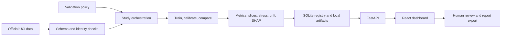

# ModelScope

### Credit Risk Model Validation & Monitoring

**Compare models, inspect their weaknesses, and turn statistical evidence into a documented human review.**

ModelScope is a local research platform comparing an interpretable logistic regression baseline with a histogram gradient boosting challenger on the UCI **Default of Credit Card Clients** dataset. A Python API and React dashboard connect model development, calibration, uncertainty, segment analysis, stress testing, explanations, and review.

The central question: *does better ranking also produce reliable probabilities and stable performance across customer segments?*

[Quick start](#quick-start) · [Results](#example-results) · [Architecture](#architecture) · [Documentation](docs/README.md) · [Demo walkthrough](docs/DEMO_WALKTHROUGH.md)

> Local research prototype. This project does not imply production readiness, bank approval, regulatory compliance, or independent organisational validation.

## Features

| Capability | Evidence and workflow |
|---|---|
| Data quality | Schema, customer IDs, missing values, prevalence, and documented versus undocumented category codes. |
| Model comparison | ROC AUC, average precision, log loss, Brier score, calibration curves, ECE, and threshold trade-offs. |
| Uncertainty | Paired bootstrap intervals and repeated development cross-validation. |
| Segment analysis | Slice metrics, confidence intervals, support warnings, and unavailable single-class results. |
| Stress and drift | Seeded input-corruption and composition scenarios, simulated drift, and monitoring-batch uploads. |
| Explanations | SHAP contributions, additivity gates in calibrated log-odds, and attribution stability checks. |
| Human review | Findings, explicit review states, deterministic checks, and append-only hash-chained audit events. |
| Reproducibility | Dataset, policy, and source identities; stale-evidence detection; Markdown and JSON exports. |

Eight dashboard sections cover **Overview**, **Data quality**, **Model comparison**, **Segment analysis**, **Stress & shift lab**, **Explanations**, **Review workspace**, and **Reports & runs**. Opening a page never starts training.

## Quick start

### Prerequisites

- **Python 3.11** (original verified environment: 3.11.9; Python 3.12 has not been verified).
- **Node.js 18+ and npm** to build the dashboard.
- **Windows PowerShell** for the supplied launcher and commands below.
- Internet for installing dependencies and downloading official data once. Core execution needs no API keys or paid services.

### 1. Clone and install

```powershell
git clone https://github.com/Xamanasif/ModelScope.git
cd ModelScope
py -3.11 -m venv .venv
.\.venv\Scripts\python.exe -m pip install -r requirements.txt
```

Build the dashboard:

```powershell
cd frontend
npm ci
npm run build
cd ..
```

`requirements.txt` pins direct dependencies. `requirements-lock.txt` records transitive dependencies from the original tested environment; optional extensions are listed in `requirements-advanced.txt`.

### 2. Download official data

```powershell
.\.venv\Scripts\python.exe scripts/download_data.py
```

The downloader retrieves the official UCI CSV, checks the column mapping against live UCI metadata, validates its schema, and records provenance, citation, licence, access time, and SHA-256 in `data/raw/source_manifest.json`. Research studies have no synthetic fallback.

The pre-registered policy requires this exact dataset SHA-256:

```text
45bcf4df62ff2e237a74eb155cabfb4bbbc171219a0637daef44fdad07503dd0
```

If automatic acquisition fails, download the CSV from the [UCI dataset page](https://archive.ics.uci.edu/dataset/350/default+of+credit+card+clients), then import it with the same validation requirements:

```powershell
.\.venv\Scripts\python.exe scripts/download_data.py --manual C:\path\to\data.csv
```

See the [dataset card](docs/DATASET_CARD.md) for provenance, licence information, fields, and limitations.

### 3. Launch

```powershell
.\run.ps1
```

Open **http://127.0.0.1:8000**. Interactive API documentation is at **http://127.0.0.1:8000/docs**.

Use `.\run.ps1 -Build` to rebuild the dashboard or `.\run.ps1 -Port 8010` to change the port. Alternatively, start the API directly:

```powershell
.\.venv\Scripts\python.exe -m uvicorn app.main:app --host 127.0.0.1 --port 8000
```

### 4. Run and review a study

Start a development study in **Reports & runs**, or use the CLI:

```powershell
.\.venv\Scripts\python.exe scripts/run_study.py development --actor "Your Name"
.\.venv\Scripts\python.exe scripts/run_study.py list
```

Inspect the development evidence before accessing the final holdout. Replace `STUDY_ID` with the printed study ID:

```powershell
.\.venv\Scripts\python.exe scripts/run_study.py final --study STUDY_ID --actor "Your Name" --confirm-final-holdout
```

The final holdout is evaluated once per study after selection is frozen. A person records the decision in **Review workspace**; automated checks provide evidence and flags for that review.

## Validation design

The [pre-registered policy](configs/validation_policy.json) defines the experiment. Customers are assigned to disjoint stratified partitions:

| Partition | Share | Purpose |
|---|---:|---|
| Train | 60% | Fit preprocessing and models; perform bounded parameter search. |
| Tuning | 15% | Compare evidence and select the model/calibration approach. |
| Calibration | 10% | Fit sigmoid calibration. |
| Final holdout | 15% | Audit the frozen selection once. |

Preprocessing is fitted only on training data. Selection retains the challenger only when the upper bound of the paired 95% bootstrap interval for its tuning log-loss difference versus the baseline is below zero. Otherwise, the baseline is retained. See the [experiment protocol](docs/EXPERIMENT_PROTOCOL.md).

## Example results

The recorded official-data study used **30,000 customers**, including **4,500** in the final holdout. These are historical results from the [generated evaluation report](docs/EVALUATION_REPORT.md), not a new experiment on every checkout.

| Final holdout metric | Logistic regression | Gradient boosting |
|---|---:|---:|
| ROC AUC | 0.7657 | 0.7819 |
| Average precision | 0.5302 | 0.5561 |
| Log loss (lower is better) | 0.4396 | 0.4276 |
| Brier score (lower is better) | 0.1378 | 0.1342 |

The challenger was selected on tuning evidence before the final audit. Its final log-loss difference was **-0.0120**, with paired 95% interval **[-0.0161, -0.0080]**. The historical study remained in review state `evaluated`; no human acceptance decision was recorded. These results do not establish generalisation to a new lending population.

## Architecture



**Backend:** Python, FastAPI, pandas, NumPy, SciPy, scikit-learn, SHAP, SQLite, joblib.
**Frontend:** React, TypeScript, Vite, custom SVG charts.
**Verification:** pytest, HTTP integration tests, Playwright with Microsoft Edge.

| Path | Contents |
|---|---|
| [`app/`](app/) | Data checks, features, models, calibration, metrics, uncertainty, slices, stress, drift, explanations, studies, registry, review, jobs, API. |
| [`frontend/`](frontend/) | Dashboard source and npm lockfile. |
| [`configs/`](configs/) | Pre-registered experiment policy. |
| [`scripts/`](scripts/) | Data acquisition, CLI study runner, single-record tracing. |
| [`tests/`](tests/) | Unit, integration, official-data, and browser tests. |
| [`docs/`](docs/README.md) | Protocol, report, model/dataset cards, design decisions, guide, risk register. |
| `data/raw/` | Downloaded dataset and manifest; generated locally and git-ignored. |
| `artifacts/` | Generated evidence, fitted models, and registry; git-ignored. |

Source, configuration, dependency manifests, tests, and documentation are included. Virtual environments, node_modules, built frontend assets, downloaded data, trained models, and local databases are regenerated locally.

## Development and tests

Run the core suite without browser tests:

```powershell
.\.venv\Scripts\python.exe -m pytest -q -m "not browser"
```

Synthetic fixtures keep core tests offline and isolated from the real registry. The official-data check skips when the dataset has not been downloaded.

Run the full suite, including browser tests when the built dashboard and Microsoft Edge are available:

```powershell
.\.venv\Scripts\python.exe -m pytest -q
.\.venv\Scripts\python.exe -m pytest -m browser -v
```

For frontend development, run the API in one terminal and `npm run dev` from `frontend/` in another. Vite serves on `127.0.0.1:5173` and proxies API requests to port 8000. `npm run build` checks TypeScript before bundling.

The [build status](docs/BUILD_STATUS.md) and [completion report](docs/COMPLETION_REPORT.md) preserve the original verification record and its limits.

## Configuration

Defaults work without an `.env` file. Set environment variables before starting the process to override paths:

| Variable | Default |
|---|---|
| `MODELSCOPE_DATA_DIR` | `data/raw/` |
| `MODELSCOPE_ARTIFACT_DIR` | `artifacts/` |
| `MODELSCOPE_DB` | `artifacts/modelscope.db` |
| `MODELSCOPE_POLICY` | `configs/validation_policy.json` |

A changed dataset, policy, or relevant source identity can make existing evidence stale. Generate a new study for the new identity.

## Limitations and documentation

Stress scenarios are robustness probes, not causal economic forecasts. SHAP values explain model outputs, not real-world causes. Monitoring workflows run locally. Authentication, production deployment, and tamper-proof audit storage are deferred. A known stress-note defect and other limitations are tracked in the [risk register](docs/RISK_REGISTER.md).

- [Master guide](docs/MODELSCOPE_MASTER_GUIDE.md): concepts, implementation, and exercises.
- [API reference](docs/API.md): endpoints and request examples.
- [Model cards](docs/MODEL_CARDS.md): intended use and model limitations.
- [Design decisions](docs/DECISIONS.md): implementation choices and trade-offs.
- [Demo walkthrough](docs/DEMO_WALKTHROUGH.md): guided project presentation.

Do not submit customer records to external AI services. The dataset licence is documented separately in the dataset card; this repository currently does not include a software licence grant.
