# ModelScope master guide

Written for you, the student who owns this project, so that you can rebuild it,
change an assumption and explain why the result changes. Every number here
comes from the real run (`study-20261118T163406-a420d0fc`, 2026-11-18) or from a
command you can re-run. Labels used throughout:

- **Fact**: true of the code or data and checkable now.
- **Finding**: a measured experimental result (it could differ on other data).
- **Assumption**: a choice we made that could reasonably have been different.
- **Extension**: not built; a proposal.


**Contents:** [A Business problem](#a-the-business-problem) · [B Architecture](#b-architecture) ·
[C Data](#c-the-data) · [D Models](#d-the-two-models) · [E Separation & leakage](#e-separation-of-data-and-every-leakage-route) ·
[F Metrics](#f-every-metric) · [G Bootstrap](#g-bootstrap-pairing-and-confidence-intervals) ·
[H Shift, stress, slices](#h-shift-stress-and-slices) · [I SHAP](#i-explanations-shap) ·
[J Registry & review](#j-registry-identities-and-the-review-workflow) · [K Code walk-through](#k-function-by-function-walk-through-of-critical-code) ·
[L One customer](#l-one-customers-path-real-output) · [M Results](#m-actual-results) · [N Alternatives](#n-alternatives-extensions-and-what-more-data-would-need) ·
[O Execution log](#o-execution-log-what-was-done-why-where-result) · [P Interview bank](#p-interview-preparation) ·
[Q Exercises](#q-hands-on-exercises) · [R Contribution](#r-honest-contribution-statement) · [S Resume evidence](#s-resume-evidence-matrix)

How to read this guide: sections A–E give you the system; F–I the statistics;
J–L the engineering and one record end to end; M the results; N–O the
alternatives and the build log; P–Q interview preparation and exercises; R–S
how to present your contribution honestly.

---

## A. The business problem

**Simple version.** A lender wants to know how likely each card customer is to
miss next month's payment. A model that outputs a number isn't enough. Before
anyone trusts it, someone independent of the builder must ask: Does it rank
risky customers above safe ones? When it says 30%, do about 30% of such
customers default? Does it behave equally well for small and large credit
limits, or for customers already behind on payments? What happens when the
input data is damaged or the customer mix changes? Who decided it was good
enough, on what evidence, and can we prove the evidence wasn't changed
afterwards? ModelScope is a small, local version of that validation workflow.

**Stakeholders and the decisions they make.**
| Stakeholder | Decision supported | What they need from ModelScope |
|---|---|---|
| Model developer | which model family and settings to propose | fair comparison under a fixed protocol, training times, failure modes |
| Model validator / reviewer | accept for research, request changes, or reject | evidence linked to findings, uncertainty, limitations, a recorded decision |
| Risk manager (hypothetical) | where to set a cut-off, how to treat segments | calibrated probabilities, threshold trade-offs, cost scenarios clearly labelled as assumptions |
| Auditor (hypothetical) | was the process followed? | frozen selection record, holdout access log, hash-verified evidence, append-only events |

**Why a prediction API alone is insufficient.** An API answers "what is the
score?" Validation asks "should anyone rely on the score, for what, and with
which caveats?" That needs the comparison with a simpler baseline, held-out
evidence, calibration, uncertainty, segment and stress behaviour, explanations
with stated limits, and a human decision bound to a specific version of the
evidence. ModelScope deliberately has **no** prediction endpoint
(`test_api_is_honest_and_never_trains_on_page_load` asserts `/api/predict` is 404).

**Scope boundaries (facts).** Local research prototype; not production; no
regulatory compliance or bank approval; developer and reviewer may be the same
student, using distinct workflows. Validating a statistical credit model is related to,
but not the same as, validating an AI system: the latter adds concerns
(generative failure modes, prompt injection, data provenance at scale, emergent
behaviour) that this project doesn't address.

---

## B. Architecture

### Directory map
```
app/                 Python backend (one module per concern)
  config.py          paths, policy loading, hashes, code identity
  data.py            schema, code tables, loading, validation report
  splitting.py       4-way customer split + manifest hash
  features.py        feature policy, LR and HGB pipelines, feature-name mapping
  models.py          bounded CV search inside train
  calibration.py     Platt fit, CalibratedModel, none-vs-sigmoid decision
  metrics.py         discrimination/probability/decision metrics, calibration table
  bootstrap.py       paired bootstrap, exact fast AUC/AP
  slices.py          segment report with CIs and warnings
  stress.py          seeded stress scenarios
  drift.py           PSI/KS, SIMULATED batches
  explain.py         SHAP + additivity + ranking stability
  study.py           orchestration of the protocol (development, final audit)
  registry.py        SQLite schema, hashed evidence, holdout log
  review.py          state machine, findings, checks, hash chain
  jobs.py            single-worker background jobs
  report.py          Markdown report from evidence
  main.py            FastAPI app + serves the built dashboard
configs/validation_policy.json   the pre-registered protocol
frontend/src/        React + TypeScript dashboard (8 pages, SVG charts)
scripts/             download_data.py, run_study.py, trace_record.py
tests/               unit, integration, official-data, browser tests
docs/                this guide, protocol, decisions, cards, report, risks
data/raw/            (git-ignored) official CSV + source_manifest.json
artifacts/           (git-ignored) modelscope.db, studies/<id>/*.json, models/*.joblib
```

### Entities
| Entity | Where | Identity |
|---|---|---|
| Dataset | `data/raw/uci_credit_default.csv` + manifest | SHA-256 of the exact bytes |
| Policy | `configs/validation_policy.json` | SHA-256 of canonical JSON |
| Code | result-affecting `app/*.py` | SHA-256 of their sources (+ git revision if any) |
| Study | `studies` table + `artifacts/studies/<id>/` | `identity_key = H(dataset, policy, code)` |
| Split manifest | `split_manifest.json` | SHA-256 of sorted IDs per partition + seed + fractions + dataset hash |
| Model | `models` table + `models/<role>.joblib` | artifact SHA-256 |
| Evidence | `evidence` table + `<name>.json` | SHA-256, verified on every read |
| Selection record | `selection.json` | its SHA-256, logged with every holdout access |
| Review case | `review_cases` | version counter + evidence bundle hash |
| Review event / finding event | append-only tables | hash chain (events) |

### End-to-end flow

```mermaid
flowchart LR
  UCI[(UCI 350 CSV)] -->|download_data.py: hash + validate| RAW[data/raw + manifest]
  POL[validation_policy.json] --> S
  RAW --> S[study.run_development_study]
  S --> SPLIT[split train/tuning/calibration/final]
  SPLIT -->|train| CV[CV search + fit pipelines]
  SPLIT -->|calibration| CAL[Platt fit]
  SPLIT -->|tuning| DEV[dev metrics, bootstrap, slices, stress, drift, SHAP]
  CV --> CAL --> DEV --> SEL[selection.json frozen]
  SEL -->|confirm + log| FIN[run_final_evaluation: final partition once]
  DEV --> EV[(evidence JSON + SQLite registry)]
  FIN --> EV
  EV --> API[FastAPI] --> UI[React dashboard]
  UI -->|findings, decisions| REV[review state machine + hash-chained events]
  REV --> EV
```


**Request flow example (start a study).** Browser button → `POST
/api/jobs/development-study` → `JobRunner.submit_development` checks for an
active job (409), computes the current identity, returns a cached study if one
matches, otherwise `new_study` inserts the study row and a `draft` review case
and queues `run_development_study` on the single worker thread. The UI polls
`/api/status` every 2 s while a job is active and shows its progress text.

**Training flow** is the numbered list at the top of `app/study.py`. **Review
flow**: `draft` → (system, when evidence is complete) `evaluated` → (human)
`in_review` → `accepted_for_research | changes_requested | rejected`, with
`reopen` from `changes_requested`.

---

## C. The data

All columns, their official meanings and how each is treated are in
[DATASET_CARD.md](DATASET_CARD.md). The key points:

- **Facts.** 30,000 customers, 25 columns, no missing values, unique IDs,
  prevalence 22.12%. Positive class: `Y = 1` = "default payment next month",
  from the source text "default payment (Yes = 1, No = 0)".
- **Used as predictors (19):** LIMIT_BAL; PAY_0, PAY_2–PAY_6 (repayment status
  Sep→Apr 2005); BILL_AMT1–6; PAY_AMT1–6.
- **Excluded:** ID (identity, not information about risk; including it would let
  the model memorise row order); the target; and by default SEX, EDUCATION,
  MARRIAGE, AGE (assumption, D-005), used only for audit slices.
- **Undocumented codes (fact):** the source documents repayment status −1, 1–9.
  The data also contains −2 (2,759 in PAY_0) and 0 (14,737 in PAY_0), the most
  common value. We keep them as distinct codes and never invent meanings. For
  logistic regression we one-hot encode codes −2, −1, 0, 1, 2 and "3 or more",
  so the model learns a separate effect for each without assuming order.
- **Duplicates:** 35 rows equal another row except ID. Kept (assumption).
- **Limitations:** one bank, one country, six months in 2005, a short-horizon
  label, no exposure/loss data, cross-sectional (no chronology).

**Why this dataset can't prove temporal generalisation.** A temporal claim
needs a model trained on earlier customers and tested on later ones. Here all
customers share one observation window and row order carries no time meaning,
so every split is an in-distribution split. It can tell you how well the model
generalises to *other customers drawn from the same 2005 population*, nothing
about 2006, let alone today.

---

## D. The two models

### D.1 Logistic regression (baseline)
**Intuition.** Add up evidence: each feature pushes the log-odds of default up or
down by a fixed amount per unit; squash the total through a sigmoid to get a
probability.

**Equations.** For transformed features z (49 columns after encoding),
`s(x) = b0 + w·z`, `p = σ(s) = 1/(1 + e^(−s))`. Training minimises the
regularised negative log-likelihood (log loss):

  L(w) = Σ_i [ −y_i log p_i − (1−y_i) log(1−p_i) ] + (1/(2C)) ‖w‖²

`C` is the inverse regularisation strength: small C shrinks the weights. We
searched C ∈ {0.001, 0.01, 0.1, 1, 10}; C = 0.1 won by CV log loss inside train
(finding). On the tuning partition the untuned C = 1 was in fact marginally
better (log loss 0.4306 vs 0.4308, AUC 0.7751 vs 0.7753): the search bought
nothing measurable for this model. The selection still follows the
pre-registered CV rule; we don't switch to whichever looks better on tuning.

**Preprocessing (and why).** Amounts are very skewed and some bills are
negative, so we apply the *signed* log `sign(x)·log(1+|x|)`, then standardise
(mean 0, sd 1, fitted on train) so the L2 penalty treats features comparably.
Repayment codes are one-hot encoded because a linear term can't capture "−2
behaves differently from 0".

**Class imbalance.** 22% positives is moderate imbalance. We did **not**
re-weight classes: weighting would move predicted probabilities away from the
true base rate (assumption D-007). Imbalance affects threshold metrics, which
we report at several thresholds.

**Alternatives.** Scorecard-style binning (WoE), splines for non-linearity, L1
(sparse) regularisation, interaction terms.

### D.2 Histogram gradient boosting (challenger)
**Intuition.** Build many small decision trees one after another; each new tree
corrects the mistakes the current ensemble still makes. Trees naturally handle
non-linear effects, interactions and different scales.

**Equations.** The model is additive in log-odds: `F_M(x) = F_0 + Σ_{m=1}^{M} η·f_m(x)`
with `p = σ(F_M)`. At each step the gradient (`p_i − y_i`) and hessian
(`p_i(1−p_i)`) of the log loss per customer are computed. A tree is grown to
fit them, with leaf values `−G/(H + λ)` (G, H = sums of gradients and hessians in the
leaf, λ = `l2_regularization`). "Histogram" means each feature is first
binned into at most 255 bins, which makes split finding fast on a CPU.

**Hyperparameters (selected: finding).** learning_rate η = 0.03 (small steps),
max_iter M = 200 trees, max_leaf_nodes 15 (shallow trees: limits interaction
order), min_samples_leaf 50 (each leaf needs 50 customers: variance control),
l2 = 1.0. Early stopping was disabled so the number of trees is an explicit,
reproducible choice.

**Missing values.** HGB learns a direction for NaN at each split *only if
training data contained NaN*. Ours didn't, so at prediction time NaNs go to
the child with more training samples. That matters in the missing-value stress
tests.

**Alternatives.** XGBoost/LightGBM (similar, extra dependency, not needed at
this size), random forests (weaker probabilities), monotonic constraints (a
natural extension: risk should not fall as delays rise), explainable boosting
machines.

---

## E. Separation of data and every leakage route

| Partition | Fit here | Evaluate here |
|---|---|---|
| train (18,000) | imputer medians, log/scale statistics, one-hot categories, model weights/trees, CV for hyperparameters, slice band edges, SHAP background, drift reference | CV folds only |
| tuning (4,500) | nothing (only *choices*: none/sigmoid, champion rule) | development metrics, bootstrap, slices, stress, drift batches, SHAP sample |
| calibration (3,000) | Platt a, b | nothing (in-sample for the calibrator) |
| final (4,500) | nothing, ever | once, after `selection.json` is frozen |

**Where preprocessing is fitted.** Everything learnable sits inside the
sklearn `Pipeline` built in `app/features.py`; `search_and_fit` calls
`model.fit(X_train, y_train)`. Later partitions only call `transform`/`predict`.
`test_preprocessing_statistics_come_from_training_rows_only` checks that the
scaler mean equals the train mean and is not refitted by prediction.

**Leakage routes and how each is closed.**
1. *Target in features:* explicit feature list; ColumnTransformer drops all other
   columns. Canary test: shuffle labels, add an exact copy of the target as a
   column; held-out AUC must stay near 0.5 (`test_target_cannot_leak_into_features`).
2. *ID as a feature:* excluded; also checked in the same test.
3. *Preprocessing fitted on all data:* prevented by pipelines (above).
4. *Hyperparameters tuned on the evaluation set:* CV inside train; the tuning
   partition is not used for hyperparameters (D-006).
5. *Calibration evaluated on its own fitting data:* calibration-partition log
   losses are labelled in-sample; calibration quality is judged on tuning.
6. *Selecting the champion on the final set:* the rule runs on tuning and is frozen.
7. *Repeated peeking at the final set:* one-shot guard + access log.
8. *Slice band edges fitted on the evaluated partition:* fitted on train.
9. *SHAP background from evaluation data:* background drawn from train.
10. *Same customer in two partitions:* split by unique ID; disjointness and
    completeness asserted in `assert_disjoint_complete` and tests.
11. *Duplicate-looking rows across partitions (35):* possible, because IDs differ;
    acknowledged, not removable without evidence they are the same person.
12. *Temporal leakage:* not applicable; there is no time order. This is also
    why no temporal claim is made.

---

## F. Every metric

Worked example used below (8 customers): labels `y = [1,0,1,0,0,1,0,0]`,
predicted default probabilities `p = [0.9,0.8,0.7,0.4,0.35,0.3,0.2,0.1]`.
All values below were computed with the project's own functions.

### F.1 Discrimination (ranking)
**ROC-AUC.** The probability that a randomly chosen defaulter gets a higher
score than a randomly chosen non-defaulter (ties count ½). Formula
(Mann–Whitney): `AUC = (Σ ranks of positives − n1(n1+1)/2) / (n1·n0)`.
Example: 3 defaulters × 5 non-defaulters = 15 pairs; the defaulter scores
higher in 11 → **AUC = 11/15 = 0.7333**.
*Edge cases:* undefined if only one class (we raise an error and show
"unavailable", never 0); ties handled by mid-ranks. *Misleading uses:* AUC
ignores calibration (multiply every score by 0.1 and AUC is unchanged), it
depends on the case mix (oversampling delinquent customers raised AUC by +0.05
in our stress suite, finding), and it averages over thresholds nobody uses.

**Average precision (AP).** Step-wise area under the precision–recall curve:
`AP = Σ_k (R_k − R_{k−1}) · P_k` over thresholds. Example: positives at ranks 1, 3,
6 have precision 1/1, 2/3, 3/6 → **AP = (1 + 0.667 + 0.5)/3 = 0.7222**. The
*trapezoidal* PR-AUC of the same curve is 0.6778, so they are different
numbers, which is why we never call AP "PR-AUC". A random ranking has AP ≈
prevalence (0.22 here). AP focuses on the top of the ranking, which suits
rare-event screening.

### F.2 Probability quality (proper scoring rules)
A scoring rule is **proper** if it is optimised in expectation by reporting the
true probability. Both of these are.

**Log loss.** `−(1/n) Σ [y log p + (1−y) log(1−p)]`. Per-row losses in the example:
0.105, 1.609, 0.357, 0.511, 0.431, 1.204, 0.223, 0.105 → **0.5682**. The worst
term is the non-defaulter given 0.8 (−log 0.2 = 1.609): log loss punishes
confident mistakes heavily, and is infinite for p = 0 when y = 1 (we clip at 1e−15).

**Brier score.** `(1/n) Σ (p − y)²` → **0.1953**. Bounded in [0, 1] and less
harsh on confident errors. A constant prediction of the base rate π scores
π(1−π) (0.172 at π = 0.22), a useful "no-skill" reference.

**Calibration.** "Of customers given about 30%, do about 30% default?"
- *Calibration curve:* sort by p, cut into 10 equal-count bins, plot mean p
  against observed rate, with Wilson 95% intervals (binomial noise only).
- *Calibration-in-the-large:* mean(y) − mean(p). Finding: +0.0012 (HGB, final).
- *Calibration slope:* fit `y ~ α + β·logit(p)`. β < 1 means predictions are
  too extreme (over-confident). Finding: LR 0.943 on final, slightly over-confident.
- *ECE:* count-weighted mean |observed − predicted| over bins. Not proper and
  binning-dependent: predicting the base rate for everyone has ECE ≈ 0 and AUC
  0.5 (`test_calibration_diagnostics_behave` demonstrates this).

### F.3 Decisions at a threshold
Flag a customer when p ≥ t. At t = 0.5 the example gives TP 2, FP 1, FN 1,
TN 4: **precision** TP/(TP+FP) = 0.667, **recall** (sensitivity) TP/(TP+FN) = 0.667,
**specificity** TN/(TN+FP) = 0.8. Edge cases: if nothing is flagged, precision
is defined as 0 here (`zero_division=0`), and the code reports `flag_rate` so
you can see why. If probabilities are calibrated, flagging when
`p > c_FP/(c_FP + c_FN)` minimises expected cost: with a missed default 5×
as costly as a false alarm, t = 1/6. The costs are *your scenario*, not
observed losses.

### F.4 Why three families of metric
They answer different questions. Two models can share an AUC and differ
in calibration (one is useful for pricing, one isn't). Or they can share calibration and
differ in ranking. And a threshold choice can make either look good or bad. ModelScope's
champion rule uses log loss because the deliverable is a probability.

---

## G. Bootstrap, pairing and confidence intervals

**Idea.** We have one evaluation sample. To ask "how different could the
metric be with another sample of similar customers?", resample the customers
with replacement many times and recompute the metric each time.

**Pairing.** For a *difference* between models, every resample draws one set
of customer indices and evaluates *both* models on it
(`app/bootstrap.py::paired_bootstrap`). The two models' errors are positively
correlated (they find the same customers hard), so the difference varies much
less than each metric alone. Unpaired resampling would ignore that
correlation and give needlessly wide intervals.

**Interval.** Percentile method: the 2.5th and 97.5th percentiles of 1,000
resampled differences (seed 2026). Finding: the final AUC difference is +0.0162
with 95% CI [0.0087, 0.0240]. All 1,000 resamples favoured the challenger.

**Failed resamples.** A resample with only one class makes AUC undefined. It
is counted in `n_failed` and excluded, never scored as 0 (0 failures on 4,500
customers; the tiny-sample test forces some).

**Assumptions and what is NOT covered.**
- Customers are treated as independent, identically distributed draws.
- The intervals are **conditional on the fitted models**: they don't include the
  variation you would see by retraining on a different training sample.
  The repeated 5×2 CV gives a rough, descriptive view of that (AUC difference
  sd 0.0029 across folds; folds overlap, so this understates variance).
- Percentile intervals can under-cover for small samples or skewed statistics;
  BCa intervals are an extension.
- Nothing here says anything about future populations.

**Avoiding significance hunting.** One pre-registered decisive comparison
(log loss on tuning), with other metrics reported, not used for selection.
Slice intervals are descriptive and uncorrected for multiplicity.

---

## H. Shift, stress and slices

### H.1 Slices
Credit-limit quartiles (edges from train: 50,000 / 140,000 / 240,000 NT$),
recent repayment status, six-month delay count, and the demographic audit
slices. For each group: n, defaults, prevalence, AUC with a bootstrap CI,
observed − predicted with a CI, recall and false-positive rate at the
threshold, and warnings below 100 customers or 20 events.

**Finding:** within repayment-status groups, ranking is much weaker (final:
PAY_0 ≥ 2 group AUC 0.537 LR / 0.575 HGB, overall 0.766 / 0.782). This is
expected *range restriction*: PAY_0 is the strongest predictor, and inside a
group where everyone has the same PAY_0 that information is gone. The
automatic check flags these slices; a human should read it as "the model mostly
separates groups" rather than "the model fails this group".

**Demographic audit limits.** Slices by SEX, EDUCATION, MARRIAGE, AGE describe
performance differences. They are not a legal fairness test, not corrected
for multiple comparisons, and they don't justify any action towards a group.
Tiny groups (EDUCATION "others": n = 20, 1 default) produce meaningless AUCs
with warnings; a single-class group (MARRIAGE code 0 on final: 5 customers, 0
defaults) is shown as **unavailable**.

### H.2 Stress suite (tuning partition, seeded)
Two kinds, which must not be confused:
- **Input corruption** damages predictor values while each customer's outcome
  stays fixed. It measures robustness to bad data. It does *not* simulate
  how customers would behave in a recession (that would change outcomes too,
  causally).
- **Composition** resamples whole rows (labels travel with them) to change the
  mix or the prevalence. It's still the same 2005 customers.

Findings: a LIMIT_BAL unit error (÷1000 for 10% of rows) cost LR −0.018 AUC
but HGB only −0.004. LR's log term extrapolates to tiny limits, while trees put
all values below their lowest split in one leaf. Missing repayment status
(10%) cost −0.008 / −0.006. Pure prevalence shift (10% or 35%) left AUC
roughly unchanged but moved log loss by about ∓0.12: the probabilities become
mis-calibrated in the large, which ranking metrics can't see.

### H.3 Shift and drift
- **Covariate shift**: P(X) changes. Detectable without labels.
- **Prevalence (label) shift**: P(Y) changes. Needs labels to confirm; the
  mean prediction moving is only a hint.
- **Concept drift**: P(Y | X) changes. **Not identifiable from unlabelled data.**

**PSI** (population stability index): bin the reference (train) distribution
into deciles, or categories for discrete codes, plus a missing bin. Then
`PSI = Σ (c_i − r_i) · ln(c_i / r_i)`. Example: reference shares 25/25/25/25%,
current 10/20/30/40% → PSI = 0.228 ("watch", just under our 0.25 review trigger).
The 0.10/0.25 triggers are a conventional rule of thumb, configurable, not
regulation.

**Caveat on score PSI.** Score PSI compares a batch's scores with the scores of
the *train* partition. An overfit model scores its own training customers more
confidently than new ones, so score PSI is inflated with no shift at all. On the
synthetic fixture HGB showed about 0.34 for an unshifted batch (found while
writing the exercises). On the official study the effect is negligible (HGB score
PSI 0.003 on S1), but a held-out reference (e.g. tuning scores) would be the
cleaner design (extension).

Findings on SIMULATED batches: oversampling delinquent customers ×3 (S5) gave
PAY_0 PSI 0.262 (review). S6 kept inputs unchanged but relabelled 40% of
defaults among PAY_0 ≥ 2: max PSI 0.02 (stable) while AUC fell from ~0.79 to
0.707 (LR) / 0.717 (HGB). That's the textbook reason unlabelled monitoring
can't see concept drift.


---

## I. Explanations (SHAP)

**Simple version.** SHAP splits one prediction into contributions: "starting
from the average customer's score, PAY_0 = 2 added +0.6, the high limit
subtracted −0.2, …". The contributions add up exactly to the model's output.

**Theory.** A Shapley value gives feature j its average marginal contribution
over all orders in which features could be "revealed", relative to a
**background** distribution standing in for "feature unknown". With
`base = E_background[f]`, additivity (local accuracy) says
`f(x) = base + Σ_j φ_j(x)`.

**What the code uses (facts, `app/explain.py`).**
- **Output space:** the base model's raw score, i.e. **log-odds**, not
  probability. The calibration map is affine in log-odds (`a·s + b`), so
  every φ is multiplied by `a` and the base becomes `a·E[s] + b`. The result
  is exact SHAP for the *calibrated* log-odds. SHAP values are not additive in
  probability space.
- **Logistic regression:** `shap.LinearExplainer` with an `Independent`
  masker of 200 train rows (interventional). For a linear model this is
  `φ_j = w_j (z_j − mean_bg z_j)` in the 49-column transformed space. One-hot
  columns are summed back to their original column (exact, by additivity).
- **HGB:** `shap.TreeExplainer(feature_perturbation="interventional")` with the
  same 200-row background, so both models answer the same question: "compared
  with a typical training customer". Additivity is measured on every row.
  Finding: max error 8.9e−16 (LR) and 2.6e−8 (HGB) in calibrated log-odds.
- **Sample:** 500 tuning customers (seed 5), so explanations are development
  evidence and the final set is never touched.
- **Stability:** 5 refits on bootstrap resamples of train; Spearman rank
  correlation of global importance with the main model 0.83–0.93; PAY_0 and
  LIMIT_BAL are in the top 5 every time; ranks 3–5 vary (finding).

**Negative finding (D-009).** With shap 0.51.0 + scikit-learn 1.9.1,
interventional TreeSHAP on HGB violated additivity by several log-odds on
non-integer continuous data, but not on integer-valued data such as UCI 350.
We first switched to path-dependent SHAP, then narrowed the condition down and
returned to interventional with a per-run additivity gate. The behaviour is
pinned in `test_hgb_interventional_condition`. Lesson: verify the library,
don't trust it.

**Limitations.** (1) Attribution of the *model*, not real-world causes. (2)
Correlated features (BILL_AMT1–6 correlate strongly; so do PAY_*): the
interventional background breaks correlations, so the model is evaluated on
unrealistic combinations and credit can move between correlated features. (3)
Background dependence: another background gives other numbers. (4) Not a
fairness certificate: a model can rely on a proxy without any demographic
feature showing up. (5) Not an adverse-action notice.

---

## J. Registry, identities and the review workflow

**Schema (`app/registry.py::SCHEMA`).** `datasets`, `studies`, `evidence`
(name, path, SHA-256), `models` (role, params, preprocessing version,
calibration, artifact SHA-256, timings), `jobs`, `holdout_access_log`,
`review_cases` (state, version, evidence hash), `review_events` (hash chain,
unique request_id), `findings`, `finding_events`.

**Single source of truth.** Numbers live only in the JSON evidence files; the
DB stores their hashes. `Registry.read_evidence` re-hashes on every read and
raises `IntegrityError` if a file changed (`test_evidence_tampering_detected`).

**Version identities.** A study is current only while the dataset SHA, policy
SHA and code SHA all match the current ones. Change the split seed in the
policy → new policy hash → the old study shows "stale: validation policy
changed", cannot get a final audit or be accepted, and a new development job
creates a new study (`test_policy_change_makes_study_stale_and_new_identity`).

**State machine.**
```
draft --system--> evaluated --start_review--> in_review
in_review --accept--> accepted_for_research   (terminal)
in_review --request_changes--> changes_requested --reopen--> in_review
in_review --reject--> rejected                (terminal)
```
Guards on human transitions (`app/review.py::transition`): `confirm = true`;
rationale ≥ 20 characters; a non-empty actor name; `expected_version` equals
the case version, otherwise **stale** (409); `expected_evidence_sha256` equals the
current bundle hash, otherwise **stale evidence** (409); unique `request_id`,
otherwise **duplicate** (409). `accept` also requires a non-stale study, a
completed final audit, and no open critical/high findings. Deterministic
checks only *flag*.

**Findings** carry category, severity (rubric in `SEVERITIES`), evidence
reference, owner, status and history. Closing one requires a comment or a
remediation note, and every change is appended to `finding_events`.

**Audit limitations (be explicit).** Append-only is enforced by SQLite
triggers, and review events are hash-chained, so an edited event breaks the chain
(`verify_event_chain`). But the owner of the `.db` file can drop the triggers
and rewrite the whole chain. It detects accidents and casual edits, not a
determined insider. Reviewer names are typed in and stored with
`identity_verified = 0`: there is no authentication.

---

## K. Function-by-function walk-through of critical code

| Step | Symbol | What happens / where the decision is |
|---|---|---|
| Acquire | `scripts/download_data.py::main`, `check_metadata_mapping` | downloads `data_url` bytes, refuses if live metadata disagrees with `SOURCE_TO_SEMANTIC`, validates, writes manifest (hash of exact bytes) |
| Schema | `app/data.py::SOURCE_TO_SEMANTIC`, `DOCUMENTED`, `UNDOCUMENTED_TOLERATED` | the column mapping and which codes are valid, tolerated (warn) or invalid (fail) |
| Validate | `app/data.py::validate_dataset` | hard failures vs warnings; `require_target=False` for unlabelled batches |
| Load + verify | `app/study.py::load_prepared` | refuses dataset hash mismatch, failed validation, or a split manifest differing from the pre-registered hash |
| Split | `app/splitting.py::split_customers`, `split_manifest` | integer partition sizes, stratified, disjoint/complete assertion, canonical manifest hash |
| Feature policy | `app/features.py::feature_columns` | the 19 predictors; demographics only if enabled; refuses ID/target |
| Pipelines | `build_logistic`, `build_hgb` | all learnable preprocessing inside the Pipeline |
| Search | `app/models.py::candidate_configs`, `search_and_fit` | bounded grid/random configs; CV log loss inside train; refit on train |
| Calibrate | `app/calibration.py::fit_platt`, `calibration_decision`, `CalibratedModel` | Platt by BFGS on calibration rows; none-vs-sigmoid chosen on tuning |
| Evaluate | `app/metrics.py::full_evaluation` | metrics, calibration table/ECE/slope, threshold grid, curves |
| Uncertainty | `app/bootstrap.py::paired_bootstrap` | same indices for both models; failures counted |
| Champion | inside `run_development_study` (`ll_ci_upper < 0`) | the frozen rule; `selection.json` written and hashed |
| Slices | `app/slices.py::fit_band_edges`, `slice_report` | edges from train; warnings; unavailable reasons |
| Stress | `app/stress.py::apply_scenario`, `run_stress_suite` | seeded perturbations; identical data for both models |
| Drift | `app/drift.py::psi`, `feature_drift`, `simulated_batches` | PSI with reference bins; SIMULATED S1–S6 |
| Explain | `app/explain.py::explain_model`, `ranking_stability` | SHAP, aggregation, additivity, calibrated space |
| Final audit | `app/study.py::run_final_evaluation` | guard order: confirm → already evaluated → frozen selection → not stale; log; verify selection and artifacts; evaluate once |
| Trusted load | `app/study.py::load_trusted_model` | path inside artifacts/ and SHA-256 match, or refuse |
| Registry | `app/registry.py::Registry.write_evidence/read_evidence/evidence_bundle_hash` | hashing; tamper detection |
| Review | `app/review.py::transition`, `add_finding`, `update_finding`, `deterministic_checks`, `verify_event_chain` | state machine and controls |
| Jobs | `app/jobs.py::JobRunner.submit_development` | single-flight (409), identity cache, failure capture, interrupted-job recovery |
| API | `app/main.py` | thin HTTP layer; errors mapped to 400/404/409/422/500 |
| UI | `frontend/src/pages1.tsx`, `pages2.tsx`, `charts.tsx` | pages, forms with confirmation, SVG charts with tooltips and data tables |

---

## L. One customer's path (real output)

Command: `python scripts/trace_record.py --study study-20261118T163406-a420d0fc`.
The script picks the first customer of the seeded SHAP sample (a tuning-partition
customer, so no sealed data is used) and prints no demographics. Output,
abridged only by removing zero one-hot columns:

```
Customer ID 27688 (tuning partition). Observed outcome DEFAULT_NEXT_MONTH = 1
Raw: LIMIT_BAL=60000, PAY_0=0, PAY_2=0, PAY_3=0, PAY_4=0, PAY_5=0, PAY_6=2,
     BILL_AMT1..6=23851, 24404, 21849, 18474, 15488, 11348,
     PAY_AMT1..6=1700, 2000, 1200, 1000, 0, 3500

[baseline] 49 transformed columns
  LIMIT_BAL=-0.707, BILL_AMT1=0.315, ..., PAY_AMT5=-1.744, PAY_AMT6=0.632,
  PAY_0_0.0=1, PAY_2_0.0=1, ..., PAY_6_2.0=1
  raw score s = -1.5059; uncalibrated p = 0.1815
  sigmoid: logit = 1.0355 * s + 0.0548 = -1.5047 -> calibrated p = 0.1817
  SHAP: base -1.4611 + sum -0.0435 = -1.5047
  largest: PAY_0 -0.5555, PAY_6 +0.2248, LIMIT_BAL +0.1292, PAY_2 +0.1126, PAY_AMT5 +0.0843

[challenger] 19 columns (raw values passed through)
  raw score s = -2.0074; uncalibrated p = 0.1184
  sigmoid: logit = 1.0416 * s + 0.0567 = -2.0343 -> calibrated p = 0.1156
  SHAP: base -1.4737 + sum -0.5606 = -2.0343
  largest: PAY_0 -0.2708, BILL_AMT1 -0.2370, PAY_6 +0.2209, BILL_AMT6 -0.1210, LIMIT_BAL +0.0913

Review: this customer is part of the evidence for case state 'evaluated'.
```

**How to read it.** The customer *did* default, but both models gave below-average
risk (18% and 12%, against a 22% base rate). The repayment status "0" in the
latest five months pulls risk down; the "2" (two months' delay) in April pushes
it up but doesn't win. Small limit (60,000) and a zero payment in PAY_AMT5 add risk for
LR. This is an ordinary miss: at threshold 0.5 neither model would flag them.
Calibration barely changes anything here (a ≈ 1.04). In both models
base + Σ SHAP reproduces the calibrated log-odds exactly. The customer enters
the review process only as part of the aggregate evidence; there are no
per-customer decisions in this project.

---

## M. Actual results

Full tables: [EVALUATION_REPORT.md](EVALUATION_REPORT.md) (generated from the
hashed evidence). Summary:

| | LR tuning | HGB tuning | LR final | HGB final |
|---|---|---|---|---|
| ROC-AUC | 0.7753 | 0.7853 | 0.7657 | 0.7819 |
| Average precision | 0.5531 | 0.5822 | 0.5302 | 0.5561 |
| Log loss | 0.4308 | 0.4218 | 0.4396 | 0.4276 |
| Brier | 0.1345 | 0.1316 | 0.1378 | 0.1342 |
| ECE (10 bins) | 0.0132 | 0.0174 | 0.0162 | 0.0114 |
| Calibration slope | 0.989 | 1.025 | 0.943 | 0.984 |

Paired differences (challenger − baseline), 95% CIs: tuning AUC +0.0099
[0.0026, 0.0167], log loss −0.0089 [−0.0129, −0.0049]; final AUC +0.0162
[0.0087, 0.0240], log loss −0.0120 [−0.0161, −0.0080]. Champion by the frozen
rule: the challenger.

**What we can conclude.** On this 2005 population, boosting ranks somewhat
better *and* gives slightly better probabilities than logistic regression, and
both are well calibrated after (almost negligible) Platt scaling. So for this data the
answer to the central question is yes, modestly. Better ranking did not cost
calibration, and the challenger was better or equal in almost every
segment.

**Negative or sobering findings.**
- The gain is small (+0.016 AUC). Hyperparameter search bought almost nothing
  (untuned HGB tuning AUC 0.7844 vs 0.7853 selected; for LR, nothing).
- At the illustrative threshold 0.5 the champion catches only 37% of defaulters.
- Among customers already 2+ months late, ranking is weak (AUC 0.54–0.58).
- LR is fragile to unit errors in LIMIT_BAL.
- Calibration did almost nothing: sigmoid a ≈ 1.04, b ≈ 0.055.
- Both tuning and final performance dropped slightly for LR (AUC −0.010):
  within sampling noise, but recorded.
- The SHAP library issue (D-009), three engineering bugs and one documentation defect in
  the stress evidence (section O, rows 12, 14, 18 and 22).

**What cannot be concluded.** Anything about future periods, other banks or
countries, losses or capital, legal fairness, causal effects of features, or
production readiness. The difference CIs don't include retraining
uncertainty.

---

## N. Alternatives, extensions and what more data would need

**Rejected alternatives (see DECISIONS.md).** Chronological split (fake here);
tuning on the tuning partition (biases the champion comparison); class
weighting (distorts probabilities); isotonic calibration (too little data to
select it cleanly); MLflow (duplicate truth); path-dependent TreeSHAP (kept
only while the interventional issue was unexplained); a chart library;
Celery/Redis; PostgreSQL now (deferred).

**Production-grade extensions (not built).** Authentication and role
separation (an independent validator); immutable audit storage (WORM/object
lock, signed events); PostgreSQL behind a migration tool; containerised
deployment; monotonic constraints in HGB; scorecard binning for the baseline;
BCa intervals and retraining-inclusive uncertainty (nested bootstrap);
fairness metrics with legal input; adverse-action reason codes;
champion/challenger in shadow mode; model inventory with periodic revalidation.

**Monitoring.** *Without labels:* feature PSI/KS, score PSI, mean predicted
probability, missing-value rates, out-of-range rates, all available
immediately. *With labels* (a month later for this target): AUC, log loss,
calibration-in-the-large and slope, slice performance, then recalibration
triggers. Only labelled monitoring detects concept drift (batch S6).

**More data needed for stronger claims.** Several origination cohorts with
dates (out-of-time tests); later outcomes (longer horizons); exposures and
recoveries (loss-based metrics); applicant-level data from another bank
(transportability); an approved legal framework and protected-attribute data
for real fairness analysis.

---

## O. Execution log (what was done, why, where, result)

All on 2026-11-18, Windows 11, Python 3.11.9, Node 24.22.1. "Claude" = the
AI assistant (Claude Code) that implemented this; see section R.

| # | Action | Why | Where | Command | Result / what could be better |
|---|---|---|---|---|---|
| 1 | Read the starter, ran its tests | establish baseline | all files | `py -3.11 -m venv .venv`; `pip install -r requirements.txt`; `python -m unittest discover -s tests -v` | 8/8 OK; Starlette httpx deprecation warning |
| 2 | Installed shap, pytest, playwright | needed for SHAP and tests | venv | `pip install shap pytest playwright` | resolved for 3.11 (an attempt to also install an unverified package `httpx2` was blocked and dropped) |
| 3 | First acquisition attempt | official data | `scripts/download_data.py` (starter) | `python scripts/download_data.py` | failed: DNS error on CSV host (metadata OK) |
| 4 | Profiled the official CSV (scratch copy) | find real codes | — | curl + pandas | undocumented codes found; licence CC BY 4.0 confirmed on landing page |
| 5 | Checked SHAP on HGB | algorithm choice | scratch | python snippets | interventional additivity failure on Gaussian data → initially path-dependent |
| 6 | Rewrote acquisition | exact-bytes hash, mapping check, manual route | `scripts/download_data.py` | `python scripts/download_data.py` | 30,000 rows, SHA-256 45bcf4df…, 10 pass / 8 warn / 2 info |
| 7 | Split hash, then policy | pre-register before modelling | `app/splitting.py`, `configs/validation_policy.json` | python snippet | manifest a35d7f50…; prevalence 0.2211–0.2213 in all partitions |
| 8 | Built backend modules | the protocol | `app/*.py` | — | — |
| 9 | Synthetic smoke test | catch bugs offline | scratch | python | pipeline end-to-end in 6 s |
| 10 | First official development run | runtime check | `scripts/run_study.py` | `run_study.py development --actor "dev-check"` | champion challenger; slices step showed 36 min wall-clock (laptop sleep plus slow sklearn validation); study now stale (code changed after) |
| 11 | Exact fast AUC/AP | bootstrap speed | `app/bootstrap.py` | equality checks vs sklearn | equal to ~1e-16 |
| 12 | Tests written | verification | `tests/` | `python -m pytest -q` | first run: **ordering bug** in the one-shot final guard (wrong refusal reason); fixed in `run_final_evaluation`, test unchanged |
| 13 | SHAP investigation | test showed interventional additive on fixture | `app/explain.py` | python snippets | condition = non-integer inputs; switched HGB back to interventional + per-run gate (D-009) |
| 14 | Unlabelled batch bug | integration test failed | `app/data.py::to_semantic` | pytest | header mapping required `Y`; fixed |
| 15 | Full offline suite | | | `python -m pytest -q` | 71 passed |
| 16 | Dashboard | product | `frontend/` | `npm install`; `npm run build` | built; palette validated for CVD |
| 17 | Official development study | evidence | | `run_study.py development --actor "Claude Code (AI-assisted run)"` | 188 s; champion challenger (rule CI [−0.0129, −0.0049]) |
| 18 | Browser tests (Edge) | real UI verification | `tests/test_browser.py` | `python -m pytest -m browser` | found a **176 px horizontal overflow** at 390 px width; fixed CSS; 2 passed |
| 19 | One-shot final audit | protocol step | | `run_study.py final --study study-20261118T163406-a420d0fc ... --confirm-final-holdout` | access logged once; results in section M; nothing changed afterwards |
| 20 | Visual review of every page | layout quality | screenshots | Playwright | fixed oversized chart text, clipped overview table, cramped stress table |
| 21 | Reports, cards, guide | deliverables | `docs/` | `GET /api/studies/{id}/report.md` | EVALUATION_REPORT.md generated from evidence |
| 22 | Independent read of the code (a separate AI agent writing section P) | catch claims the code doesn't support | `app/stress.py`, `app/data.py` | — | **documentation defect**: the stress note says the validator flags LIMIT_BAL unit errors; it doesn't (only ≤ 0 is rejected). Not fixed in the result modules (would make the audited study stale); corrected in docs (RISK_REGISTER R11); an out-of-training-range check added to monitoring-batch uploads (`app/main.py`), with a test |
| 23 | Exercise verification (a third AI agent writing section Q) | check every exercise runs | temp dirs only | — | found the PowerShell 5.1 `Set-Content -Encoding utf8` BOM pitfall (`load_policy` rejects a BOM; write policy copies from Python) and the score-PSI reference caveat (section H.3) |

**What could be improved.** Repeat the experiment over several split seeds
(only one was run); add retraining-inclusive uncertainty; let a different
person do the review; put the project under git so the code identity includes
a revision (the folder is not a git repository, so `git_revision` is null).


---

## P. Interview preparation

This section is for practice. Every number below comes from the real run on the official data (study `study-20261118T163406-a420d0fc`, written up in `docs/EVALUATION_REPORT.md`) or from the evidence JSON files that run produced under `artifacts/studies/`. Every file and function named here exists in the repository. If an interviewer asks something this project cannot answer, the honest answer is "this project cannot show that". Say it plainly and do not stretch.

Ground rules for every answer:

- **Be clear about who did what.** Claude Code (an AI coding assistant) wrote the implementation. My work was to specify it, run it, read the code and evidence, check claims against the code, and learn the methods well enough to defend them. Don't hide this, and don't apologise for it.
- **Never claim** production deployment, regulatory compliance, bank approval or independent validation. "Accepted for research" in this project means a local research-prototype decision. No reviewer has recorded even that decision yet: the review case is still in state `evaluated`.
- **Validating a financial model is not the same as validating an AI system.** This project validates a statistical credit-default classifier: discrimination, calibration, stability, segments and governance of the evidence. It does not validate an LLM, and the AI assistance used to build it is not part of what was validated.
- **Answer in two layers.** Start with one plain-English sentence, then give the technical detail.

---

### Spoken explanations

#### 30-second version

"ModelScope is a local research tool I built with an AI coding assistant to practise validating a credit-risk model properly. It uses a public dataset of 30,000 Taiwanese credit-card customers and asks whether a gradient-boosting model really beats a simple logistic regression at predicting default next month. It also asks whether the probabilities can be trusted, and where the model is weak. The key idea is discipline. The rules were written down before modelling. A final holdout was used exactly once, after the choice was frozen. Every piece of evidence is hashed and logged. A human makes the review decision, not the software. The challenger won modestly: about 0.016 AUC on the holdout, with a confidence interval that excludes zero."

#### 2-minute version

"ModelScope is a validation workbench for a credit-default model. I specified it and Claude Code implemented it. My job has been to run it, read the code, check the claims and learn the methods.

The data is UCI dataset 350: 30,000 credit-card customers from Taiwan in 2005, with a 22% default rate. The file is checked against a pre-registered SHA-256 hash before anything runs. Customers are split once, by ID, into four groups: train (18,000), tuning (4,500), calibration (3,000) and a final holdout (4,500).

Two models compete. The baseline is a logistic regression. The challenger is scikit-learn's HistGradientBoosting. Hyperparameters are chosen by cross-validated log loss inside the training set only. A sigmoid calibration map is fitted on the calibration set. The models are compared on the tuning set with a paired bootstrap. The rule was frozen in `configs/validation_policy.json` before modelling: choose the challenger only if the whole 95% interval for its log-loss difference is below zero. It was, [−0.0129, −0.0049], so the challenger became the champion.

Only after that choice was frozen and hashed was the final holdout opened, once, with the access logged. The challenger held up: AUC 0.782 versus 0.766, log loss 0.428 versus 0.440.

The tool also reports weaknesses honestly. Within repayment-status groups, AUC falls to around 0.55–0.69. At a 0.5 threshold, recall is only 37%. Unlabelled drift monitoring cannot see concept drift. Everything ends in a human review workflow. No step approves anything automatically."

#### 5-minute version

"Let me walk through the problem, the protocol, the results, the controls and the limits.

**Problem.** A lender wants a probability that each customer will default next month. Two things matter: does the model rank risky customers above safe ones, and are its probabilities honest? A model that ranks well but says 40% when the true rate is 20% will mis-price risk. So I test discrimination and calibration separately. I also test where the model fails, not only how it does on average.

**Data.** UCI dataset 350: 30,000 customers, April to September 2005, prevalence 22.12%. `scripts/download_data.py` records the source metadata. `app/study.py::load_prepared` refuses any file whose SHA-256 differs from the hash in the policy. `app/data.py::validate_dataset` checks the schema and code ranges. It warns, without recoding, about undocumented codes: PAY status codes −2 and 0, EDUCATION 0, 5 and 6, MARRIAGE 0. It also notes 35 rows that are identical except for the ID. Demographics (sex, education, marriage, age) are excluded from the predictors by default and used only for audit slices.

**Protocol.** `app/splitting.py::split_customers` makes four disjoint, stratified partitions by customer ID with seed 42. The split manifest is hashed and must match the pre-registered hash. This is not an out-of-time test; the data is cross-sectional. `app/models.py::search_and_fit` tunes inside train with 5-fold CV log loss: 5 values of C for the logistic regression, and 13 configurations for the boosting model, including the untuned default. Preprocessing lives inside sklearn Pipelines, so medians, scaling and encodings are learned from training rows only. `app/calibration.py::calibration_decision` fits a sigmoid map on the calibration partition. It keeps the map unless it raises log loss on the tuning partition. In this run the maps were almost the identity, with slope about 1.04. They changed almost nothing.

**Selection.** `app/bootstrap.py::paired_bootstrap` resamples the same customers for both models 1,000 times. On tuning, the challenger's AUC was higher by 0.0099 [0.0026, 0.0167]. Its log loss was lower by 0.0089 [−0.0129, −0.0049]. The frozen rule therefore picked the challenger. `selection.json` was written and hashed before any final data was read. Repeated 5×2 CV agreed: the challenger had lower log loss in 10 of 10 folds.

**Final audit.** `app/study.py::run_final_evaluation` requires explicit confirmation. It refuses if the audit already ran, if the study is stale, or if the model files' hashes do not match the frozen record. It logs every attempt in an append-only table. On the final 4,500 customers the challenger scored AUC 0.7819, AP 0.556, log loss 0.4276 and calibration slope 0.98. The baseline scored AUC 0.7657 and log loss 0.4396. The paired AUC difference was +0.0162 [0.0087, 0.0240].

**Weaknesses found.** First, most ranking power comes from PAY_0, the most recent repayment status. Inside the PAY_0 ≥ 2 group, final AUC is only 0.54 for the baseline and 0.58 for the challenger. Second, at threshold 0.5 only about 12% of customers are flagged, so recall is 37%. That threshold is illustrative, not a lending rule. Third, stress tests show the logistic regression is more fragile to a unit error in credit limit: AUC −0.018 against −0.004 for the challenger. Fourth, AUC is not invariant to case mix: oversampling delinquent customers raised it by about 0.05. Fifth, in a simulated concept-drift batch, input PSI stayed near 0.02 while AUC fell to about 0.71. You cannot monitor concept drift without labels.

**Controls.** A study's identity is the hash of the dataset, the policy and the result-affecting code. Change any of them and the study becomes stale and cannot be accepted. Evidence files are hashed in a SQLite registry. Model files are loaded only if their hash matches and they sit inside `artifacts/`. Review events are append-only and hash-chained. Acceptance needs the final audit, a non-stale study and no open critical or high findings.

**Limits.** This is a public 2005 sample on a local prototype. There is no out-of-time evidence, no real monitoring, no loss-given-default or IFRS 9 conclusion, no authenticated reviewers, and no independent validation. I can defend the method. I cannot claim the model is fit for lending."

---

### Business & stakeholders

**Q1. In one sentence, what problem does ModelScope solve?**
**Answer.** It gives a disciplined, reproducible way to decide whether a more complex credit-default model is genuinely better than a simple one. "Better" covers both ranking and honest probabilities, and the tool records evidence of where the model is weak. The deliverable is an evidence bundle and a human review case, not a deployed model.
**Follow-up challenge.** "A bank already has validation teams. Why would anyone need this?"
**How to answer the follow-up.** Don't claim it replaces them. It is a learning prototype showing the mechanics a validation team cares about: pre-registered rules, a one-shot holdout, hashed evidence and a human decision. A real team adds independence, regulatory standards and real portfolio data.

**Q2. Who are the stakeholders of a credit-default model, and what does each care about?**
**Answer.** Credit officers care about ranking customers and about workable thresholds. Finance and risk care about calibrated probabilities, because probabilities feed pricing and provisions. Validators care about leakage, stability and documentation. Customers and compliance care about fair treatment and explanations. ModelScope speaks mainly to the validator: it reports discrimination, calibration, segments, stress and explanations, and it routes the decision to a reviewer.
**Follow-up challenge.** "Which stakeholder does your project serve worst?"
**How to answer the follow-up.** Customers and compliance. The demographic slices are descriptive only, with no legal fairness test. The SHAP values are model attributions, not adverse-action reasons, and there is no customer-facing output at all.

**Q3. Why does the champion need to beat the baseline by a margin, rather than just score higher?**
**Answer.** A complex model has real costs: harder explanation, more fragile monitoring, more governance. A small point improvement can also be pure sampling noise. The policy therefore requires the whole 95% paired-bootstrap interval for the log-loss difference to be below zero. Otherwise the interpretable baseline is kept.
**Follow-up challenge.** "Your margin is just 'CI excludes zero'. That's statistical significance, not business significance."
**How to answer the follow-up.** Agree. The rule tests whether the gain is distinguishable from noise, not whether it is worth the cost. A real policy would add a minimum effect size tied to economic value. This project has no loss data, so it cannot set one. That gap is a limitation, not something the rule solves.

**Q4. Is the champion "approved"?**
**Answer.** No. The frozen rule selected the challenger as the candidate. The review case for the real study is still in state `evaluated`, and no reviewer has started a review, recorded findings or accepted anything. Even `accepted_for_research`, the strongest state in `app/review.py`, explicitly means a local research-prototype decision. It is never bank, regulatory or production approval.
**Follow-up challenge.** "Then what is the point of the workflow if nobody used it on the real study?"
**How to answer the follow-up.** The workflow is tested end-to-end in `tests/test_api_integration.py` and the browser test on synthetic data. On the real study, the honest next step is for me to start a review and record findings, for example on the slice flags, before any decision. I haven't done that yet, and I say so.

**Q5. What would a real lender need before using a model like this?**
**Answer.** Recent data from its own portfolio. An out-of-time test. A threshold chosen from actual costs and strategy. Loss-given-default and exposure models if expected loss is needed. A legal fairness review. Production monitoring with labels. Change control. Independent validation. ModelScope provides none of these. It shows the shape of the evidence.
**Follow-up challenge.** "Name the single biggest gap."
**How to answer the follow-up.** Time. The data is one cross-sectional sample from 2005, so I cannot show the model survives a later period or a different economic cycle. That is the question a lender cares about most.

**Q6. Why predict default probability instead of just a yes/no decision?**
**Answer.** A probability serves many decisions: different thresholds for different products, pricing, limit setting and expected-loss inputs. A yes/no label fixes one trade-off forever. That is why the project measures probability quality with proper scoring rules, log loss and Brier, and treats the 0.5 threshold as illustrative only.
**Follow-up challenge.** "If probabilities are what matter, why report precision and recall at all?"
**How to answer the follow-up.** Because people act on decisions, and a probability model can look fine on log loss while giving a useless flag rate at a naive threshold. Recall of 0.37 at 0.5 shows why the threshold must be chosen deliberately.

---

### Data & provenance

**Q7. What exactly is the dataset?**
**Answer.** UCI Machine Learning Repository dataset 350, "default of credit card clients": 30,000 customers from Taiwan, observed April to September 2005. It has 23 predictors and a target, Y, documented as "default payment (Yes = 1, No = 0)". Prevalence is 22.12%. In `app/data.py` the target is renamed `DEFAULT_NEXT_MONTH` and the X1..X23 headers are mapped to their documented names by `SOURCE_TO_SEMANTIC`.
**Follow-up challenge.** "How do you know 1 means default and not the reverse?"
**How to answer the follow-up.** The source's own variable information says "Yes = 1, No = 0". The policy records that quote under `target.source_confirmation`, and `validate_dataset` reports it in the `target_binary` check. I didn't infer the label from the prevalence.

**Q8. How do you guarantee that everyone runs on the same file?**
**Answer.** The policy pre-registers SHA-256 `45bcf4df62ff…`. `app/study.py::load_prepared` computes the file hash and refuses to proceed on a mismatch, with HTTP 409 and the message "a different file is a different study". `tests/test_official_data.py` checks the hash and the expected split.
**Follow-up challenge.** "What if UCI legitimately republishes a corrected file?"
**How to answer the follow-up.** Then it is a different study. You update the policy, which changes the policy hash and therefore the study identity, and rerun from scratch. You never quietly reuse old evidence.

**Q9. What undocumented codes did you find, and what did you do with them?**
**Answer.** PAY status codes −2 and 0 occur often (PAY_0: 0 appears 14,737 times, −2 appears 2,759 times) but are not defined by the source. EDUCATION 0, 5 and 6 and MARRIAGE 0 are also undocumented. They are kept as distinct codes and reported as warnings. They are never reinterpreted. Grouping EDUCATION {0, 5, 6} into "undocumented_code" happens only where demographics are used, which is for slices by default.
**Follow-up challenge.** "Many tutorials say −2 means 'no consumption'. Why not use that?"
**How to answer the follow-up.** Because the source doesn't say so. Inventing semantics would put an unverifiable assumption into the model and the explanations. Keeping the code distinct lets the model learn whatever the code empirically means, without me asserting a meaning.

**Q10. What did data validation actually check?**
**Answer.** `app/data.py::validate_dataset` checks: exact schema, integer numeric types, no missing cells, unique IDs and a binary target. It checks every categorical code against documented or tolerated sets, age in 18–100, positive credit limits and non-negative payments. It also reports two information items: 3,932 negative bill cells (plausible credit balances) and 35 rows identical apart from the ID. Any hard failure makes `ok` false, and training is refused with HTTP 422.
**Follow-up challenge.** "Why are the 35 duplicate rows not removed?"
**How to answer the follow-up.** Their IDs are distinct, so they may be different customers with identical records. The source can't confirm either way. Removing them would be an unverified edit. With 35 rows out of 30,000, the effect is negligible either way, and the decision is documented rather than hidden.

**Q11. Why are demographics excluded from the predictors?**
**Answer.** `policy.features.demographic_predictors` is false. Sex, education, marriage and age are therefore used only for audit slices, not for prediction. This avoids building a model that directly conditions on protected-type attributes, while still letting us look at performance by group. Changing the flag changes the policy hash and creates a new study.
**Follow-up challenge.** "Doesn't excluding them just hide discrimination through proxies like credit limit?"
**How to answer the follow-up.** Yes, it can. Exclusion is not fairness. Proxies can carry the same information. The slice reports exist to look for disparate performance, but they are descriptive, uncorrected for multiple comparisons and not a legal determination.

**Q12. What do the PAY_x, BILL_AMTx and PAY_AMTx columns represent?**
**Answer.** PAY_0 and PAY_2–PAY_6 are monthly repayment-status codes. −1 is "pay duly", 1–8 are months of delay and 9 is nine or more; −2 and 0 are undocumented. PAY_0 is the most recent month. BILL_AMT1–6 are bill-statement amounts and PAY_AMT1–6 are amounts paid, in NT dollars. LIMIT_BAL is the credit limit.
**Follow-up challenge.** "Why is there no PAY_1?"
**How to answer the follow-up.** That's how the source names the columns: the documented names jump from PAY_0 to PAY_2. I kept the documented names rather than renaming, so the mapping can be checked against the source.

**Q13. Can this dataset support an out-of-time validation?**
**Answer.** No. The rows are a cross-sectional sample, and row order is not chronological. There is no later cohort to hold out. `app/splitting.py` says so in its docstring, and the policy's `split.temporal_note` records it. All results measure in-distribution generalisation only.
**Follow-up challenge.** "Couldn't you treat PAY_6 to PAY_0 as a time series and predict later months?"
**How to answer the follow-up.** That would be a different target, built from inside the observation window. The documented target is default in the month after the window, so we'd be inventing a new label. It still wouldn't give a later customer cohort or a different economic period.

---

### Leakage & splitting

**Q14. What is data leakage, in plain terms?**
**Answer.** Leakage is when information the model would not have at prediction time gets into training or evaluation. The result is scores that look better than reality. It can come from the target itself, from a proxy of it, from statistics fitted on test rows, or from repeatedly peeking at a holdout and adjusting.
**Follow-up challenge.** "Which kind of leakage is hardest to catch in your setup?"
**How to answer the follow-up.** Leakage through the process: re-using the holdout to make decisions. Code tests catch target columns. Only process controls catch a human peeking. That is why the final audit is one-shot, confirmation-gated and logged.

**Q15. How are the four partitions created?**
**Answer.** `app/splitting.py::split_customers` works on unique customer IDs. It calls stratified `train_test_split` three times with seed 42: first it carves off the final 15%, then the calibration 10%, then the tuning 15%. The rest, 60%, is train. Integer counts are computed once to avoid rounding drift. `assert_disjoint_complete` raises if any ID repeats or goes missing. The result here is 18,000 / 4,500 / 3,000 / 4,500, each with prevalence close to 22.1%.
**Follow-up challenge.** "Why split by customer ID if each customer appears once?"
**How to answer the follow-up.** Because it states the unit of independence explicitly and makes the code safe if a dataset ever has repeated customers. Splitting rows in that case would let the same person appear in train and test. Here it changes nothing numerically, but it is the right invariant.

**Q16. What is the split manifest, and why hash it?**
**Answer.** `app/splitting.py::split_manifest` records the dataset hash, the seed, the fractions and the sorted IDs in each partition, then hashes all of it. The policy pre-registers `a35d7f50…`, and `load_prepared` refuses a different manifest. The final evaluation also re-checks it. This proves the final partition at audit time is the same set of customers that was held out during development.
**Follow-up challenge.** "Doesn't a fixed seed make the split arbitrary? A different seed might change your conclusion."
**How to answer the follow-up.** Yes, any single split is one draw. That is why the repeated 5×2 CV on train plus tuning exists: it shows the challenger winning on log loss in 10 of 10 folds. Those folds overlap, though, so it is supporting evidence, not proof.

**Q17. Why four partitions instead of the usual train/test?**
**Answer.** Each partition answers one question, so no data is reused for two decisions. Train fits models and tunes hyperparameters via inner CV. Calibration fits the sigmoid map. Tuning chooses whether to calibrate, compares models and selects the champion. Final is an untouched audit. Reusing one set for both fitting the calibrator and judging it would bias the judgement.
**Follow-up challenge.** "Tuning is used for both the calibration choice and champion selection. Isn't that double use?"
**How to answer the follow-up.** Yes, it is a mild one, and I should admit it. Both are low-capacity choices (two calibration options, two models), so the optimism is small. The final holdout exists precisely to measure performance after all of these choices. The tuning-to-final drops (AUC 0.785 → 0.782 for the challenger) are consistent with that.

**Q18. How do you prevent preprocessing leakage?**
**Answer.** All learned statistics live inside sklearn Pipelines in `app/features.py` (`build_logistic`, `build_hgb`). These include imputation medians, standardisation means and standard deviations, and one-hot categories. `fit` runs only on train rows; every other partition only goes through `transform` or `predict`. `tests/test_modelling.py::test_preprocessing_statistics_come_from_training_rows_only` checks that the scaler mean and the median equal the training values and do not change after predicting.
**Follow-up challenge.** "Inside your 5-fold CV, are the medians fitted on all of train?"
**How to answer the follow-up.** No. `app/models.py::cross_validate_config` builds a fresh Pipeline per fold and fits it only on that fold's training indices. The validation fold never informs its own preprocessing.

**Q19. How would you know if the target had leaked into the features?**
**Answer.** `tests/test_modelling.py::test_target_cannot_leak_into_features` shuffles the labels so that features carry no information. It then passes a frame that still contains the target plus an exact copy, `LEAK_COPY_OF_TARGET`. If either reached the model, held-out AUC would be near 1. The test requires AUC below 0.62 and checks that no transformed feature name contains the target or the ID. This works because `feature_columns` and the ColumnTransformer select explicit columns only.
**Follow-up challenge.** "That only catches exact copies. What about a subtle proxy, like a column computed after the default?"
**How to answer the follow-up.** Correct. A code test can't catch semantic leakage. For this dataset, all predictors are documented as observed during April to September, before the target month. That defence comes from the source documentation, not from a test.

**Q20. How is the final holdout protected?**
**Answer.** `app/study.py::run_development_study` never reads final rows. `run_final_evaluation` refuses in this order: if not explicitly confirmed; if already evaluated; if development isn't complete or the selection isn't frozen; if the study is stale. It then verifies that the model hashes equal those in the frozen `selection.json`. Every attempt, granted or refused, is written to the append-only `holdout_access_log`. The API additionally requires an acknowledgement containing the word "frozen".
**Follow-up challenge.** "A developer could just open the CSV and look at the final rows. So what does this protect?"
**How to answer the follow-up.** Agree: it is a process control, not a security boundary. It prevents accidental reuse, makes the one legitimate access visible, and stops the software itself from evaluating twice. A determined insider can bypass it, as with any local file.

**Q21. Why does the order of the refusal checks matter?**
**Answer.** The guard originally checked study status before checking "already evaluated". After the first audit the status becomes `final_evaluated`, so a second attempt was refused with the wrong reason: "selection not frozen". `tests/test_api_integration.py::test_final_holdout_requires_confirmation_and_is_one_shot` expects the log to read exactly "refused: not confirmed", "granted", "refused: already evaluated", and it caught the bug. The checks were reordered.
**Follow-up challenge.** "It still refused, so why does a misleading message matter?"
**How to answer the follow-up.** Because the audit log is evidence. A reviewer reading "selection not frozen" might conclude that the protocol was broken. A wrong reason in an audit trail is a defect even when the outcome is right.

---

### Models

**Q22. Why logistic regression as the baseline?**
**Answer.** It is the traditional credit-scoring model: interpretable coefficients, stable and well understood by validators. Preprocessing in `build_logistic`: amounts get median imputation, a signed log1p and standardisation. PAY codes are rounded, clipped to [−2, 3] and one-hot encoded. C was chosen from {0.001, 0.01, 0.1, 1, 10} by 5-fold CV log loss on train, and C = 0.1 won.
**Follow-up challenge.** "C = 0.1 versus the default C = 1 — did tuning matter?"
**How to answer the follow-up.** Barely. CV log loss was 0.43566 against 0.43574, and on tuning the untuned model was actually 0.4306 against 0.4308 for the selected one. The honest reading is that regularisation barely matters for 18,000 rows and about 50 features. The selection was essentially a tie, broken by a tiny CV difference.

**Q23. Why clip PAY codes at 3 for the logistic regression?**
**Answer.** Codes 4–9 are rare. One-hot encoding each would give unstable coefficients, so "3 or more" becomes one category. Rounding plus clipping also keeps unseen values inside known categories. `handle_unknown="ignore"` covers anything else. This is documented as `LR_PREPROCESSING_VERSION = "lr-pre-v1…"`.
**Follow-up challenge.** "Doesn't that throw away information? A six-month delay is worse than a three-month one."
**How to answer the follow-up.** It does lose some detail in the tail. That's a deliberate bias-variance trade-off for a small number of customers. The boosting model receives raw codes and can use that detail, which is one plausible reason it ranks better inside the PAY_0 ≥ 2 slice (0.575 against 0.537).

**Q24. Why HistGradientBoosting as the challenger?**
**Answer.** It captures non-linearities and interactions without manual feature engineering. It handles missing values natively, and it is part of scikit-learn, so it serialises with the same tooling and needs no extra dependency. `build_hgb` passes the numeric features through raw, with `early_stopping=False` so that the number of iterations is exactly the tuned `max_iter`.
**Follow-up challenge.** "Why not XGBoost or LightGBM? Industry uses them."
**How to answer the follow-up.** For this project the point was the validation protocol, not winning a leaderboard. HGB is algorithmically similar (histogram-based gradient boosting) and keeps the dependency surface small. I can't claim it would match XGBoost's results without running it.

**Q25. How was the challenger tuned?**
**Answer.** `app/models.py::candidate_configs` draws 12 configurations at random (seed 7) from a 108-point grid in the policy, then prepends the untuned default, for 13 in total. Each is scored by mean 5-fold stratified CV log loss on train. The winner was learning_rate 0.03, max_iter 200, max_leaf_nodes 15, min_samples_leaf 50, l2 1.0. The search took about 110 seconds.
**Follow-up challenge.** "Only 12 random configurations out of 108? You might have missed a better one."
**How to answer the follow-up.** Possibly, but the untuned default already reached tuning AUC 0.7844 against 0.7853 for the selected model. The surface is flat, so a bigger search would likely gain little. The bounded search is a deliberate compute and reproducibility choice, and it is pre-registered.

**Q26. Why include the untuned default in the search?**
**Answer.** It shows how much tuning actually bought, and it guarantees the selected model is at least as good as the default in CV. Both untuned and selected results are reported on tuning (`untuned_uncalibrated_metrics` in `development.json`). For the challenger, log loss improved from 0.4241 to 0.4221. Tuning helped a little, not dramatically.
**Follow-up challenge.** "So was 110 seconds of tuning worth it?"
**How to answer the follow-up.** For a 0.002 log-loss gain on one dataset, arguably not. The value is mostly the evidence: we now know the model is not sensitive to hyperparameters. That is reassuring for stability.

**Q27. Why select hyperparameters by log loss rather than AUC?**
**Answer.** The project's product is a probability, and log loss is a strictly proper scoring rule: it rewards both ranking and calibration. AUC ignores calibration entirely. Selecting by AUC could pick a model with good ranking and distorted probabilities. AUC is still reported in every CV row.
**Follow-up challenge.** "But you then re-calibrate anyway. Doesn't that make the selection metric irrelevant?"
**How to answer the follow-up.** Not entirely. Sigmoid calibration is a two-parameter monotone map. It can fix overall scale and offset, but not ranking, and not local miscalibration. Starting from a model with good log loss means less depends on the calibrator. Here the maps were almost the identity, which confirms that.

**Q28. Why no class weighting or oversampling for a 22% minority class?**
**Answer.** The policy states "class_weighting: none (resampling/weighting distorts predicted probabilities)". Reweighting shifts the model's implied base rate, so the probabilities no longer match the real default frequency. If you need more flags, you lower the threshold. You don't distort the probabilities.
**Follow-up challenge.** "Wouldn't weighting improve recall?"
**How to answer the follow-up.** It would change the operating point, not the underlying ranking much. Lowering the threshold on calibrated probabilities achieves the same trade-off transparently. The threshold-scenario endpoint does exactly that from user-supplied costs.

---

### Calibration & proper scoring

**Q29. What does "calibrated" mean?**
**Answer.** It means that among customers given, say, 30%, about 30% actually default. Calibration is different from ranking: a model can rank perfectly and still say 60% where the truth is 30%. ModelScope reports calibration tables with Wilson intervals, ECE, calibration slope and calibration-in-the-large, all in `app/metrics.py`.
**Follow-up challenge.** "Give me an example of a well-calibrated but useless model."
**How to answer the follow-up.** Predicting 22.1%, the prevalence, for every customer. ECE is about zero and calibration-in-the-large is zero, but AUC is 0.5. The `expected_calibration_error` docstring says exactly this. That is why ECE is never used alone.

**Q30. How does the sigmoid (Platt) calibration work here?**
**Answer.** `app/calibration.py::fit_platt` fits p = 1/(1+exp(−(a·s+b))), where s is the base model's raw log-odds score from `decision_function`. a and b come from maximum likelihood (BFGS with an analytic gradient) on the 3,000 calibration rows only. The fitted maps were a ≈ 1.036, b ≈ 0.055 for the logistic regression and a ≈ 1.042, b ≈ 0.057 for the boosting model, which is close to the identity.
**Follow-up challenge.** "Platt's original paper smooths the targets. Did you?"
**How to answer the follow-up.** No. The module docstring says it is plain maximum-likelihood Platt scaling without target smoothing. With 3,000 rows and 660 positives, smoothing would make a negligible difference. It matters mostly for tiny calibration sets.

**Q31. How was the calibration method chosen, and did it matter?**
**Answer.** `calibration_decision` keeps the sigmoid unless it increases log loss on the tuning partition relative to no calibration. That rule was pre-registered. Sigmoid was kept for both models, but tuning log loss changed only from 0.43080 to 0.43078 for the baseline and from 0.42215 to 0.42184 for the challenger. In practice calibration did almost nothing, because both models were already well calibrated.
**Follow-up challenge.** "If it does nothing, why keep it? It adds complexity."
**How to answer the follow-up.** The rule was fixed before seeing results, and changing rules after seeing results is the thing the protocol exists to prevent. Its cost is two numbers and one documented map. The finding that the models were already calibrated is itself useful evidence.

**Q32. Why not isotonic calibration?**
**Answer.** The policy says isotonic is "not used in v1: only 3000 calibration rows and no separate partition to select it without bias". Isotonic regression is flexible and can overfit small calibration sets, producing step-shaped probabilities. A two-parameter sigmoid is low-variance.
**Follow-up challenge.** "Isotonic often wins on log loss in benchmarks. Aren't you leaving performance on the table?"
**How to answer the follow-up.** Possibly, at larger sample sizes. To pick fairly between sigmoid and isotonic I would need another clean partition or nested CV. Choosing by the tuning partition that also selects the champion would compound selection bias. It's a reasonable v2 experiment.

**Q33. What are proper scoring rules, and which ones do you use?**
**Answer.** A scoring rule is proper if you get the best expected score by reporting your true belief, so it can't be gamed by distorting probabilities. Log loss and the Brier score are both strictly proper, and both are reported everywhere. On final: challenger log loss 0.4276 and Brier 0.1342, baseline 0.4396 and 0.1378. ECE is explicitly not proper.
**Follow-up challenge.** "Log loss and Brier gave the same ranking. When would they disagree?"
**How to answer the follow-up.** Log loss punishes confident mistakes very heavily, such as saying 1% for a customer who defaults. Brier is bounded and gentler. A model with a few extreme wrong predictions can win on Brier and lose on log loss. That is why the selection metric was named in advance.

**Q34. What is the calibration slope, and what did the final audit show?**
**Answer.** `calibration_slope_intercept` fits y ~ α + β·logit(p). A slope β below 1 means the predictions are too extreme (over-confident); above 1 means too timid. On final, the challenger's slope was 0.984 and the baseline's 0.943. The baseline is slightly over-confident on new data, while the challenger is close to ideal.
**Follow-up challenge.** "0.943 — is that bad?"
**How to answer the follow-up.** It's mild. It suggests some overfitting or shift between development and final. No check flagged it: ECE was about 0.016 and calibration-in-the-large about 0.002. I'd describe it as a small optimism signal, not a failure. There is no confidence interval on the slope here, so I wouldn't over-read it.

**Q35. What is calibration-in-the-large, and how is it checked?**
**Answer.** It is the observed default rate minus the mean predicted probability: is the model right on average? It was −0.0018 (baseline) and +0.0004 (challenger) on tuning. `app/review.py::deterministic_checks` flags anything above ±0.02 for a human. The docstring notes that this is different from the intercept of the joint slope fit, which is why both are reported.
**Follow-up challenge.** "Your stress test said log loss jumped by 0.12 under prevalence shift. Would calibration-in-the-large catch that in production?"
**How to answer the follow-up.** Only with labels. Without labels you see the mean predicted probability, which won't move under a pure prevalence shift, because the inputs' class-conditional distribution is unchanged. You'd need observed outcomes to detect it.

**Q36. What does ECE measure, and what are its weaknesses?**
**Answer.** `expected_calibration_error` sorts predictions into 10 equal-count bins. It takes the count-weighted mean absolute gap between the observed rate and the mean prediction. Final ECE was 0.0114 for the challenger. Weaknesses: it depends on the binning, it isn't a proper score, and it can be zero for a useless model. It is a diagnostic, flagged above 0.03.
**Follow-up challenge.** "Challenger ECE on tuning was 0.0174, higher than the baseline's 0.0132, yet it 'won'. Contradiction?"
**How to answer the follow-up.** No. The selection metric was log loss, which combines calibration and sharpness. The challenger's sharper, better-ranked probabilities outweighed a slightly larger binned gap. Both ECEs were well under the 0.03 flag, and binned ECE differences of 0.004 are within noise.

---

### Metrics & thresholds

**Q37. Why report AUC, AP, log loss and Brier, not just accuracy?**
**Answer.** They answer different questions, as the `app/metrics.py` docstring sets out. AUC and AP measure ranking. Log loss and Brier measure probability quality. Precision, recall and specificity measure one threshold decision. Accuracy is misleading at 22% prevalence: predicting "no default" for everyone scores 78%.
**Follow-up challenge.** "Which single metric would you show a credit committee?"
**How to answer the follow-up.** None alone. I'd show AUC for ranking and a calibration plot for trust, plus the confusion matrix at their chosen threshold. A single metric hides the trade-off they actually have to make.

**Q38. Interpret AUC 0.78 in plain English.**
**Answer.** Pick one random defaulter and one random non-defaulter. The challenger gives the defaulter the higher score about 78% of the time. `app/bootstrap.py::fast_auc` computes exactly this as the Mann-Whitney statistic with mid-ranks for ties. It is a ranking measure and says nothing about whether the probabilities are correct.
**Follow-up challenge.** "Is 0.78 good?"
**How to answer the follow-up.** It is typical for this public dataset, but "good" depends on the use and on the alternatives. In context, the baseline gets 0.766, so the gain is modest. AUC also depends on case mix, as the stress tests showed, so you can't compare it across populations naively.

**Q39. What is average precision, and why is it implemented as a step-wise sum?**
**Answer.** AP summarises the precision-recall curve: AP = Σ(R_k − R_{k−1})·P_k over the score thresholds. It focuses on the positive class, which helps when defaults are the minority. The step-wise sum matches sklearn's `average_precision_score`. Trapezoidal PR-AUC can be optimistic. `fast_average_precision` groups tied scores, and `tests/test_modelling.py::test_fast_metrics_match_sklearn_with_ties` checks that it equals sklearn.
**Follow-up challenge.** "What's AP for a random model here?"
**How to answer the follow-up.** About the prevalence, 0.22. So the challenger's final AP of 0.556 is about 2.5 times the no-skill level. Unlike AUC, AP's baseline moves with prevalence, so AP values are only comparable at similar prevalence.

**Q40. Why is recall only 37% at threshold 0.5?**
**Answer.** On calibrated probabilities, 0.5 means "default more likely than not". Few customers reach that level: only about 12% of the final set is flagged. The challenger catches 371 of 995 defaulters, with precision 0.677 and specificity 0.950. Many defaulters have predicted probabilities between 0.2 and 0.5. The threshold is illustrative, as the policy's `threshold.rationale` says.
**Follow-up challenge.** "So the model misses 63% of defaulters. Isn't it useless?"
**How to answer the follow-up.** At that threshold, for a recall-focused use, yes, it's a poor operating point. But that's a threshold choice, not a model property. The threshold grid (0.1–0.7) in the evidence shows the trade-off, and lowering the threshold raises recall at the cost of more false positives. The choice needs business costs.

**Q41. How would you choose a threshold properly?**
**Answer.** From costs. If the probabilities are calibrated, flagging is worthwhile when p·c_fn > (1−p)·c_fp, so the threshold is t = c_fp/(c_fp+c_fn). `app/metrics.py::bayes_cost_threshold` implements this. The endpoint `/api/studies/{id}/threshold-scenario` applies it to user-supplied costs. Its output is labelled "USER-SUPPLIED COST SCENARIO (not observed banking losses)".
**Follow-up challenge.** "What if the probabilities aren't calibrated?"
**How to answer the follow-up.** Then the formula gives the wrong threshold. That is one practical reason calibration matters, and why the final calibration slope of 0.98 is reassuring for the challenger. Even so, the costs are hypothetical, so the scenario is illustrative.

**Q42. Why is the threshold chosen before seeing the final results?**
**Answer.** The threshold is a model decision. Picking it on the final holdout would turn the audit into a tuning step and bias the reported precision and recall. `selection.json` freezes the threshold at 0.5, and the final evaluation reads it from there. The policy says the final results "are never used to change models, thresholds, calibration or criteria."
**Follow-up challenge.** "But 0.5 is clearly bad for recall. Wouldn't a sensible person change it now?"
**How to answer the follow-up.** They could, in a new study, with the change labelled as a response to audit evidence and ideally validated on fresh data. The `audit_note` in `final.json` says exactly that. What they shouldn't do is report a threshold tuned on the final data as if it were unbiased.

---

### Uncertainty & bootstrap

**Q43. What is a paired bootstrap, and why paired?**
**Answer.** `app/bootstrap.py::paired_bootstrap` draws 4,500 customer indices with replacement, 1,000 times. On each draw it scores both models on the same customers and records the difference. Pairing matters because the models make correlated errors on the same hard customers. Separate intervals would overstate the uncertainty of the difference.
**Follow-up challenge.** "The individual AUC intervals for the two models probably overlap. Doesn't that mean no difference?"
**How to answer the follow-up.** No. Overlapping marginal intervals don't imply a non-significant difference when the estimates are positively correlated. The paired interval for the difference, [0.0087, 0.0240] on final, is the right object to look at.

**Q44. What exactly does the bootstrap interval account for, and what does it ignore?**
**Answer.** It covers sampling variability of the evaluation customers, given the fitted models. It ignores variability from retraining on a different training sample, from hyperparameter choice, and from the split itself. The module docstring and the policy's `uncertainty.conditional_on` both say "excludes training-sample uncertainty".
**Follow-up challenge.** "So your interval is too narrow?"
**How to answer the follow-up.** For the question "would this algorithm win again with new training data?", yes, probably. That's why the repeated 5×2 CV is reported as supporting evidence. It is descriptive only, because fold training sets overlap.

**Q45. What happens when a bootstrap resample contains only one class?**
**Answer.** AUC is undefined. The resample is counted in `n_failed` and excluded, never treated as zero or 0.5. In this run there were 0 failures out of 1,000, as expected with about 995 positives. `tests/test_modelling.py::test_one_class_resamples_are_counted_not_zeroed` covers the edge case, which matters for small slices.
**Follow-up challenge.** "Excluding failures biases the interval. Isn't that a problem?"
**How to answer the follow-up.** Slightly, towards resamples that contain both classes. That's why the count is reported. When failures are a material share, as in tiny slices, the interval is unreliable, and the slice report adds an explicit caution.

**Q46. Why percentile intervals and not BCa?**
**Answer.** Percentile intervals are simple, transparent and adequate when the sampling distribution is roughly symmetric, which is reasonable for AUC and log-loss differences at n = 4,500. BCa corrects bias and skew but adds complexity and a jackknife step. The method is stated in the evidence as "paired percentile bootstrap over customers".
**Follow-up challenge.** "For small slices, the distribution won't be symmetric."
**How to answer the follow-up.** Agreed. Small-slice intervals (200 resamples) are rough, and the support and event warnings exist for that reason. I wouldn't base a decision on any slice below 20 events.

**Q47. Why did you write your own AUC and AP instead of calling sklearn?**
**Answer.** Speed. sklearn's per-call input validation dominated the bootstrap's run time: 1,000 resamples × 4 metrics × 2 models. `fast_auc` (Mann-Whitney with mid-ranks) and `fast_average_precision` (step-wise, tie-grouped) are exact reimplementations. A test checks they equal sklearn on data with ties. The full metrics outside the bootstrap still use sklearn.
**Follow-up challenge.** "Re-implementing metrics is risky. How do you know they're right?"
**How to answer the follow-up.** Because of the equality test with deliberately tied scores. Ties are where custom AUC and AP usually go wrong. I'd also point to the point estimates in the report: bootstrap point estimates and sklearn full-sample metrics agree, for example AUC 0.7753 in both tables.

**Q48. What did repeated cross-validation add?**
**Answer.** `app/study.py::repeated_development_cv` refits both models with their selected hyperparameters (uncalibrated) in 5-fold × 2 repeats on train plus tuning. The challenger had lower log loss in 10 of 10 folds, with an AUC advantage of mean +0.0092 and SD 0.0029. This addresses "did we just get a lucky split?", which the single-split bootstrap can't.
**Follow-up challenge.** "Why is it labelled 'descriptive only'?"
**How to answer the follow-up.** Fold training sets overlap heavily, so the fold results aren't independent and their SD understates true variance. The evidence's `caveat` field says so. I use it as consistency evidence, not as a formal test.

**Q49. The final AUC gap (+0.016) is bigger than the tuning gap (+0.010). Is that suspicious?**
**Answer.** Not by itself. The two intervals overlap substantially: [0.0026, 0.0167] and [0.0087, 0.0240]. Different samples of 4,500 customers vary. The baseline fell more from tuning to final (0.775 → 0.766) than the challenger did (0.785 → 0.782). Combined with the baseline's final calibration slope of 0.94, that hints at slightly more optimism in the baseline's development numbers.
**Follow-up challenge.** "Couldn't the final set just be unrepresentative?"
**How to answer the follow-up.** It's a stratified random draw with the same prevalence (22.11%), so it's representative of this dataset. What I can't claim is that the dataset represents any future population. And with only one final draw I can't separate luck from a real difference.

---

### Segments & fairness limits

**Q50. What slices are analysed, and how are they defined?**
**Answer.** `app/slices.py::slice_labels` defines seven families. Credit-limit quartile bands use edges fitted on train only (50k, 140k, 240k). There is recent repayment status (PAY_0 ≤ 0, = 1, ≥ 2) and the number of delayed months out of six (0, 1–2, 3+). The demographic families are SEX, EDUCATION, MARRIAGE and AGE_BAND. Each slice reports support, AUC with a 200-resample bootstrap CI, recall, false-positive rate, flag rate and observed-minus-predicted. Slices are computed on both tuning and final.
**Follow-up challenge.** "Why fit band edges on train and not on the slice's own partition?"
**How to answer the follow-up.** So the bands mean the same thing on every partition, and no information from the evaluated partition defines its own groups. It's a small point, but it keeps slice definitions pre-specified.

**Q51. Why are within-repayment-group AUCs so low?**
**Answer.** Range restriction. Most of the ranking power comes from PAY_0 itself. Inside a group where PAY_0 is roughly constant, that signal is removed, so the remaining AUC is low. On final, inside PAY_0 ≥ 2 (472 customers, 333 defaults), AUC is 0.537 for the baseline and 0.575 for the challenger. Inside PAY_0 ≤ 0 it is 0.66 and 0.69. This doesn't mean the model is "broken" for those customers. It means it struggles to rank customers who already share the dominant signal.
**Follow-up challenge.** "But for a collections team working on the delinquent group, 0.54 is the number that matters."
**How to answer the follow-up.** Exactly, and that's a real finding. If the use case is ranking within delinquents, this model is close to useless for it. That is a strong candidate for a high or medium finding in the review, and a reason to consider a segment-specific model.

**Q52. The check `slice_auc_below_overall` flags 14 slice/model pairs. Is that alarming?**
**Answer.** Mostly expected. The check flags any slice whose AUC interval lies wholly below the overall AUC. Range-restricting slices like PAY_0 groups and delay counts almost always trigger it, and the check message says so. `app/review.py::deterministic_checks` only flags: a human must interpret each flag and decide whether to record a finding. No finding has been recorded yet.
**Follow-up challenge.** "If a check fires on things you already expect, it's noise. Why keep it?"
**How to answer the follow-up.** Because it also catches unexpected cases among the expected ones, such as credit-limit Q1 for the challenger on final. A reviewer should go through them rather than turn off the alarm. A better v2 check would compare against a within-slice benchmark instead of the overall AUC.

**Q53. How are tiny slices handled?**
**Answer.** Every slice below 100 customers or 20 defaults gets a warning, and the `slice_support` check flags them. On final, EDUCATION "others" has n = 20 with 1 default, so its AUC of 0.947 is meaningless. MARRIAGE undocumented code has n = 5 and 0 defaults. Its AUC is reported as unavailable ("single class in slice: AUC undefined"), not as zero. `tests/test_foundations.py::test_single_class_is_not_reported_as_zero_auc` protects this.
**Follow-up challenge.** "EDUCATION undocumented_code shows AUC 0.23 on final. Isn't that a red flag?"
**How to answer the follow-up.** With 41 customers and 3 defaults, it isn't interpretable. Three positives give a huge interval. I'd record it as an observation with low support, not as evidence of bias, and note that this group's codes are undocumented anyway.

**Q54. Is this a fairness analysis?**
**Answer.** No. It is a descriptive audit. The policy says "no legal fairness determination; no multiplicity correction". It shows AUC, recall and calibration gaps by sex, education, marriage and age band. For example, final AUC is about 0.78 for both female and male customers. But there's no fairness definition, no legal test, no consideration of proxies, and no correction for running many comparisons.
**Follow-up challenge.** "What fairness metric would you add first?"
**How to answer the follow-up.** I'd first ask which definition the stakeholder and the law require, because the definitions conflict. Then I'd report calibration within groups and error-rate parity at the chosen threshold, with uncertainty. I wouldn't pick a metric before the question is defined.

**Q55. With 25+ slice comparisons, won't some look bad by chance?**
**Answer.** Yes. With many slices and 95% intervals, a few will exclude the reference purely by chance. No multiplicity correction is applied, and the policy says so. Slices are pre-specified, which limits fishing, but individual flags should be treated as prompts for investigation, not conclusions.
**Follow-up challenge.** "Then why not apply Bonferroni?"
**How to answer the follow-up.** Bonferroni would hide genuine weak spots in a screening exercise. Missing a real weak segment costs more than investigating a false alarm. In a confirmatory analysis with a specific hypothesis, I would correct.

---

### Stress, shift & monitoring

**Q56. What is the stress suite, and what is it not?**
**Answer.** `app/stress.py::SCENARIOS` holds ten seeded scenarios run on the tuning partition. Input-corruption scenarios damage predictor values while each customer's outcome stays fixed: missing values, a unit error in LIMIT_BAL, noise in amounts, PAY_0 shifted upward. Composition scenarios resample rows to change the case mix or the prevalence. They are robustness probes. The `caveat` says they are not causal simulations of a recession.
**Follow-up challenge.** "A regulator's 'stress test' means something else. Why use the word?"
**How to answer the follow-up.** Fair point. In banking, stress testing usually means projecting losses under macroeconomic scenarios. Here it means model-robustness perturbation. I'd call it "robustness and shift probes" to avoid that confusion.

**Q57. What did the LIMIT_BAL unit-error scenario reveal?**
**Answer.** With 10% of rows' limits divided by 1,000, the baseline lost 0.018 AUC and the challenger only 0.004. The logistic regression uses a signed log1p, so a 1,000× smaller value moves the input by about −6.9 on the log scale. Its linear coefficient then extrapolates that far outside the training range. Trees put out-of-range values in the edge bin, so their response saturates. The stress evidence also counts rows whose limit falls below the training minimum (`rows_below_train_min_limit`).
**Follow-up challenge.** "So the linear model is less robust. Doesn't that undermine choosing an interpretable baseline?"
**How to answer the follow-up.** It shows interpretability and robustness to bad inputs are different properties. The right fix is input validation upstream, not changing the model. Be honest here: `app/data.py::validate_dataset` rejects only non-positive limits, so it would not catch a value like 50. The `valid_range_note` in `app/stress.py` wrongly says the validator flags these; that note is baked into the official study's evidence and is recorded as a documentation defect (RISK_REGISTER R11), because changing a result-affecting module would make the audited study stale. What *does* catch it now is the monitoring-batch endpoint (`app/main.py::monitoring_batch`), which counts values outside the training range per feature.

**Q58. Why did oversampling delinquent customers raise AUC by about 0.05?**
**Answer.** AUC depends on the population, not only on the model. Doubling the share of customers with PAY_0 ≥ 1 adds many easy-to-rank high-risk cases and widens the spread of the main signal. Ranking gets easier. The model didn't improve; the case mix changed. This is why AUC can't be compared across populations or over time without care.
**Follow-up challenge.** "So if production AUC rises, is that good news?"
**How to answer the follow-up.** Not necessarily. It may just mean the portfolio became more polarised, for example more delinquent customers. You'd check the input distribution (PSI) and calibration alongside AUC before celebrating.

**Q59. What does the pure prevalence-shift scenario show?**
**Answer.** Resampling to 10% or 35% defaults keeps P(X|Y) fixed and changes P(Y). AUC barely moved (+0.001 to +0.007), but log loss changed by about −0.12 and +0.12. The model's probabilities still assume 22% prevalence, so calibration-in-the-large breaks. AUC is blind to this; proper scoring rules catch it.
**Follow-up challenge.** "How would you correct for a known prevalence shift?"
**How to answer the follow-up.** If only the prior changed, you can adjust the log-odds by log(π_new/(1−π_new)) − log(π_old/(1−π_old)), or refit the calibration intercept on recent labelled data. But you need evidence that only the prior changed, and that requires labels.

**Q60. What is PSI, and how is it computed here?**
**Answer.** The Population Stability Index is Σ(c − r)·ln(c/r) over bins. `app/drift.py::psi` builds the bins from the reference (train) only: deciles for continuous features, categories for 12 or fewer distinct values, plus an explicit missing bin and an unseen-category bin. Empty shares are floored at 1e-4. The policy sets watch at 0.10 and review at 0.25, described as "configurable review triggers, not regulatory limits."
**Follow-up challenge.** "Where do 0.1 and 0.25 come from?"
**How to answer the follow-up.** They are industry conventions, not derived from statistical theory, and their meaning depends on bin count and sample size. I adopted them as configurable triggers and say so. I wouldn't call them standards.

**Q61. What do the simulated drift batches show?**
**Answer.** `app/drift.py::simulated_batches` creates six labelled-as-SIMULATED batches of 1,500 from tuning. S1–S5 oversample customers with PAY_0 ≥ 1 by factors from 1 to 3. At ×3 (S5), PAY_0 PSI reached 0.262 and crossed the review trigger. S6 keeps the inputs as in S1 but relabels 40% of defaults with PAY_0 ≥ 2 as non-defaults. Its maximum feature PSI was only 0.02, yet AUC fell to about 0.71 against roughly 0.79 for S1.
**Follow-up challenge.** "So what does S6 prove?"
**How to answer the follow-up.** That unlabelled input monitoring can't detect concept drift, a change in P(Y|X), by construction. You need outcome labels, which in credit arrive with a delay. A monitoring plan must include delayed performance tracking, not only PSI.

**Q62. Is there real monitoring in ModelScope?**
**Answer.** No. The drift evidence is simulated from the tuning partition. `/api/studies/{id}/monitoring-batch` lets a user upload a CSV, with labels optional. It returns PSI, score PSI and, if labelled, performance. The result is explicitly "not persisted", so it can't alter the review evidence. There is no scheduled monitoring, alerting or live data feed.
**Follow-up challenge.** "Why not persist uploaded batches? Monitoring needs history."
**How to answer the follow-up.** Because persisting them would let arbitrary uploads change the evidence bundle that a reviewer signed off on. A real monitoring store should be separate from the validation evidence, with its own provenance. That's out of scope here.

**Q63. Why did S5 AUC go up to about 0.84 when the data drifted?**
**Answer.** Same mechanism as Q58. Oversampling delinquents makes the population more separable on PAY_0, so ranking gets easier. Drift in inputs doesn't necessarily hurt AUC. It can help AUC while hurting calibration. That's why the evidence reports mean predicted probability and observed rate next to AUC for each batch.
**Follow-up challenge.** "So PSI going red can coincide with better AUC. What should a reviewer do?"
**How to answer the follow-up.** Investigate why the population changed, and check calibration on labelled data when it's available. A PSI trigger is a reason to look, not a verdict that the model has failed.

---

### Explainability

**Q64. What explanation method is used, and why?**
**Answer.** SHAP. `app/explain.py` uses a LinearExplainer with an Independent masker for the logistic regression and an interventional TreeExplainer for the boosting model. Both use the same 200-row train background and explain 500 tuning rows. Using the same background means both answer the same question: "how does this customer's prediction differ from a typical training customer's, feature by feature?"
**Follow-up challenge.** "Why not TreeExplainer's default path-dependent mode?"
**How to answer the follow-up.** Path-dependent SHAP uses the tree's own training cover rather than an explicit background, so the two models' explanations would answer subtly different questions. Interventional with a shared background makes them comparable.

**Q65. SHAP values are additive in which space?**
**Answer.** In calibrated log-odds. SHAP explains the base model's raw log-odds score. Because the calibrated logit is a·raw + b, multiplying every SHAP value by a and setting the base value to a·E[raw] + b keeps additivity exact. They are not additive in probability space. The evidence's `output_space` field and the `limitations` list both state this.
**Follow-up challenge.** "Business users think in probabilities. Isn't log-odds unhelpful?"
**How to answer the follow-up.** It's less intuitive, but it's the space where the decomposition is exact. Converting each contribution to probability points would depend on the order you add them, which hides the non-linearity. I'd show log-odds contributions plus the final probability.

**Q66. How do you know the explanations are correct?**
**Answer.** Additivity is measured on every explained row: the SHAP values plus the base value must equal the model's output. The maximum error was 8.9e-16 for the logistic regression and 2.6e-8 for the boosting model, both under the policy tolerance of 1e-6. Violations would set `additivity_ok = False`, and `deterministic_checks` would flag them with suggested severity "high". `tests/test_modelling.py::test_shap_additivity_in_calibrated_logit_space` tests both families.
**Follow-up challenge.** "Additivity just means the arithmetic adds up. It doesn't mean the explanation is meaningful."
**How to answer the follow-up.** Correct. It's a necessary consistency check, not proof of usefulness. Meaningfulness is limited by correlated features, by the choice of background and by the non-causal nature of SHAP, all of which are listed as limitations.

**Q67. Tell me about the TreeSHAP negative finding.**
**Answer.** With shap 0.51.0 and sklearn 1.9.1, interventional TreeSHAP on HistGradientBoosting violated additivity by several log-odds on non-integer continuous inputs. It was additive to about 1e-7 on integer-valued inputs. This dataset is entirely integer-valued, so the run is fine. `tests/test_modelling.py::test_hgb_interventional_condition` documents both behaviours and is skipped on other library versions. Additivity is measured on every run, so the code doesn't trust the explainer blindly.
**Follow-up challenge.** "Did you report this upstream, and do you know the root cause?"
**How to answer the follow-up.** I don't know the root cause. I'd guess at threshold or bin-edge handling, but that's speculation. I haven't filed an upstream report. What I can defend is that the behaviour is pinned by a test that will fail if the libraries change it, and that the pipeline measures additivity rather than assuming it.

**Q68. What were the top features, and does that make sense?**
**Answer.** Both models put PAY_0 first by a wide margin (mean |SHAP| 0.567 for the baseline, 0.411 for the challenger), then LIMIT_BAL. The challenger then uses BILL_AMT1, PAY_3 and PAY_2. The baseline uses PAY_AMT2, PAY_3 and PAY_AMT1. Recent repayment behaviour dominating is plausible, and it matches the slice finding that PAY_0 carries most of the ranking power.
**Follow-up challenge.** "Does that mean late payment causes default?"
**How to answer the follow-up.** No. SHAP attributes the model's output, not real-world causes, which is the first listed limitation. PAY_0 is a strong predictor, and possibly an early symptom of the same underlying distress.

**Q69. How stable are the feature rankings?**
**Answer.** `app/explain.py::ranking_stability` refits each model on 5 bootstrap resamples of train and recomputes the global ranking. Spearman rank correlations with the reference were 0.86–0.93 for the baseline and 0.83–0.90 for the challenger. The top features are stable, but the middle ranks swap, as you'd expect with correlated BILL_AMT and PAY columns.
**Follow-up challenge.** "Is five refits enough?"
**How to answer the follow-up.** It's enough to show the ranking isn't fragile at the top, and not enough for a precise stability estimate. It's bounded for compute. I'd describe it as a sanity check.

**Q70. What are the main limitations of SHAP in this project?**
**Answer.** The evidence lists five. SHAP is not causal. Correlated features can share or swap credit. Values depend on the 200-row background. It is not a fairness certificate. It is additive in log-odds, not in probability. In addition, explanations cover a bounded sample of 500 tuning customers only. The local-explanation endpoint returns 404 for anyone outside that sample.
**Follow-up challenge.** "Could you use these SHAP values as adverse-action reasons for a declined customer?"
**How to answer the follow-up.** Not as they are. Adverse-action reasons need legal review, stable and actionable wording, and usually a policy for correlated features and for which features are allowed. This project produces model-diagnostic attributions, not customer notices.

---

### Registry, review & governance

**Q71. What defines a study's identity, and why?**
**Answer.** `app/study.py::current_identity` hashes three things together: the dataset SHA-256, the canonical policy hash and a hash of the result-affecting app modules (`app/config.py::RESULT_MODULES`). If any of them changes, `stale_reasons` reports "dataset file changed", "validation policy changed" or "backend code changed". A stale study can't be finally evaluated or accepted.
**Follow-up challenge.** "Even a comment change in `metrics.py` makes the study stale. Isn't that over-conservative?"
**How to answer the follow-up.** Yes, deliberately, and the `code_identity` docstring says so. False staleness costs a rerun. False freshness means accepting evidence produced by different code. The API, jobs, registry, review and report modules are excluded, because editing them can't change a prediction.

**Q72. How is evidence stored and protected?**
**Answer.** The numbers live in JSON files under `artifacts/studies/<study_id>/`. The SQLite registry stores each file's path and SHA-256 (`app/registry.py::write_evidence`). `read_evidence` re-hashes on every read and raises `IntegrityError` if the file changed. The review case also stores an evidence-bundle hash over all evidence and model hashes.
**Follow-up challenge.** "Why not just store the numbers in the database?"
**How to answer the follow-up.** Two copies can silently disagree. With a single source of truth and a hash reference, a modified file is detected instead of being trusted. That's the "single source of truth rule" in the registry docstring.

**Q73. Why is loading the model file a security concern?**
**Answer.** joblib and pickle execute code during loading, so loading an untrusted model file is arbitrary code execution. `app/study.py::load_trusted_model` loads only models registered for the study, and only after checking two things: that the resolved path is inside `ARTIFACT_DIR`, and that its SHA-256 matches the registered value. The API never accepts uploaded models. `tests/test_api_integration.py::test_tampered_model_artifact_is_refused` checks that a modified file is refused.
**Follow-up challenge.** "An attacker with write access could change both the file and the hash in the database."
**How to answer the follow-up.** Yes. The hash check detects accidental or casual tampering, not a privileged attacker. Real protection would need signed artifacts and access control on the store, which this local prototype doesn't have.

**Q74. Walk me through the review state machine.**
**Answer.** `app/review.py::TRANSITIONS`. The system moves draft → evaluated when the development evidence is complete. A reviewer moves evaluated → in_review, and then to accepted_for_research, changes_requested or rejected. changes_requested can be reopened back to in_review. Accepted and rejected are terminal. Every human transition needs `confirm: true`, an actor name, a rationale of at least 20 characters, a matching `expected_version`, a matching `expected_evidence_sha256` and a unique `request_id`.
**Follow-up challenge.** "Why both a version number and an evidence hash?"
**How to answer the follow-up.** They catch different staleness. The version catches any change to the case, such as another reviewer acting. The evidence hash catches the evidence itself changing, for example the final audit being added after you loaded the page. `test_stale_decision_after_evidence_change_and_accept` exercises exactly that.

**Q75. What does "accept" require?**
**Answer.** All the generic controls, plus three more. The study must be non-stale. The final-holdout audit must exist. There must be no findings of severity critical or high in status open or in_remediation. Otherwise it returns 409 with the reason. `tests/test_api_integration.py::test_review_cannot_accept_before_final` and `tests/test_review_registry.py::test_accept_guards` cover these.
**Follow-up challenge.** "A reviewer can just mark a high finding 'risk_accepted' and then accept. So the guard is weak."
**How to answer the follow-up.** True. The software can enforce that a closure comment exists, which `update_finding` requires, but not that the judgement is sound. That is a governance question: in a real organisation, risk acceptance needs a separate authority. Here the actor isn't even authenticated.

**Q76. How trustworthy is the audit trail?**
**Answer.** `review_events`, `finding_events` and `holdout_access_log` have SQLite triggers that abort UPDATE and DELETE. Review events are hash-chained: each event's hash includes the previous one, and `verify_event_chain` detects a broken link. The registry docstring is explicit that this is not tamper-proof. Anyone with write access can drop the triggers or rewrite the file. Reviewer identity is self-entered and stored with `identity_verified = 0`.
**Follow-up challenge.** "Then why bother?"
**How to answer the follow-up.** It protects against accidental edits and makes casual tampering detectable. `test_append_only_tables_and_hash_chain_detects_tampering` shows that. Real assurance would need authentication, an external append-only log or signatures, and separation of duties.

**Q77. What do the deterministic checks do, and what don't they do?**
**Answer.** `app/review.py::deterministic_checks` evaluates configured thresholds: study identity, calibration-in-the-large (±0.02), ECE (0.03), worst stress AUC drop (0.05), slice support, slice AUC versus overall, SHAP additivity, and the final-versus-development AUC drop (0.03). Each produces ok, flag or pending, with a suggested severity. They never change the case state. `test_checks_never_decide` asserts that. In the real run, 2 checks flagged (slice support, slice AUC); the others were ok.
**Follow-up challenge.** "If everything else is ok, why not auto-accept?"
**How to answer the follow-up.** Because checks only cover what someone thought to encode. The PAY_0 ≥ 2 weakness, the 0.5-threshold recall and the cross-sectional data limit are all judgements a human must weigh against the intended use. The policy's `release_approval` is "explicit_human_research_review".

**Q78. What does "pre-registered" mean in this project?**
**Answer.** `configs/validation_policy.json` (status "pre_registered_before_modelling") fixed the data hash, split, model families, search spaces, selection metric, calibration rule, champion rule, threshold, bootstrap settings and check limits before modelling. Its hash is part of the study identity, so editing it after seeing results makes the old study stale. You can't quietly move the goalposts.
**Follow-up challenge.** "The expected split-manifest hash is in the policy. Doesn't that mean you ran the split before 'pre-registering'?"
**How to answer the follow-up.** Yes, the manifest hash had to be computed by running the split, which reads no outcomes beyond stratification. Pre-registration here means before model fitting and before any performance was seen, not before touching the file. I'd say that precisely rather than overstate it.

---

### Software & API

**Q79. What is the architecture?**
**Answer.** A Python FastAPI backend (`app/main.py`) bound to 127.0.0.1, a SQLite registry (`app/registry.py`), and a single-worker background job runner (`app/jobs.py`). The modelling modules are separate: data, splitting, features, models, calibration, metrics, bootstrap, slices, stress, drift, explain and study. The front end is React + TypeScript + Vite in `frontend/`. There is also a CLI, `scripts/run_study.py`, and `app/report.py` generates the Markdown report from registered evidence.
**Follow-up challenge.** "Why SQLite and not PostgreSQL?"
**How to answer the follow-up.** It's a single-user local prototype, and SQLite needs no server. The registry docstring notes that a PostgreSQL port would need a driver, different placeholders and identity columns, and that this is not implemented.

**Q80. Why does opening the dashboard never train anything?**
**Answer.** Training and the final audit are expensive, and the audit is one-shot, so neither should happen as a side effect of a GET request or a page refresh. They run only through explicit POST requests with `confirm=true`, and the final audit also needs an acknowledgement containing "frozen". `tests/test_foundations.py::test_api_is_honest_and_never_trains_on_page_load` protects this.
**Follow-up challenge.** "What stops a user double-clicking 'start study'?"
**How to answer the follow-up.** The job runner is single-flight: a second submission while one is queued or running gets 409. If a completed study with the same identity exists, it returns that study ("cached") instead of retraining. `test_development_job_single_flight_and_cache` covers both.

**Q81. What happens if the server crashes mid-study?**
**Answer.** On start-up, `app/jobs.py::JobRunner` marks any job left queued or running as `interrupted` and its study as `failed`. Job exceptions are caught, recorded with their type, message and a short traceback, and surfaced in the UI. They are never swallowed. A failed study isn't reused by the cache, which only matches `development_complete` or `final_evaluated`.
**Follow-up challenge.** "What if it crashes after the holdout access is logged as 'granted' but before results are written?"
**How to answer the follow-up.** Then the log shows a granted access with no `final` evidence. The study can still be re-attempted, because the "already evaluated" check looks for the evidence, not for the log entry. A reviewer would see two granted entries in the log. That edge case isn't specifically tested, and I'd say so.

**Q82. How are uploads handled safely?**
**Answer.** Uploads are CSV text only, capped at 20 MB (413 above that). They are parsed with pandas, renamed to semantic headers and validated by `validate_dataset`. `/api/data/validate-upload` stores nothing and trains nothing. The monitoring upload returns results without persisting them. No uploaded model or code is ever loaded.
**Follow-up challenge.** "CSV parsing can still be attacked, for example with huge row counts or formula injection."
**How to answer the follow-up.** The size cap limits the resource attack. Formula injection matters when CSVs are reopened in spreadsheets; we don't export uploaded content, so the risk is low here. A hardened service would add row limits and timeouts.

**Q83. How do the API's HTTP status codes reflect domain errors?**
**Answer.** Domain exceptions carry their own codes, mapped by handlers in `app/main.py`. A missing dataset or stale study gives 409. Failed data quality gives 422. Missing confirmation gives 400. Unknown studies and evidence give 404. Job conflicts give 409. Integrity failures, such as a tampered file, give 500 with "Integrity check failed". Clients can distinguish "you did something wrong" from "the evidence is compromised".
**Follow-up challenge.** "Why is a tampered artifact a 500 and not a 4xx?"
**How to answer the follow-up.** Because the client didn't send a bad request. The server's own trusted state is inconsistent, which is a server-side integrity failure that needs investigation. 409 would wrongly suggest the client could resolve it.

---

### Testing

**Q84. What does the test suite cover?**
**Answer.** 71 offline tests run on synthetic fixtures (`tests/fixtures.py`). They cover data validation, splits and manifests, leakage, preprocessing fit scope, calibration, metric edge cases, bootstrap behaviour, stress reproducibility, PSI and concept drift, SHAP additivity, the review state machine, append-only tables, tamper detection and API integration. Two Playwright tests drive Microsoft Edge through the full UI flow and a narrow-viewport check. One official-data test checks the real file's hash and split.
**Follow-up challenge.** "Synthetic data tests prove the code runs, not that the model is good."
**How to answer the follow-up.** Agreed, and `docs/BUILD_STATUS.md` warns against reading fixture tests as real-world validation. The tests check invariants: no leakage, correct metrics, controls that refuse. The real-data evidence comes from the official run and its report.

**Q85. Give an example of a test that caught a real bug.**
**Answer.** The one-shot final-holdout integration test (Q21). It expects the access log to read "refused: not confirmed", "granted", "refused: already evaluated". The original check order logged a misleading reason, so the test failed, and the order in `run_final_evaluation` was fixed. Separately, the real-browser test found a 176 px horizontal overflow at phone width, which was fixed in CSS. `test_narrow_viewport_has_no_horizontal_scroll` now asserts an overflow of at most 1 px.
**Follow-up challenge.** "Did you find those bugs or did the AI?"
**How to answer the follow-up.** The tests found them. The AI assistant wrote both the tests and the fixes during the build. My part is understanding why each mattered and being able to show the check in the code. I won't claim I spotted them myself.

**Q86. How do you test that something does not happen, for example that development never reads the final data?**
**Answer.** `tests/test_api_integration.py::test_development_evidence_is_complete_and_final_untouched` checks that after a development study there is no final evidence and the holdout access log is empty. In the code, `run_development_study` only partitions train, tuning and calibration. Negative properties are tested through observable side effects: the log, the evidence list, the job status.
**Follow-up challenge.** "Code could still read the final rows without logging. Your test wouldn't notice."
**How to answer the follow-up.** True. A test can't prove that a read never happened. The defence is a design you can review: one function, `partition`, selects rows by name, and you can grep for every use of `"final"`. Instrumenting data access would be stronger.

**Q87. Why test sklearn-equivalence for the fast metrics with ties specifically?**
**Answer.** Ties are where hand-written AUC and AP usually go wrong. Rounded probabilities and integer-like scores create many ties. `test_fast_metrics_match_sklearn_with_ties` compares `fast_auc` and `fast_average_precision` to sklearn on tied data, and `test_paired_bootstrap_deterministic_and_paired` checks that seeded results are reproducible.
**Follow-up challenge.** "What other property would you test for the bootstrap?"
**How to answer the follow-up.** Coverage. On simulated data with a known true difference, roughly 95% of intervals should contain it. That's expensive, and the suite doesn't include it. It's the test I'd add to support the interval claim beyond "it runs and is seeded".

**Q88. Why is there a test that only runs on specific library versions?**
**Answer.** `test_hgb_interventional_condition` is skipped unless shap is 0.51.0 and sklearn is 1.9.1. It documents an observed library behaviour, not a general truth. If the libraries change, the skip prevents a false failure. When someone does upgrade, the test should be re-run deliberately and the decision revisited. The tested versions are pinned in `requirements-tested.txt` and `requirements-lock.txt`.
**Follow-up challenge.** "Doesn't a skipped test silently hide regressions after an upgrade?"
**How to answer the follow-up.** It can. The mitigation is that additivity is measured on every real run and flagged if violated, so a broken explainer would still surface in the evidence. Without that runtime check, the skip alone would be a real gap.

---

### Limitations & next steps

**Q89. What are the three most important limitations?**
**Answer.** First, there is no out-of-time evidence: one cross-sectional sample from Taiwan in 2005. Second, the uncertainty is conditional on the fitted models and the evaluation sample, and the drift and stress batches are simulations from the same data. Third, governance is a prototype: no authentication, no independence, a local SQLite file and no recorded reviewer decision on the real study. Also: no LGD, EAD, IFRS 9 or capital conclusions, and no legal fairness assessment.
**Follow-up challenge.** "Given all that, what can you actually claim?"
**How to answer the follow-up.** That on this dataset, under a pre-registered protocol with a one-shot holdout, the gradient-boosting challenger ranks and predicts modestly better than logistic regression, with intervals excluding zero. And that the tool makes the weaknesses visible. Nothing about real lending performance.

**Q90. If you had one more month, what would you do first?**
**Answer.** Start a real review on the existing study and record findings: the PAY_0 ≥ 2 discrimination weakness, the low recall at 0.5, the cross-sectional limitation and the tiny undocumented-code slices. That uses the controls as intended. Then: a bootstrap coverage simulation, a within-slice benchmark for the slice check, and a nested comparison of sigmoid and isotonic calibration.
**Follow-up challenge.** "Why not get better data first?"
**How to answer the follow-up.** Better data is the most valuable step, but it's outside my control. Finishing the review is what I can do now, and it's the part of the process the real study hasn't exercised yet.

**Q91. How would this design change for a real bank?**
**Answer.** Use out-of-time and out-of-sample partitions defined by dates. Make the validation independent of model development. Add authenticated users with role separation and a real database with access control. Use signed artifacts. Choose thresholds from business costs. Add a fairness review with legal input, and production monitoring with delayed labels. Map the documentation to the institution's model-risk standards. The protocol ideas carry over; the implementation would not.
**Follow-up challenge.** "Which part of your code would you throw away first?"
**How to answer the follow-up.** The trust model: self-entered reviewer names and a local SQLite audit log. It's the piece that is explicitly not fit for any real accountability.

**Q92. What would change your conclusion that the challenger is better?**
**Answer.** An out-of-time test where the advantage disappears. A different seed or split where the tuning CI for log loss crosses zero, which the 10/10 repeated-CV result makes less likely but doesn't exclude. Or a business requirement that values interpretability above a 0.012 log-loss gain. The frozen rule answers a narrow statistical question; the final decision needs those wider considerations.
**Follow-up challenge.** "Would you switch back to the baseline if a reviewer prefers it?"
**How to answer the follow-up.** That's legitimate, if recorded with a rationale in the review case. The rule picks a candidate; it doesn't override human judgement about fitness for use. I'd want the reason documented.

---

### Honest-contribution questions

**Q93. What did you personally do, and what did the AI do?**
**Answer.** Claude Code implemented the system: the backend modules, the front end, the tests and the documentation, and it ran the official study. The final audit's log even records the actor as "Claude Code (AI-assisted run)". My role is to understand and verify it: reading the code, checking that the report's numbers match the evidence files, learning why each control exists, and being able to defend or criticise each decision. I'm presenting this as AI-assisted work I can explain, not as code I wrote line by line.
**Follow-up challenge.** "Then why should we credit you with anything?"
**How to answer the follow-up.** Point to the skill being shown: I can explain why the selection metric is log loss, why the holdout is one-shot, why slice AUCs are low and where the evidence is weak. I can find the relevant function in seconds. Specifying, checking and challenging AI-built work is a real skill, but I won't inflate it into authorship.

**Q94. How did you verify that what the AI built is correct?**
**Answer.** By reading the code against its claims. For example, I confirmed that `run_development_study` never partitions "final", and that `calibration_decision` fits only on calibration rows. I ran the tests and the real study, and cross-checked report numbers against the evidence JSON, such as the slice AUCs in `slices_final.json`. I also looked for places where the docs could overclaim. Some things I could not verify independently, such as the exact build-time history of fixes. I describe those as what the build log reports.
**Follow-up challenge.** "Name something the AI got wrong."
**How to answer the follow-up.** The final-holdout guard's check order (Q21) and the 176 px mobile overflow were both genuine defects, caught by tests. A third was a documentation defect: the stress note claiming the validator flags LIMIT_BAL unit errors, which an independent read of the code caught (see Q57's follow-up).

**Q95. What is the difference between validating this credit model and validating an AI system like the assistant that built it?**
**Answer.** This project validates a statistical classifier with a defined target, a holdout and measurable metrics: discrimination, calibration, stability and segments. Validating an AI coding assistant or an LLM is a different problem, with open-ended outputs and different failure modes, and needs different evaluation methods. The AI was a development tool here. Its correctness was checked through ordinary code review and tests, not through anything in ModelScope.
**Follow-up challenge.** "Isn't using an AI to build a validation tool a model-risk issue in itself?"
**How to answer the follow-up.** Yes, it's a tooling risk: the code could contain subtle errors. The mitigations are the same as for any code: tests on invariants, readable modules, hashing of the code identity, and a human who reads and challenges it. A real institution would also need its own policy on AI-assisted development.

**Q96. If I asked you to modify the champion rule right now, could you?**
**Answer.** Yes. The rule is a single line in `app/study.py::run_development_study`: `champion = "challenger" if (ll_ci_upper is not None and ll_ci_upper < 0) else "baseline"`. The policy text in `configs/validation_policy.json` describes it. Changing either one changes the code or policy hash, so the existing study becomes stale and a new study must be run. Results produced under the old rule can't be relabelled.
**Follow-up challenge.** "Add a minimum effect size of 0.005 log loss. What's the CI condition?"
**How to answer the follow-up.** Require the upper bound below −0.005, i.e. `ll_ci_upper < -0.005`, and update the policy text to match. On tuning the upper bound was −0.0049, so the challenger would just fail that stricter rule and the baseline would be retained. That shows how sensitive the decision is to a margin chosen in advance.


---

## Q. Hands-on exercises

**How to use these.** There are 14 exercises. Each one has a goal, the skills it
practises, steps, and questions to answer in your own words. The solutions are
all together at the end under **Solutions**, so you won't see them by accident.
Try each exercise first, write your answers down (for example in a notebook or
`docs/MY_CONTRIBUTION.md`), and only then compare. Tick the status box when
*you* have done the exercise. None of them has been completed by you yet.

Three rules apply to every exercise:

1. **Never touch the sealed final holdout.** The official study
   `study-20261118T163406-a420d0fc` has already had its one-shot final audit.
   Nothing in these exercises reads the real final partition or uses its
   numbers to tune anything. Every exercise uses either the synthetic fixtures
   in `tests/fixtures.py` (`synthetic_uci_frame`, `small_policy`) or development
   partitions. Where an exercise runs a "final evaluation", it runs on a
   synthetic lab study in a temp folder. That is allowed because it is not the
   real holdout.
2. **Never write into `data/`, `artifacts/` or the real registry
   `artifacts/modelscope.db`.** When you need the app's paths, point them at a
   temp folder with the four environment variables read by `app/config.py`:
   `MODELSCOPE_DATA_DIR`, `MODELSCOPE_ARTIFACT_DIR`, `MODELSCOPE_DB` and
   `MODELSCOPE_POLICY`. The test suite does the same in `tests/conftest.py`.
   These variables are read **when `app.config` is first imported**, so set them
   before you start Python. Don't `import app.main` in a Python session without
   them: at import time it creates a `Registry()` on whatever `MODELSCOPE_DB`
   points to.
3. **Don't edit the real `app/*.py` files for experiments.** Edits to any module
   in `app.config.RESULT_MODULES` change the code identity hash and mark the
   real studies stale ("backend code changed") until you revert exactly.
   Exercises 2 and 13 use a scratch copy of the repo instead.

**Conventions.** Shell commands are Windows PowerShell 5.1, run from the
repository root (`c:\Users\zaman asif\Downloads\ModelScope\ModelScope`). Python
snippets begin with `sys.path.insert(0, os.getcwd())`. Save a snippet as
`$Lab\exNN.py` and run it as `.\.venv\Scripts\python.exe $Lab\exNN.py` from
the repository root. Create the lab folder once:

```powershell
$Lab = "$env:TEMP\modelscope-lab"
New-Item -ItemType Directory -Force $Lab | Out-Null
```

Outputs marked **"observed when this guide was written"** come from running the
same code in this environment (Python 3.11, scikit-learn 1.9.1, shap 0.51.0,
numpy 2.4.6) on 2026-11-18. Fixed seeds should reproduce them. A different
library version may change the last digits.

---

### Exercise 1 — Split disjointness, seed sensitivity, and 400 vs 403 customers

- [ ] Status: not yet completed by the student

**Goal.** Show that `app.splitting.split_customers` produces four disjoint,
complete, reproducible, stratified partitions. See how much the membership moves
when the seed changes, and why partition sizes are allocated as integers up
front.

**Skills.** Data splits, reproducibility, manifests, rounding.

**Steps.**
1. Save and run this as `$Lab\ex01.py`:
   ```python
   import os, sys
   sys.path.insert(0, os.getcwd())
   from tests.fixtures import synthetic_uci_frame
   from app.data import to_semantic, TARGET, ID_COLUMN
   from app.splitting import split_customers, split_manifest, PARTITIONS

   f = to_semantic(synthetic_uci_frame(2000, seed=0))
   a = split_customers(f, TARGET, ID_COLUMN, seed=42)
   b = split_customers(f, TARGET, ID_COLUMN, seed=42)
   c = split_customers(f, TARGET, ID_COLUMN, seed=43)
   print("counts", {k: len(v) for k, v in a.items()})
   print("same seed identical:", a == b)
   names = list(a)
   for i, x in enumerate(names):
       for y in names[i + 1:]:
           print(f"overlap {x}&{y}:", len(set(a[x]) & set(a[y])))
   print("union complete:", set().union(*map(set, a.values())) == set(f[ID_COLUMN]))
   for k in PARTITIONS:
       print(k, "customers kept when seed 42 -> 43:", len(set(a[k]) & set(c[k])), "of", len(a[k]))
   fr = {"train": .6, "tuning": .15, "calibration": .1, "final": .15}
   print("manifest 42:", split_manifest(a, 42, fr, "x")["manifest_sha256"][:16])
   print("manifest 43:", split_manifest(c, 43, fr, "x")["manifest_sha256"][:16])
   y = f.set_index(ID_COLUMN)[TARGET]
   print("prevalence", round(y.mean(), 4), {k: round(float(y.loc[v].mean()), 4) for k, v in a.items()})
   for n in (400, 403):
       g = to_semantic(synthetic_uci_frame(n, seed=3))
       p = split_customers(g, TARGET, ID_COLUMN)
       print(n, {k: len(v) for k, v in p.items()}, "raw products:", {k: n * v for k, v in fr.items()})
   ```
2. Now write a "naive" version that calls
   `sklearn.model_selection.train_test_split` three times in a chain with
   *fractional* `test_size` values: 0.15, then 0.10/0.85, then 0.15/0.75. Run it
   on 400 and 403 customers and compare the counts with `split_customers`.
3. Run the two split tests:
   ```powershell
   .\.venv\Scripts\python.exe -m pytest "tests/test_data_and_splits.py::test_split_disjoint_complete_reproducible_and_seed_sensitive" "tests/test_data_and_splits.py::test_split_stratification_and_non_divisible_size" -q
   ```

**Questions to answer.**
1. Which three properties does `assert_disjoint_complete` enforce, and which
   failure would each one catch?
2. Why stratify on the target? What could go wrong for the calibration partition
   of a small dataset if you didn't?
3. For 403 customers, where do the 3 "extra" customers go, and why? What does the
   naive chained split do for 400 customers, and why?
4. Why does changing the seed change the manifest hash, and why does that make
   an old study's artifacts incompatible?
5. Why can't this split measure performance on a future cohort?

---

### Exercise 2 — Deliberately leak the target, watch the test fail, revert

- [ ] Status: not yet completed by the student

**Goal.** Bring in a realistic leakage bug and watch
`tests/test_modelling.py::test_target_cannot_leak_into_features` catch it.

**Skills.** Leakage, pipeline design, reading a test.

**Steps.**
1. Read `test_target_cannot_leak_into_features`. Note three things: it shuffles
   the labels, it adds `LEAK_COPY_OF_TARGET`, and it passes the *whole* frame,
   target included, to `fit` and `predict_proba`.
2. Make a scratch copy of the repository. Don't edit the real one, because
   `features.py` is in `RESULT_MODULES` and editing it marks real studies stale:
   ```powershell
   $Repo = (Get-Location).Path
   $Copy = "$env:TEMP\modelscope-scratch"
   Remove-Item -Recurse -Force $Copy -ErrorAction SilentlyContinue
   New-Item -ItemType Directory $Copy | Out-Null
   Copy-Item -Recurse app, tests, configs, scripts, pytest.ini -Destination $Copy
   ```
3. In `$Copy\app\features.py`, inside `build_hgb`, change
   `ColumnTransformer(transformers, verbose_feature_names_out=False)` to
   `ColumnTransformer(transformers, remainder="passthrough", verbose_feature_names_out=False)`.
   This is a one-word "convenience" change that people really make.
4. Run the test from the copy with the real venv's Python:
   ```powershell
   Push-Location $Copy
   & "$Repo\.venv\Scripts\python.exe" -m pytest "tests/test_modelling.py::test_target_cannot_leak_into_features" -q
   Pop-Location
   ```
5. Revert (`Copy-Item "$Repo\app\features.py" "$Copy\app\features.py" -Force`)
   and run the test again.

**Questions to answer.**
1. Which parametrised case fails, and which passes? Why only that one?
2. Why does the test shuffle the labels first? What would AUC look like with a
   leak but *without* shuffling, and why would that make a weaker test?
3. The test has a second assertion on `get_feature_names_out()`. What kind of
   leak would that catch that the AUC assertion might miss?
4. `feature_columns()` already refuses ID/target. Why didn't that protect you
   here?
5. If you had made this edit in the real `app/features.py` and reverted it
   byte-for-byte, would the real studies still be stale?

---

### Exercise 3 — ROC-AUC by hand (Mann–Whitney) vs `app.bootstrap.fast_auc`

- [ ] Status: not yet completed by the student

**Goal.** Compute AUC on six points with pencil and paper, including a tie. Then
check your answer with `fast_auc` and scikit-learn.

**Skills.** Metrics, ranking, ties.

**Steps.**
1. Use labels `y = [0, 0, 1, 0, 1, 1]` and scores
   `p = [0.10, 0.40, 0.40, 0.80, 0.70, 0.90]`.
2. **By hand, method A (pairs):** list every (positive, negative) pair. Count 1
   if the positive scores higher, 0.5 for a tie and 0 otherwise. Divide by
   n1·n0.
3. **By hand, method B (ranks):** give mid-ranks to all six scores, sum the
   positives' ranks, and apply AUC = (R1 − n1(n1+1)/2) / (n1·n0), as in the
   `fast_auc` docstring.
4. Check:
   ```python
   import os, sys
   sys.path.insert(0, os.getcwd())
   import numpy as np
   from scipy.stats import rankdata
   from sklearn.metrics import roc_auc_score
   from app.bootstrap import fast_auc
   y = np.array([0, 0, 1, 0, 1, 1]); p = np.array([0.10, 0.40, 0.40, 0.80, 0.70, 0.90])
   print("ranks", rankdata(p))
   print("fast_auc", fast_auc(y, p), "sklearn", roc_auc_score(y, p))
   print("p**3", fast_auc(y, p ** 3), "1-p", fast_auc(y, 1 - p))
   ```

**Questions to answer.**
1. What is the AUC? Do both of your hand methods agree with `fast_auc`?
2. Why does `p**3` give the same AUC while `1-p` gives 1 − AUC? What does that
   tell you about whether AUC measures calibration?
3. Why does the project use `fast_auc` inside bootstrap loops rather than
   `roc_auc_score`? (See `docs/DECISIONS.md` D-014.) What does
   `test_fast_metrics_match_sklearn_with_ties` guarantee?
4. What does `fast_auc` do with a single-class input, and why does that matter
   for the bootstrap?

---

### Exercise 4 — Log loss vs Brier vs ECE: a useless model with near-zero ECE

- [ ] Status: not yet completed by the student

**Goal.** Show that the expected calibration error (ECE) can be close to zero for
a predictor that knows nothing, while the proper scoring rules (log loss and
Brier) are not fooled.

**Skills.** Metrics, calibration diagnostics.

**Steps.**
```python
import os, sys
sys.path.insert(0, os.getcwd())
import numpy as np
from app.metrics import expected_calibration_error, binary_metrics
rng = np.random.default_rng(0)
p = rng.uniform(0.05, 0.95, 20000)
y = (rng.random(20000) < p).astype(int)            # p is the true probability
cands = {
    "calibrated informative": p,
    "constant prevalence": np.full_like(p, y.mean()),
    "overconfident": 1 / (1 + np.exp(-3 * np.log(p / (1 - p)))),
    "perfect ranking, squashed": 0.45 + 0.1 * p,
}
for name, q in cands.items():
    m = binary_metrics(y, q)
    print(f"{name:28s} AUC {m['roc_auc']:.4f} logloss {m['log_loss']:.4f} "
          f"brier {m['brier']:.4f} ECE {expected_calibration_error(y, q):.4f}")
```

**Questions to answer.**
1. Rank the four predictors by ECE, then by log loss. Why do the two rankings
   disagree?
2. Why does the constant predictor get a low ECE? (Hint: look at how
   `calibration_table` bins with `np.array_split` over sorted predictions.)
3. Two predictors share the same AUC but have very different log loss. What does
   that tell you about using AUC alone to pick a champion?
4. Why does the champion rule in `configs/validation_policy.json` use log loss
   rather than ECE or AUC?
5. Which existing test asserts the "constant predictor" point?

---

### Exercise 5 — Platt calibration with known a, b, and why calibration-partition log loss is in-sample

- [ ] Status: not yet completed by the student

**Goal.** Recover a known sigmoid map with `app.calibration.fit_platt`. Then
show why the calibration-partition log loss reported by `calibration_decision`
is an in-sample number.

**Skills.** Calibration, estimation error, honest evaluation.

**Steps.**
1. Recover a known map at three sample sizes:
   ```python
   import os, sys
   sys.path.insert(0, os.getcwd())
   import numpy as np
   from app.calibration import fit_platt
   for n in (20000, 3000, 300):
       rng = np.random.default_rng(0)
       s = rng.normal(0, 2, n)
       y = (rng.random(n) < 1 / (1 + np.exp(-(0.5 * s - 1.0)))).astype(int)
       print(n, "a,b =", tuple(round(v, 4) for v in fit_platt(s, y)))
   ```
2. Fit two models on synthetic data and run `calibration_decision`:
   ```python
   import os, sys
   sys.path.insert(0, os.getcwd())
   from tests.fixtures import synthetic_uci_frame
   from app.data import to_semantic, TARGET
   from app.features import build_model, feature_columns
   from app.calibration import calibration_decision
   COLS = feature_columns(False)
   f = to_semantic(synthetic_uci_frame(2400, seed=1))
   tr, tu, ca = f.iloc[:1400], f.iloc[1400:1900], f.iloc[1900:]
   for fam, params in [("logistic_regression", {"C": 1.0}), ("hist_gradient_boosting", {"max_iter": 40})]:
       base = build_model(fam, params, False, 0).fit(tr[COLS], tr[TARGET])
       rec = calibration_decision(base, ca[COLS], ca[TARGET], tu[COLS], tu[TARGET])["record"]
       cin = rec["calibration_partition_log_loss_in_sample"]
       print(fam, {k: round(v, 3) for k, v in rec["sigmoid_params"].items()},
             "| cal (in-sample) none/sig", round(cin["none"], 4), round(cin["sigmoid"], 4),
             "| tuning none/sig", {k: round(v, 4) for k, v in rec["tuning_log_loss"].items()},
             "->", rec["method"])
   ```

**Questions to answer.**
1. How close is (a, b) to (0.5, −1.0) at each n? About how large is the error at
   n = 3000, which is the size of the real calibration partition?
2. Look at the calibration-partition log losses. Can "sigmoid" ever be worse than
   "none" on the rows it was fitted on? Prove it in one sentence.
3. For which model does sigmoid improve the in-sample number but get **worse** on
   the tuning partition? What did the pre-registered rule choose?
4. Why is the none/sigmoid choice made on *tuning* and not on *calibration*?
5. Why isn't isotonic regression used? (See the `calibration` block of the
   policy.)

---

### Exercise 6 — Threshold and cost: c_fp/(c_fp+c_fn) and the threshold-scenario endpoint

- [ ] Status: not yet completed by the student

**Goal.** Derive the Bayes cost threshold. Then use
`GET /api/studies/{id}/threshold-scenario` to see what the threshold does to the
confusion matrix and scenario cost.

**Skills.** Decisions at a threshold, API.

**Steps.**
1. **Part A (paper).** If a customer has calibrated default probability p, the
   expected cost of flagging them is (1 − p)·c_fp and the expected cost of not
   flagging them is p·c_fn. Derive the threshold at which flagging becomes the
   cheaper choice. Compute it for (c_fp, c_fn) = (1, 5), (1, 1) and (1, 4).
   Check with `app.metrics.bayes_cost_threshold`.
2. **Part B (API).** This part needs the lab server and lab study from Exercise
   11. Do Exercise 11 first, then come back. With the server running on port
   8010:
   ```powershell
   $Base = "http://127.0.0.1:8010"
   $sid = "<your lab study id>"
   $sc = Invoke-RestMethod "$Base/api/studies/$sid/threshold-scenario?cost_fp=1&cost_fn=5"
   "label: $($sc.label)"; "threshold: $($sc.threshold) partition: $($sc.partition)"
   foreach ($r in "baseline","challenger") { $m = $sc.models.$r; "{0}: precision {1:N3} recall {2:N3} flag_rate {3:N3} cost/customer {4:N3} cm {5}" -f $r, $m.precision, $m.recall, $m.flag_rate, $m.scenario_cost_per_customer, ($m.confusion_matrix | ConvertTo-Json -Compress) }
   $sc1 = Invoke-RestMethod "$Base/api/studies/$sid/threshold-scenario?cost_fp=1&cost_fn=1"
   foreach ($r in "baseline","challenger") { "t=0.5 {0}: cm {1}" -f $r, ($sc1.models.$r.confusion_matrix | ConvertTo-Json -Compress) }
   try { Invoke-RestMethod "$Base/api/studies/$sid/threshold-scenario?cost_fp=1&cost_fn=5&partition_name=final" } catch { "final: HTTP $($_.Exception.Response.StatusCode.value__) $($_.ErrorDetails.Message)" }
   try { Invoke-RestMethod "$Base/api/studies/$sid/threshold-scenario?cost_fp=0&cost_fn=0" } catch { "zero: HTTP $($_.Exception.Response.StatusCode.value__) $($_.ErrorDetails.Message)" }
   ```
3. Using the t = 0.5 confusion matrix, compute by hand what costs (1, 5) would
   come to per customer at t = 0.5, and compare with the cost at t = 1/6.

**Questions to answer.**
1. What is the threshold for (1, 5)? Why is it far below 0.5?
2. Why does the formula assume **calibrated** probabilities? What happens to the
   "optimal" threshold if the model is overconfident?
3. Why does the endpoint default to `partition_name=tuning`, and why does it
   return 409 for `final` before an audit exists?
4. The response is labelled "USER-SUPPLIED COST SCENARIO (not observed banking
   losses)". Why does that label matter in a validation report?
5. Should you ever pick the threshold by looking at final-partition costs? Why
   not?

---

### Exercise 7 — Paired vs unpaired bootstrap for a difference in metrics

- [ ] Status: not yet completed by the student

**Goal.** Show that the paired percentile bootstrap in
`app.bootstrap.paired_bootstrap` gives a narrower interval for (challenger −
baseline) than an unpaired bootstrap when the two models' errors are correlated.

**Skills.** Bootstrap, uncertainty, model comparison.

**Steps.**
```python
import os, sys
sys.path.insert(0, os.getcwd())
import numpy as np
from tests.fixtures import synthetic_uci_frame
from app.data import to_semantic, TARGET
from app.features import build_model, feature_columns
from app.bootstrap import paired_bootstrap, fast_log_loss, fast_auc
COLS = feature_columns(False)
f = to_semantic(synthetic_uci_frame(2400, seed=1))
tr, tu = f.iloc[:1400], f.iloc[1400:1900]
lr = build_model("logistic_regression", {"C": 1.0}, False, 0).fit(tr[COLS], tr[TARGET])
hgb = build_model("hist_gradient_boosting", {"max_iter": 40}, False, 0).fit(tr[COLS], tr[TARGET])
y = tu[TARGET].to_numpy()
pa, pb = lr.predict_proba(tu[COLS])[:, 1], hgb.predict_proba(tu[COLS])[:, 1]
print("correlation of predictions", round(np.corrcoef(pa, pb)[0, 1], 3))
res = paired_bootstrap(y, pa, pb, n_resamples=1000, seed=2026)

def unpaired(y, pa, pb, fn, n_resamples=1000, seed=2026):
    rng = np.random.default_rng(seed); n = len(y); d = []
    while len(d) < n_resamples:
        i, j = rng.integers(0, n, n), rng.integers(0, n, n)   # DIFFERENT customers per model
        if y[i].min() == y[i].max() or y[j].min() == y[j].max():
            continue
        d.append(fn(y[j], pb[j]) - fn(y[i], pa[i]))
    return np.quantile(d, [0.025, 0.975])

for m, fn in [("log_loss", fast_log_loss), ("roc_auc", fast_auc)]:
    pc, uc = res["metrics"][m]["difference_ci"], unpaired(y, pa, pb, fn)
    print(m, "paired", [round(v, 4) for v in pc], "width", round(pc[1] - pc[0], 4),
          "| unpaired", [round(float(v), 4) for v in uc], "width", round(float(uc[1] - uc[0]), 4))
print("identical models:", paired_bootstrap(y, pa, pa, n_resamples=200, seed=1)["metrics"]["log_loss"]["difference_ci"])
```

**Questions to answer.**
1. How much wider is the unpaired interval? Explain using
   Var(B − A) = Var(A) + Var(B) − 2·Cov(A, B).
2. Why do identical models give a paired difference CI of exactly [0, 0]? What
   would the unpaired method give?
3. Which data does the paired bootstrap resample, and what uncertainty does it
   **not** include? (Read the module docstring and `uncertainty.conditional_on`
   in the policy.)
4. What does `n_failed` count, and why is it wrong to score a one-class resample
   as AUC 0?
5. In the real study's development evidence (`docs/EVALUATION_REPORT.md`,
   tuning partition), the log-loss difference CI is [−0.0129, −0.0049]. What
   does the champion rule conclude, and why is that rule applied to tuning and
   not to final?

---

### Exercise 8 — PSI under covariate shift and a concept-drift batch (why PSI misses S6)

- [ ] Status: not yet completed by the student

**Goal.** Use `app.drift.psi`, `app.drift.feature_drift` and
`app.drift.simulated_batches` to see which kinds of shift PSI detects and which
it cannot.

**Skills.** Drift, monitoring, label vs input information.

**Steps.**
```python
import os, sys
sys.path.insert(0, os.getcwd())
import pandas as pd
from tests.fixtures import synthetic_uci_frame, small_policy
from app.data import to_semantic, TARGET
from app.features import build_model, feature_columns
from app.drift import psi, simulated_batches, feature_drift
from app.metrics import binary_metrics
COLS = feature_columns(False)
f = to_semantic(synthetic_uci_frame(2400, seed=1))
tr, tu = f.iloc[:1400].reset_index(drop=True), f.iloc[1400:1900].reset_index(drop=True)
hgb = build_model("hist_gradient_boosting", {"max_iter": 40}, False, 0).fit(tr[COLS], tr[TARGET])
print("psi self", psi(tr["LIMIT_BAL"], tr["LIMIT_BAL"]))
print("psi LIMIT_BAL x3", round(psi(tr["LIMIT_BAL"], tr["LIMIT_BAL"] * 3), 3))
print("psi LIMIT_BAL +10%", round(psi(tr["LIMIT_BAL"], tr["LIMIT_BAL"] * 1.1), 3))
pol = small_policy()
ref = pd.Series(hgb.predict_proba(tr[COLS])[:, 1])
for b in simulated_batches(tu, tu[TARGET].to_numpy(), seed=1, size=1500):
    fd = feature_drift(tr, b["frame"], COLS, pol)
    p = hgb.predict_proba(b["frame"][COLS])[:, 1]
    m = binary_metrics(b["y"], p)
    print(b["batch"], b["kind"], "| PAY_0 psi", round(psi(tr["PAY_0"], b["frame"]["PAY_0"]), 3),
          "| max", fd[0]["feature"], round(fd[0]["psi"], 3), fd[0]["status"],
          "| score psi", round(psi(ref, pd.Series(p)), 3), "| mean p", round(p.mean(), 3),
          "obs", round(b["y"].mean(), 3), "AUC", round(m["roc_auc"], 3))
```
Then compare with the real development drift evidence (simulated from the
tuning partition, no holdout involved). You can read it in the dashboard, or
from `artifacts/studies/study-20261118T163406-a420d0fc/drift.json` (read only).

**Questions to answer.**
1. Which batch crosses `psi_watch` (0.1) or `psi_review_trigger` (0.25), and on
   which feature? Why does the PSI grow from S1 to S5?
2. How was S6 built? Why does its PSI stay low while observed default rate and
   AUC change?
3. Without labels, what *could* hint at a prevalence shift? Why can nothing in
   P(X) reveal a change in P(Y|X)?
4. In the synthetic run, the HGB "score psi" is already high (≈0.3) for S1, which
   is essentially unshifted. Why? (Hint: the reference is the **train**
   partition, which the model was fitted on. Compare with logistic regression.)
5. Why are these batches labelled SIMULATED, and why would a real monitoring
   claim need labelled outcomes over time?

---

### Exercise 9 — Stress reproducibility with `apply_scenario`; input corruption vs composition

- [ ] Status: not yet completed by the student

**Goal.** Confirm that `app.stress.apply_scenario` is deterministic per seed, and
understand the two scenario kinds in `app.stress.SCENARIOS`.

**Skills.** Stress testing, reproducibility, interpreting robustness probes.

**Steps.**
```python
import os, sys
sys.path.insert(0, os.getcwd())
import numpy as np
from tests.fixtures import synthetic_uci_frame
from app.data import to_semantic, TARGET
from app.features import build_model, feature_columns
from app.metrics import binary_metrics
from app.stress import apply_scenario, SCENARIOS
COLS = feature_columns(False)
f = to_semantic(synthetic_uci_frame(2400, seed=1))
tr, tu = f.iloc[:1400].reset_index(drop=True), f.iloc[1400:1900].reset_index(drop=True)
hgb = build_model("hist_gradient_boosting", {"max_iter": 40}, False, 0).fit(tr[COLS], tr[TARGET])
y = tu[TARGET].to_numpy()
a, ya = apply_scenario(tu, y, "missing_bill_10", 99)
b, yb = apply_scenario(tu, y, "missing_bill_10", 99)
c, yc = apply_scenario(tu, y, "missing_bill_10", 100)
print("same seed equal:", a.equals(b), "| NaN cells", int(a.isna().sum().sum()),
      "| seed 100 same mask?", a["BILL_AMT1"].isna().equals(c["BILL_AMT1"].isna()),
      "| labels unchanged:", np.array_equal(ya, y))
m0 = binary_metrics(y, hgb.predict_proba(tu[COLS])[:, 1])
for sid in ["limit_in_thousands_10", "composition_delinquent_x2", "prevalence_35pct"]:
    fs, ys = apply_scenario(tu, y, sid, 99)
    m = binary_metrics(ys, hgb.predict_proba(fs[COLS])[:, 1])
    print(sid, "| labels identical:", np.array_equal(ys, y), "| prevalence", round(ys.mean(), 3),
          "| dAUC", round(m["roc_auc"] - m0["roc_auc"], 4), "| dLogLoss", round(m["log_loss"] - m0["log_loss"], 4))
print([(s["id"], s["kind"]) for s in SCENARIOS])
```
Also look at how `run_stress_suite` gives each scenario its seed
(`policy["stress"]["seed"] + k`). Then run
`tests/test_modelling.py::test_stress_reproducible_and_labels_fixed_for_corruption`.

**Questions to answer.**
1. What makes two runs identical, and what changes with the seed? Why must both
   models see the **same** perturbed data?
2. Define input corruption and composition in one sentence each. For which kind
   are the labels held fixed, and why?
3. `prevalence_35pct` barely moves AUC but moves log loss a lot. Why? (Think about
   what a fixed calibration map assumes about the base rate.)
4. In the real development evidence (`docs/EVALUATION_REPORT.md`, stress table),
   `composition_delinquent_x2` *raises* AUC by about 0.05. Is that a sign of
   robustness? Explain.
5. Why is it wrong to call `missing_pay_status_10` a "recession scenario"?

---

### Exercise 10 — SHAP additivity and the integer vs non-integer TreeSHAP finding

- [ ] Status: not yet completed by the student

**Goal.** Check SHAP additivity in calibrated log-odds space with
`app.explain.explain_model`, and reproduce the condition pinned by
`tests/test_modelling.py::test_hgb_interventional_condition`.

**Skills.** SHAP, explanation spaces, testing library behaviour.

**Steps.**
1. Additivity on synthetic data:
   ```python
   import os, sys
   sys.path.insert(0, os.getcwd())
   import numpy as np
   from tests.fixtures import synthetic_uci_frame
   from app.data import to_semantic, TARGET
   from app.features import build_model, feature_columns
   from app.calibration import CalibratedModel, fit_platt
   from app.explain import explain_model
   COLS = feature_columns(False)
   f = to_semantic(synthetic_uci_frame(2400, seed=1))
   tr, tu, ca = f.iloc[:1400], f.iloc[1400:1900], f.iloc[1900:]
   for fam, params in [("logistic_regression", {"C": 1.0}), ("hist_gradient_boosting", {"max_iter": 40})]:
       base = build_model(fam, params, False, 0).fit(tr[COLS], tr[TARGET])
       a, b = fit_platt(base.decision_function(ca[COLS]), ca[TARGET])
       cm = CalibratedModel(base, "sigmoid", a, b)
       res = explain_model(cm, fam, tu[COLS].iloc[:60], tr[COLS].iloc[:50], COLS, 1e-6)
       phi = res["local_phi"]
       print(fam, "a=%.3f" % a, "ok", res["additivity_ok"],
             "err raw %.2e cal %.2e" % (res["additivity_max_abs_error_raw"], res["additivity_max_abs_error_calibrated"]),
             "| row0 base+sum %.6f vs logit %.6f" % (res["base_value_calibrated_logit"] + phi[0].sum(),
                                                    cm.calibrated_logit(tu[COLS].iloc[:1])[0]),
             "| top3", [g["feature"] for g in res["global"][:3]])
   ```
2. Reproduce the library finding:
   ```python
   import numpy as np, shap
   from sklearn.ensemble import HistGradientBoostingClassifier
   rng = np.random.default_rng(0)
   X = rng.normal(size=(2000, 5)); y = (X[:, 0] + X[:, 1] ** 2 + rng.normal(size=2000) > 1).astype(int)
   def error(XX):
       m = HistGradientBoostingClassifier(max_iter=100, random_state=0, early_stopping=False).fit(XX, y)
       e = shap.TreeExplainer(m, data=XX[:100], feature_perturbation="interventional")
       phi = e.shap_values(XX[:300], check_additivity=False)
       return np.max(np.abs(phi.sum(1) + e.expected_value - m.decision_function(XX[:300])))
   print("integer-valued %.2e" % error(np.round(X * 100)))
   print("continuous     %.3f" % error(X))
   print("2 decimals     %.3f" % error(np.round(X, 2)))
   ```
3. Run `.\.venv\Scripts\python.exe -m pytest "tests/test_modelling.py::test_hgb_interventional_condition" -q`.

**Questions to answer.**
1. What does "additivity" mean here? In which space do the values add up: raw
   score, calibrated log-odds, or probability? Why does multiplying by `a` keep
   additivity exactly?
2. Why can't SHAP values be additive in probability space?
3. What is the integer vs non-integer finding? Why is it safe for UCI 350 but
   still checked on every row (`additivity_ok`)?
4. Why is the test decorated with `skipif` on exact shap/sklearn versions? What
   should you do if it starts failing after an upgrade?
5. Name two things SHAP does **not** tell you (see `limitations` in
   `explanation_evidence`).

---

### Exercise 11 — API: run uvicorn against a temp directory, start a job, see the 409, poll

- [ ] Status: not yet completed by the student

**Goal.** Run the real FastAPI app against a throw-away data/artifact/DB/policy
set built from the synthetic fixture. Then drive it with `Invoke-RestMethod`.

**Skills.** API, job control, environment isolation.

**Steps.**
1. Build the lab files (synthetic CSV + `small_policy()`):
   ```powershell
   $Lab = "$env:TEMP\modelscope-lab"
   New-Item -ItemType Directory -Force "$Lab\data", "$Lab\artifacts" | Out-Null
   $env:MODELSCOPE_LAB = $Lab
   .\.venv\Scripts\python.exe -c "import json, os; from pathlib import Path; from tests.fixtures import synthetic_uci_frame, small_policy; lab = Path(os.environ['MODELSCOPE_LAB']); synthetic_uci_frame(1600, seed=0).to_csv(lab / 'data' / 'uci_credit_default.csv', index=False); (lab / 'policy.json').write_text(json.dumps(small_policy(), indent=1), encoding='utf-8'); print('lab ready')"
   ```
2. **Terminal 1** (server). Set the four variables first, then start uvicorn on
   port 8010 so it can't be confused with a real instance on 8000:
   ```powershell
   $Lab = "$env:TEMP\modelscope-lab"
   $env:MODELSCOPE_DATA_DIR = "$Lab\data"
   $env:MODELSCOPE_ARTIFACT_DIR = "$Lab\artifacts"
   $env:MODELSCOPE_DB = "$Lab\artifacts\lab.db"
   $env:MODELSCOPE_POLICY = "$Lab\policy.json"
   .\.venv\Scripts\python.exe -m uvicorn app.main:app --host 127.0.0.1 --port 8010
   ```
3. **Terminal 2** (client). Check that you are talking to the lab and not the
   real registry. `policy_status` must be `TEST_ONLY_small_budget` and the study
   list must be empty:
   ```powershell
   $Base = "http://127.0.0.1:8010"
   Invoke-RestMethod "$Base/health"
   $st = Invoke-RestMethod "$Base/api/status"
   "dataset_present=$($st.dataset_present) policy_status=$($st.policy_status) studies=$($st.studies.Count)"
   ```
4. Submit a job and **immediately** submit it again, then poll:
   ```powershell
   $body = @{ actor = "Student"; confirm = $true } | ConvertTo-Json
   $first = Invoke-RestMethod -Method Post -Uri "$Base/api/jobs/development-study" -ContentType "application/json" -Body $body
   $first | Format-List
   try {
       Invoke-RestMethod -Method Post -Uri "$Base/api/jobs/development-study" -ContentType "application/json" -Body $body
   } catch {
       "HTTP status: $($_.Exception.Response.StatusCode.value__)"
       "Body: $($_.ErrorDetails.Message)"
   }
   do {
       Start-Sleep -Seconds 3
       $job = Invoke-RestMethod "$Base/api/jobs/$($first.job_id)"
       "{0,-10} {1}" -f $job.status, $job.progress
   } while ($job.status -in @("queued", "running"))
   $job.error
   ```
5. Submit once more after the job has finished, and look at the response.
6. Try invalid requests: `confirm = $false`, an empty actor, and a missing
   `confirm` field. Note the status codes.
7. Keep the server running for Exercises 6 and 12. Stop it with Ctrl+C when you
   are done. Delete `$Lab` whenever you like; nothing real lives there.

**Questions to answer.**
1. Which code path produces the 409, and under what exact condition? Why might
   you *not* get a 409 if you wait too long before the second POST?
2. What does the third submission return, and why is that not a 409? Which three
   hashes form the identity key?
3. Why does the API need `confirm: true` to train, and why does opening the
   dashboard never train (see `test_api_is_honest_and_never_trains_on_page_load`)?
4. Why is binding to `127.0.0.1` (not `0.0.0.0`) the right default here?
5. What happens to a job left `running` if you kill the server mid-job? (Read
   `JobRunner.__init__`.)

---

### Exercise 12 — Review controls: stale version, stale evidence, duplicate request, append-only and hash chain

- [ ] Status: not yet completed by the student

**Goal.** Trigger every rejection in `app.review.transition` on purpose. Then show
the append-only trigger and break the hash chain checked by
`app.review.verify_event_chain`.

**Skills.** Review controls, concurrency, audit trails.

**Steps.**
1. **Python, temp registry.** This never touches `artifacts/modelscope.db`:
   ```python
   import os, sys, sqlite3, tempfile, uuid
   from pathlib import Path
   sys.path.insert(0, os.getcwd())
   from app import review
   from app.registry import Registry

   tmp = Path(tempfile.mkdtemp(prefix="modelscope-review-"))
   reg = Registry(tmp / "review.db")            # explicit temp path
   reg.execute("INSERT INTO studies VALUES (?,?,?,?,?,?,?,?,?,?,?,?,?)",
               ("s1", "k", "d", "p", "c", None, "m", "development_complete", "t", None, None, "dev", str(tmp)))
   reg.write_evidence("s1", tmp, "development", {"x": 1}, "development")
   case = review.create_case(reg, "s1")
   review.system_transition(reg, case, "evaluated", {}, candidate_role="baseline")

   def act(action, **over):
       c = reg.one("SELECT * FROM review_cases WHERE case_id=?", (case,))
       args = dict(actor="Student", rationale="A rationale of at least twenty characters", confirm=True,
                   expected_version=c["version"], expected_evidence_sha256=reg.evidence_bundle_hash("s1"),
                   request_id=uuid.uuid4().hex, study_is_stale=False, final_complete=True)
       args.update(over)
       return review.transition(reg, case, action, **args)

   def attempt(label, fn):
       try:
           fn(); print(f"{label}: ACCEPTED (unexpected)")
       except review.ReviewError as e:
           print(f"{label}: {e.status_code} {e}")

   v0 = reg.one("SELECT version FROM review_cases WHERE case_id=?", (case,))["version"]
   print("start_review ->", act("start_review", request_id="req-0001")["state"])
   attempt("duplicate", lambda: act("request_changes", request_id="req-0001"))
   attempt("stale version", lambda: act("request_changes", expected_version=v0))
   old = reg.evidence_bundle_hash("s1")
   reg.write_evidence("s1", tmp, "final", {"pretend": "audit"}, "final")   # evidence changes under the reviewer
   attempt("stale evidence", lambda: act("accept", expected_evidence_sha256=old))
   attempt("case not refreshed", lambda: act("accept"))
   review.refresh_evidence(reg, case, "final added")
   print("after refresh, accept ->", act("accept")["state"])
   print("chain:", review.verify_event_chain(reg, case))
   for sql in ("UPDATE review_events SET actor='someone else' WHERE event_type='accept'", "DELETE FROM review_events"):
       try:
           reg.execute(sql)
       except sqlite3.IntegrityError as e:
           print("blocked:", e)
   reg.execute("DROP TRIGGER review_events_no_update")
   reg.execute("UPDATE review_events SET actor='someone else' WHERE event_type='accept'")
   print("after tampering:", review.verify_event_chain(reg, case))
   ```
2. **HTTP (optional).** On the lab server from Exercise 11, read
   `GET /api/studies/{id}/review`. Send `start_review` with the case's `version`,
   `evidence_sha256` and a fresh `request_id` (for example
   `[guid]::NewGuid().ToString("N")`). Then re-send the identical body
   (duplicate), send `request_changes` with the *old* version (stale), send
   `accept` (refused before the final audit), and send `request_changes` with
   `expected_evidence_sha256 = "0" * 64` (stale evidence). Catch each error
   with `try { ... } catch { $_.ErrorDetails.Message }`.

**Questions to answer.**
1. For each rejection, what real-world mistake does it prevent? (Two reviewers
   in two tabs; a double-clicked button; a decision made on yesterday's
   numbers.)
2. Why does the stale-evidence check compare **both** the client's hash and the
   case's stored hash against the current bundle? What did "case not refreshed"
   show?
3. Which tables are append-only, and how is that enforced? Why is that **not**
   tamper-proof?
4. How does the hash chain detect the tampering after the trigger was dropped?
   What could an attacker with file access still do that the chain cannot
   detect?
5. Why does `accept` also need a completed final audit, a non-stale study and no
   open critical/high findings? And why do the deterministic checks never accept
   anything by themselves?

---

### Exercise 13 — Failure reproduction: the one-shot-holdout check-ordering bug

- [ ] Status: not yet completed by the student

**Goal.** Re-create a check-ordering defect in `app.study.run_final_evaluation`
in a scratch copy, see which test catches it, and explain why the order of guard
clauses matters for an audit log.

**Skills.** Failure reproduction, reading tests, audit integrity.

**Background.** `run_final_evaluation` runs its refusals in this order:
(1) not confirmed, (2) `final` evidence already exists → "refused: already
evaluated", (3) status is not `development_complete` or no frozen selection →
"refused: selection not frozen", (4) study stale. Each refusal writes one row to
the append-only `holdout_access_log`. After a successful audit, the status
becomes `final_evaluated`. The repository does not keep the history of how this
order was reached. This exercise rebuilds the plausible wrong order and shows
that the suite catches it.

**Steps.**
1. Make the scratch copy from Exercise 2 (or reuse it). In
   `$Copy\app\study.py`, inside `run_final_evaluation`, swap the "already
   evaluated" `if` block and the "selection not frozen" `if` block so the status
   check comes first.
2. Run the integration tests in the copy. They use synthetic data and their own
   temp dirs, so a final evaluation here is on a synthetic study only:
   ```powershell
   Push-Location $Copy
   & "$Repo\.venv\Scripts\python.exe" -m pytest tests/test_api_integration.py -q -rf
   Pop-Location
   ```
3. Read the assertion that failed, then restore
   `Copy-Item "$Repo\app\study.py" "$Copy\app\study.py" -Force` and run the
   tests again.
4. If you can't run it, do it on paper. Trace a second, confirmed
   final-evaluation request through both orders and write down the exception
   message and the `holdout_access_log.outcome` in each case.

**Questions to answer.**
1. With the swapped order, is a second holdout access still refused? Then what
   exactly is wrong?
2. Which test catches it, and which two assertions are involved?
3. Why does the one-shot guard check for the **existence of `final` evidence**
   rather than the study status? Think about a crash between writing
   `final.json` and updating the status.
4. Why is the confirmation check first, before anything else is logged?
5. If a final-audit result disappoints you, what is the correct reaction
   according to `final_holdout_rule` and the `audit_note`?

---

### Exercise 14 — Change an assumption in a policy copy and watch identity and staleness

- [ ] Status: not yet completed by the student

**Goal.** Point `MODELSCOPE_POLICY` at a **copy** of the lab policy with
`features.demographic_predictors = true`, rerun on the synthetic fixture, and
explain why the result is a new study and the old evidence goes stale.

**Skills.** Review controls, reproducibility, pre-registration.

**Steps.**
1. Use the lab from Exercise 11. Stop the lab server first so only the CLI
   touches the lab DB. In one PowerShell window:
   ```powershell
   $Lab = "$env:TEMP\modelscope-lab"
   $env:MODELSCOPE_DATA_DIR = "$Lab\data"
   $env:MODELSCOPE_ARTIFACT_DIR = "$Lab\artifacts"
   $env:MODELSCOPE_DB = "$Lab\artifacts\lab.db"
   $env:MODELSCOPE_POLICY = "$Lab\policy.json"
   .\.venv\Scripts\python.exe scripts\run_study.py list
   .\.venv\Scripts\python.exe scripts\run_study.py development --actor "Student"
   ```
   If the lab study from Exercise 11 exists, the second command just says
   "Cached".
2. Write the policy **copy** with Python. Don't use PowerShell's
   `Set-Content -Encoding utf8`. See the pitfall in the solution.
   ```powershell
   $env:MODELSCOPE_LAB = $Lab
   .\.venv\Scripts\python.exe -c "import json, os; from pathlib import Path; lab = Path(os.environ['MODELSCOPE_LAB']); p = json.loads((lab / 'policy.json').read_text(encoding='utf-8')); p['features']['demographic_predictors'] = True; (lab / 'policy_demo.json').write_text(json.dumps(p, indent=1), encoding='utf-8'); print('written')"
   $env:MODELSCOPE_POLICY = "$Lab\policy_demo.json"
   .\.venv\Scripts\python.exe scripts\run_study.py list
   .\.venv\Scripts\python.exe scripts\run_study.py development --actor "Student"
   .\.venv\Scripts\python.exe scripts\run_study.py list
   $env:MODELSCOPE_POLICY = "$Lab\policy.json"
   .\.venv\Scripts\python.exe scripts\run_study.py list
   ```
3. Optional variant: make a second copy with `split.seed = 43` instead. Before
   rerunning, predict what changes in `split_manifest.json`.

**Questions to answer.**
1. Which hash changed, and how does `stale_reasons` report it? Why does the
   study ID suffix change?
2. Why is flipping `demographic_predictors` a new experiment and not a "setting"?
   What changes in the feature list and the models?
3. Why does switching back to the original policy make the *old* study current
   again and the *new* one stale?
4. What would happen to a review `accept` on a stale study?
5. On the **real** policy, `expected_manifest_sha256` is pre-registered. What
   would `load_prepared` do if you changed the split seed in a copy of the real
   policy, and why is that the right behaviour?

---

### Solutions

Don't read on until you have tried the exercises.

#### Solution 1

**Observed when this guide was written** (`ex01.py`):

```
counts {'train': 1200, 'tuning': 300, 'calibration': 200, 'final': 300}
same seed identical: True
overlap ...: 0            (all six pairs)
union complete: True
train kept with seed 43: 717 of 1200
tuning kept with seed 43: 45 of 300
calibration kept with seed 43: 24 of 200
final kept with seed 43: 39 of 300
manifest 42: 0473e5298fd43e2a    manifest 43: de4f60aa4775f5b5
prevalence 0.2405 {'train': 0.2408, 'tuning': 0.24, 'calibration': 0.24, 'final': 0.24}
400 {'train': 240, 'tuning': 60, 'calibration': 40, 'final': 60}
403 {'train': 243, 'tuning': 60, 'calibration': 40, 'final': 60}   (raw products 241.8 / 60.45 / 40.3 / 60.45)
naive chained split: 400 -> {'train': 239, 'tuning': 60, 'calibration': 41, 'final': 60}
                     403 -> {'train': 240, 'tuning': 61, 'calibration': 41, 'final': 61}
```

1. `assert_disjoint_complete` checks three things. (a) No ID is repeated within
   a partition, which catches duplicate rows sneaking in. (b) No ID appears in
   two partitions, which catches cross-partition leakage: the same customer in
   train and final would inflate final performance. (c) The union equals the
   input IDs, which catches lost or invented customers.
2. Stratification keeps the default rate about equal in every partition (0.24
   everywhere above). Without it, a small calibration partition could end up
   with an unusual base rate. Platt's intercept `b` would then learn that
   accident and shift every probability.
3. `split_customers` rounds each holdout size once (`round(n*fraction)`, so
   60.45 → 60 and 40.3 → 40) and gives the remainder to train: 403 − 60 − 40 −
   60 = 243. The naive chain asks sklearn for a *fraction* of an
   already-reduced set: 340 × (0.10/0.85) = 40.000000000000014 in floating
   point. sklearn takes the ceiling of that, giving 41. That is the bug the
   comment in `split_customers` describes ("ceil 40.00000000001 to 41").
   Integer allocation makes sizes exact and predictable, which matters because
   the real policy pre-registers `expected_counts`.
4. The manifest hash covers the dataset hash, seed, fractions and the sorted IDs
   per partition. A different seed means different IDs and so a different hash.
   Models, calibration maps and evidence built on the old partitions describe a
   different experiment. Reusing them with a new manifest could, for example,
   put a former training customer into the "final" partition.
5. The rows are a cross-sectional 2005 sample with no time ordering
   (`split.temporal_note`). All four partitions come from the same population
   and period, so the split measures in-distribution generalisation only.

#### Solution 2

**Observed when this guide was written:** with `remainder="passthrough"` in
`build_hgb`, the result was

```
FAILED tests/test_modelling.py::test_target_cannot_leak_into_features[hist_gradient_boosting-params1]
E   AssertionError: held-out AUC 1.000 on shuffled labels suggests target leakage
1 failed, 1 passed
```

After reverting: `2 passed`. Running all of `tests/test_modelling.py` with the
leak gave `1 failed, 20 passed`, so only this test noticed.

1. Only the HGB case fails, because the edit was only in `build_hgb`.
   `remainder="passthrough"` forwards every column the transformers didn't
   name. In the test that means `ID`, the demographics, `DEFAULT_NEXT_MONTH`
   and `LEAK_COPY_OF_TARGET`, straight into the booster. The logistic pipeline
   still drops unnamed columns (the default `remainder="drop"`).
2. After shuffling, the honest features carry no information, so an honest model
   scores AUC ≈ 0.5 and the 0.62 bar is easy to judge. Without shuffling, an
   honest model already scores maybe 0.7. A *partial* leak (say a noisy proxy
   of the target) could lift that to 0.8, and a fixed threshold would be hard
   to set. Shuffling makes "any signal at all" the alarm.
3. The name check catches a leak that the model happens not to use much: the
   column is present but contributes little, so AUC stays low. It also catches
   the ID entering as a feature. ID is not predictive on shuffled data, but it
   is a design error.
4. `feature_columns()` only builds the *list* the study uses to slice frames.
   The leak lives inside the pipeline, which received a wider frame. Defence in
   depth means the pipeline itself must ignore unnamed columns, and the test
   exercises exactly that by passing the whole frame.
5. No. `code_identity` hashes the file bytes with CRLF normalised to LF, so a
   byte-for-byte revert restores the same `source_sha256`. But while the edit
   was in place, `/api/status` would have reported the real studies as stale
   ("backend code changed"). That is why the scratch copy is the safer habit.

#### Solution 3

Pairs: positive 0.40 beats 0.10 (1), ties 0.40 (0.5) and loses to 0.80 (0) for
1.5. Positive 0.70 beats 0.10 and 0.40 (2). Positive 0.90 beats all three (3).
Total 6.5 out of 9 = **0.7222**.

Ranks: 0.10→1, 0.40→2.5, 0.40→2.5, 0.70→4, 0.80→5, 0.90→6. The positives'
rank sum is 2.5 + 4 + 6 = 12.5, so U = 12.5 − 3·4/2 = 6.5 and AUC = 6.5/9.

**Observed when this guide was written:**
`ranks [1. 2.5 2.5 5. 4. 6.]`, `fast_auc 0.7222222222222222 sklearn 0.7222222222222222`,
`p**3 0.7222… 1-p 0.2777…`.

1. Yes, 0.7222 by all methods.
2. AUC depends only on the **order** of scores. Any strictly increasing
   transform keeps the order, and `1-p` reverses it. So AUC says nothing about
   whether 0.4 really means 40%: it is blind to calibration.
3. D-014 records that profiling found about 9 ms per `roc_auc_score` call,
   almost all of it input validation. That cost is multiplied by 1000 resamples
   × 4 metrics × 2 models. The test checks equality with sklearn to 1e-12 on
   heavily tied scores (rounded to 0, 1 and 3 decimals), so the shortcut is
   exact, not an approximation.
4. It raises `ValueError("AUC undefined for a single class")`. The bootstrap
   avoids that by skipping one-class resamples and counting them in `n_failed`
   instead of scoring them as 0 or 0.5.

#### Solution 4

**Observed when this guide was written:**

```
calibrated informative       AUC 0.8041 logloss 0.5384 brier 0.1806 ECE 0.0075
constant prevalence          AUC 0.5000 logloss 0.6931 brier 0.2500 ECE 0.0043
overconfident                AUC 0.8041 logloss 0.7416 brier 0.2064 ECE 0.1488
perfect ranking, squashed    AUC 0.8041 logloss 0.6672 brier 0.2370 ECE 0.2067
```

1. ECE ranks the useless constant predictor **best** (0.0043, even below the
   true probabilities' 0.0075, which reflects binning noise). Log loss ranks it
   worst among calibrated-looking options and correctly puts the true
   probabilities first. ECE measures only whether observed rates match
   predicted rates inside bins. Log loss and Brier are proper scoring rules:
   the expected score is optimised only by the true probabilities, so they
   reward sharpness *and* calibration.
2. Every prediction equals the base rate. Each quantile bin then predicts the
   base rate and observes about the base rate, so |observed − predicted| ≈ 0.
   The docstring of `expected_calibration_error` says exactly this.
3. Three predictors share AUC 0.8041 (the same ranking), yet log loss ranges from
   0.538 to 0.742. AUC can't tell you whether the probabilities are usable, and
   ModelScope's product *is* a probability.
4. `champion_selection.metric` is "log_loss of calibrated probabilities" because
   it is proper, needs no binning, and punishes confident mistakes. ECE is a
   review **check** (`review_checks.ece_max`), not a selection metric.
5. `tests/test_modelling.py::test_calibration_diagnostics_behave`
   (`expected_calibration_error(y, const) < 0.01` and AUC == 0.5).

#### Solution 5

**Observed when this guide was written** (true a = 0.5, b = −1.0):
`20000 → (0.5023, -1.0068)`, `3000 → (0.4762, -1.0139)`, `300 → (0.5261, -1.0196)`.

Calibration decision on synthetic models:

```
logistic_regression    {'a': 1.004, 'b': -0.182} | cal (in-sample) none/sig 0.4793 0.4766 | tuning none/sig {'none': 0.5245, 'sigmoid': 0.5253} -> none
hist_gradient_boosting {'a': 0.578, 'b': -0.498} | cal (in-sample) none/sig 0.5206 0.5049 | tuning none/sig {'none': 0.5312, 'sigmoid': 0.5203} -> sigmoid
```

1. At n = 20000 the error is under 0.01. At n = 3000 the slope is about 0.024 off
   (about 5%). At n = 300 it is off by a similar absolute amount, but in the
   other direction, a sign of noise. Each run uses a single seed, so these are
   single draws, not standard errors.
2. No. `fit_platt` minimises log loss on the calibration rows over all (a, b),
   and (a, b) = (1, 0) is exactly "none". The fitted optimum is therefore never
   worse in-sample (assuming the optimiser converges). The in-sample comparison
   is rigged in sigmoid's favour, which is why the record carries the warning
   "In-sample for the calibrator; not an unbiased estimate of calibration
   quality".
3. Logistic regression: sigmoid improved in-sample (0.4793 → 0.4766) but was
   slightly worse on tuning (0.5245 → 0.5253). The rule ("sigmoid unless it
   increases tuning-partition log loss") correctly chose `none`. HGB, which was
   overconfident (a = 0.578 shrinks its log-odds), gained on both.
4. A choice made on the same rows the map was fitted on would always pick
   sigmoid (see answer 2). Tuning rows are independent of the calibrator, and by
   D-006 they are also untouched by hyperparameter search.
5. The `calibration.isotonic` note: only 3000 calibration rows and no separate
   partition to choose isotonic without bias. Isotonic regression is far more
   flexible and overfits small sets.

#### Solution 6

1. Flag when p·c_fn > (1 − p)·c_fp, that is when p > c_fp/(c_fp + c_fn). For
   (1, 5) that gives **1/6 ≈ 0.167**, for (1, 1) 0.5, and for (1, 4) 0.2.
   `bayes_cost_threshold(1, 4) == 0.2` is asserted in
   `test_wilson_and_bayes_threshold`. A missed default costs five times a false
   alarm, so you flag much earlier.

   **Observed when this guide was written** (lab study, synthetic, tuning
   partition n = 240):

   ```
   label: USER-SUPPLIED COST SCENARIO (not observed banking losses)
   threshold: 0.16666666666666666 partition: tuning
   baseline:   precision 0.288 recall 0.914 flag_rate 0.767 cost/customer 0.650 cm {"tn":51,"fp":131,"fn":5,"tp":53}
   challenger: precision 0.305 recall 0.914 flag_rate 0.725 cost/customer 0.608 cm {"tn":61,"fp":121,"fn":5,"tp":53}
   t=0.5 baseline:   cm {"tn":180,"fp":2,"fn":55,"tp":3}
   t=0.5 challenger: cm {"tn":179,"fp":3,"fn":54,"tp":4}
   final: HTTP 409 {"detail":"Final holdout not yet evaluated"}
   zero:  HTTP 400 {"detail":"Costs must be non-negative and not both zero"}
   ```

   Hand calculation at t = 0.5 with costs (1, 5): baseline (2·1 + 55·5)/240 =
   **1.154** per customer, against 0.650 at t = 1/6. Challenger
   (3 + 270)/240 = 1.138, against 0.608. Your numbers can differ if your lab
   data differ. The pattern should not.
2. The derivation treats p as the true probability. If the model is
   overconfident (probabilities too extreme), a "p = 0.17" customer may really be
   at 0.25 or 0.10. The cost-optimal cut-off on the *model's* scale is then
   somewhere else, and the formula's guarantee is gone. This is one reason
   calibration is validated before thresholds are discussed.
3. Thresholds are a decision you might adjust, so they must be explored on
   development data. The `final` option exists only to *report* an
   already-chosen scenario after the audit, which is why it returns 409 until
   `final` evidence exists.
4. The costs are hypotheses typed in by a user, not measured losses. A reader
   must not mistake "cost per customer 0.608" for an expected-loss figure (the
   report's limitations also exclude ECL/IFRS 9 conclusions).
5. No. Choosing anything (threshold, model, calibration) by looking at final
   results turns the holdout into a tuning set. Its estimate is then optimistic
   and no longer an audit (`final_holdout_rule`).

#### Solution 7

**Observed when this guide was written:**

```
correlation of predictions 0.703
log_loss paired [-0.0236, 0.037]  width 0.0605 | unpaired [-0.0625, 0.0746] width 0.1371
roc_auc  paired [-0.0489, 0.0446] width 0.0934 | unpaired [-0.0751, 0.0697] width 0.1447
identical models: [0.0, 0.0]
```

1. The unpaired interval is about 2.3× wider for log loss and 1.5× for AUC. Both
   models do well on the same "easy" customers and badly on the same "hard"
   ones, so Cov(A, B) > 0. Pairing subtracts 2·Cov. The unpaired version
   resamples different customers for each model and throws that covariance
   away, so sample-composition noise is counted twice.
2. On every resample both metrics are computed on the same rows with the same
   predictions, so the difference is exactly 0. The unpaired method would give
   a wide interval around 0 for two *identical* models. That is plainly wrong
   and shows why pairing is the correct design
   (`test_paired_bootstrap_deterministic_and_paired` asserts [0, 0]).
3. It resamples customers of the evaluation partition. It is conditional on the
   fitted models and that sample, so it excludes training-sample uncertainty
   (re-fitting on other data). The repeated development CV is the descriptive
   complement for that.
4. Resamples with only one class, where AUC is undefined. Scoring them as 0
   would drag the AUC distribution down and invent evidence.
   `test_one_class_resamples_are_counted_not_zeroed` guards this.
5. The upper bound −0.0049 < 0, so the frozen rule selected the challenger. The
   rule runs on tuning because it is a *selection*. Doing it on final would make
   final part of model choice.

#### Solution 8

**Observed when this guide was written** (synthetic, HGB, 1500 rows per batch):

```
psi self 0.0 | LIMIT_BAL x3 1.895 | LIMIT_BAL +10% 0.06
S1 covariate_and_prevalence_shift | PAY_0 0.022 | max PAY_2 0.049 stable    | score psi 0.317 | mean p 0.237 obs 0.233 AUC 0.689
S2 ...                            | PAY_0 0.008 | max LIMIT_BAL 0.066 stable| score psi 0.339 | mean p 0.246 obs 0.275 AUC 0.686
S3 ...                            | PAY_0 0.029 | max LIMIT_BAL 0.065 stable| score psi 0.338 | mean p 0.261 obs 0.251 AUC 0.713
S4 ...                            | PAY_0 0.062 | max LIMIT_BAL 0.075 stable| score psi 0.476 | mean p 0.274 obs 0.267 AUC 0.682
S5 ...                            | PAY_0 0.217 | max PAY_0 0.217 watch     | score psi 0.522 | mean p 0.301 obs 0.322 AUC 0.633
S6 concept_drift                  | PAY_0 0.014 | max LIMIT_BAL 0.073 stable| score psi 0.358 | mean p 0.237 obs 0.197 AUC 0.677
score PSI train->tuning (no shift at all): logistic_regression 0.04, hist_gradient_boosting 0.337
```

The real development evidence (`drift.json` of the official study, simulated
from the tuning partition) shows the same story more cleanly. S5 has PAY_0 PSI
0.262, which puts it in `features_review`. S6 has its largest feature PSI at
only 0.020 (PAY_3) and challenger score PSI 0.004. Yet its observed default
rate is 0.195 against a mean prediction of 0.221, and challenger AUC falls to
0.717 from about 0.79 in S1.

1. On synthetic data, S5 reaches "watch" on PAY_0 (0.217). On the real data, S5
   crosses the 0.25 review trigger on PAY_0. The factors are 1.0, 1.25, 1.5,
   2.0 and 3.0: oversampling delinquent customers by a growing factor shifts
   PAY_0's distribution more each time.
2. S6 draws inputs uniformly, just like S1, so P(X) is unchanged. It then
   relabels 40% of defaults with PAY_0 ≥ 2 as non-defaults, which changes only
   P(Y|X). PSI compares input distributions (or score distributions, which are
   functions of the inputs), so it **cannot** see a change that lives only in
   the labels. Only labelled performance (observed rate, AUC, log loss)
   reveals it.
3. Without labels, a moving mean predicted probability or score PSI hints that
   the mix changed (S1→S5: mean p 0.237 → 0.301). Confirming a prevalence shift
   needs labels. For concept drift, P(X) is by definition the same, so no
   input-only statistic can detect it.
4. The reference distribution is the HGB's scores on its **own training rows**,
   where a boosted model is more confident (overfit) than on unseen rows. Even
   the unshifted tuning partition gives score PSI 0.337 for HGB but 0.04 for the
   smoother logistic model. Score PSI against a train reference mixes
   "overfitting gap" with "drift". A held-out reference (for example scores on
   tuning) would separate the two. This is a design caveat worth raising in
   review. On the real study (more data, regularised HGB) the effect is small
   (S1 challenger score PSI 0.003).
5. All batches are resamples of historical tuning rows, made to illustrate
   mechanisms. A monitoring claim needs new data from a later period with
   outcomes observed after the fact, which UCI 350 cannot provide.

#### Solution 9

**Observed when this guide was written:**

```
same seed equal: True | NaN cells 298 | seed 100 same mask? False | labels unchanged: True
limit_in_thousands_10     | labels identical: True  | prevalence 0.248 | dAUC -0.0047 | dLogLoss 0.0022
composition_delinquent_x2 | labels identical: False | prevalence 0.264 | dAUC -0.0351 | dLogLoss 0.0389
prevalence_35pct          | labels identical: False | prevalence 0.35  | dAUC 0.0006  | dLogLoss 0.1058
```

1. `apply_scenario` builds `np.random.default_rng(seed)`, and all randomness
   flows from it. The same seed gives the same cells masked, rows resampled and
   noise drawn, while a different seed masks different cells (same count here by
   chance). `run_stress_suite` uses seed `stress.seed + k` per scenario, and
   both models score the identical perturbed frame. A difference between models
   is then due to the models, not to different random damage.
2. **Input corruption** damages predictor values while each customer keeps their
   observed outcome. It asks "how sensitive is the model to bad data?".
   **Composition** resamples whole rows, labels included, to change the mix or
   the base rate. It asks "how would metrics look on a differently composed
   sample from the same history?". Labels are held fixed for corruption because
   the customer did not change, only the recorded data did.
   `test_stress_reproducible_and_labels_fixed_for_corruption` asserts this.
3. Class-conditional resampling preserves P(X|Y), so the ranking quality (AUC) is
   about unchanged. The calibration map was fitted for a base rate of about 22%,
   so at 35% the probabilities are systematically too low and log loss rises.
   Ranking survives a prevalence shift, but calibration does not.
4. No. Oversampling customers with PAY_0 ≥ 1 adds many easy-to-rank high-risk
   customers and widens the spread of risk, which mechanically raises AUC. AUC
   depends on case mix, so a higher AUC under a composition change says nothing
   about robustness.
5. It holds outcomes fixed and only blanks repayment codes. It is a data-quality
   probe. A recession would change customers' behaviour and default rates,
   which this suite does not and cannot simulate (see the `caveat` field).

#### Solution 10

**Observed when this guide was written:**

```
logistic_regression    a=1.004 ok True err raw 4.44e-16 cal 8.88e-16 | row0 base+sum -1.012446 vs logit -1.012446 | top3 ['PAY_0', 'PAY_2', 'LIMIT_BAL']
hist_gradient_boosting a=0.578 ok True err raw 4.93e-08 cal 2.85e-08 | row0 base+sum -0.537349 vs logit -0.537349 | top3 ['PAY_0', 'LIMIT_BAL', 'PAY_2']
integer-valued 9.20e-08
continuous     2.480
2 decimals     3.263
test_hgb_interventional_condition: passed
```

1. Base value plus the sum of the row's SHAP values equals the model's output for
   that row. `explain_model` checks this in raw-score space and in calibrated
   log-odds space. The calibrated logit is a·s + b, so multiplying every φ by a
   and setting the base to a·E[s] + b keeps the identity exact:
   a·(base + Σφ) + b = a·s + b.
2. The sigmoid is non-linear. Contributions that add in log-odds don't add in
   probability: the same +0.5 log-odds moves p more near 0.5 than near 0.05. In
   the run above, row 0 has expit(base) ≈ 0.20 but p ≈ 0.27 (LR). There is no
   additive split of that 0.07 that is independent of the order of features.
3. With shap 0.51.0 and scikit-learn 1.9.1, interventional TreeSHAP on HGB is
   additive (~1e-7) on integer-valued inputs but off by several log-odds on
   non-integer inputs (2.48 and 3.26 above). UCI 350 is all integers, so the
   real study is unaffected (challenger max error 2.6e-08 in the report). The
   root cause was not established (D-009), so the property is measured on every
   explained row and a violation would raise the `shap_additivity_*` review
   check.
4. The finding describes those exact library versions, so it is pinned to them.
   If the test starts failing after an upgrade, the behaviour has changed (maybe
   fixed, maybe different). Revisit D-009, rerun additivity checks, and record a
   new decision. Don't just delete the test.
5. Examples: SHAP is not causal (it attributes the model's output, not
   real-world causes); it is not a fairness certificate; values depend on the
   200-row background; and correlated features (BILL_AMT1..6, PAY_*) can share
   or swap credit.

#### Solution 11

**Observed when this guide was written** (port 8010, temp lab):

```
status ok, version 1.0.0
dataset_present=True policy_status=TEST_ONLY_small_budget studies=0
cached   : False
job_id   : job-c0255355ca58
study_id : study-20261118T165331-fc51ba54
HTTP status: 409
Body: {"detail":"Job job-c0255355ca58 (development_study) is already running"}
    3s  running    repeated development cross-validation
    6s  running    SHAP explanations
    9s  succeeded  complete
(third submission) cached : True, message : A completed study with identical dataset, policy and code exists; not retraining.
```

The whole synthetic small-budget study took about 9 seconds. You have only a few
seconds to send the duplicate.

1. `JobRunner.submit_development` raises `JobConflict` when `_active()` finds a
   job with status `queued` or `running`. The `job_conflict` handler in
   `app/main.py` turns that into 409. Once the first job has finished, there is
   no active job and you get the cache response instead. The 409 is about
   *concurrent* duplicates.
2. `{"cached": true, "study_id": ...}` with HTTP 202. It is not an error because
   asking for an experiment that already exists is legitimate: the system
   answers with the existing study rather than retraining. The identity key is
   the SHA-256 of [dataset SHA-256, policy SHA-256, code `source_sha256`]
   (`current_identity`).
3. Training costs time and creates registry records. An explicit confirmation
   prevents accidental runs (and a GET must never have side effects). The
   foundations test checks that loading `/` and `/api/status` creates no study
   or job, and that there is no `/api/predict`.
4. The app has no authentication: reviewer names are self-entered. Binding to
   the loopback interface keeps it unreachable from the network.
5. On the next start-up, `JobRunner.__init__` marks it `interrupted` with an
   error message, and marks its study `failed` if it was still `running`. A
   crashed job is never left looking alive.

Invalid requests (verified in `test_invalid_requests_rejected`, not separately
in PowerShell): missing `confirm` → 422, `confirm=false` → 400, empty actor →
422.

#### Solution 12

**Observed when this guide was written** (Python, temp registry):

```
start_review -> in_review
duplicate: 409 Duplicate submission: this request_id was already recorded
stale version: 409 Stale decision: case is at version 3, request was based on 2. Reload and re-check.
stale evidence: 409 Stale decision: the evidence bundle changed since you loaded it
case not refreshed: 409 Stale decision: the evidence bundle changed since you loaded it
after refresh, accept -> accepted_for_research
chain: {'ok': True, 'n_events': 5}
blocked: review_events is append-only
blocked: review_events is append-only
after tampering: {'ok': False, 'broken_at_event': 5, 'n_events': 5}
```

**Observed over HTTP** on the lab study: duplicate → `409 Duplicate
submission…`; old version → `409 Stale decision: case is at version 3, request
was based on 2…`; accept → `409 Cannot accept before the final-holdout audit has
been run`; wrong evidence hash → `409 Stale decision: the evidence bundle
changed…`; `event_chain` `{"ok":true,"n_events":3}`.

1. **Duplicate `request_id`:** stops a double-click or network retry from
   recording a decision twice. **Stale version:** two reviewers (or two tabs)
   loaded version 2, and one acted first. The second must reload rather than
   overwrite (optimistic concurrency). **Stale evidence:** the reviewer read
   numbers that have since changed, for example a final audit was added. A
   decision must refer to the evidence it was based on.
2. The client hash proves what the *reviewer* saw. The case's stored hash proves
   the *case* has been formally updated (`refresh_evidence` logs an
   `evidence_changed` event and bumps the version). "Case not refreshed" shows
   that even a client with the up-to-date hash is refused until the system has
   recorded the evidence change in the audit trail.
3. `review_events`, `finding_events` and `holdout_access_log` are append-only.
   SQLite `BEFORE UPDATE/DELETE` triggers `RAISE(ABORT, ...)`. Anyone with
   write access to the `.db` file can `DROP TRIGGER`, as you did, so the
   triggers stop accidents, not attackers (registry docstring: "NOT
   tamper-proof").
4. Each event's hash is SHA-256(previous hash + canonical JSON of its fields).
   Changing the actor changes the recomputed hash, which no longer matches the
   stored `event_hash` (broken at event 5). An attacker who can write the file
   can still recompute and rewrite the **whole** chain from the edited event
   onward, or delete the file. Detecting that needs an external anchor (for
   example a hash published elsewhere), which this prototype doesn't have.
5. `accept` is the strongest claim in the workflow ("accepted for research").
   It must rest on the one-shot audit, on current evidence and on no unresolved
   serious findings. Deterministic checks compare numbers to configured limits
   and only *flag*, because judging whether a flagged limitation matters for the
   intended use is a human responsibility (`release_approval` in the policy).

#### Solution 13

**Observed when this guide was written** (scratch copy, status check moved before
the one-shot check):

```
>  assert job["status"] == "failed" and "already evaluated" in job["error"]
E  ... 'StudyError: Final evaluation requires a completed development study with a frozen selection ...'
FAILED tests/test_api_integration.py::test_final_holdout_requires_confirmation_and_is_one_shot
1 failed, 10 passed in 21.12s
```

After restoring `study.py` in the copy, the file passes again.

1. Yes, the second access is still refused, because the status is now
   `final_evaluated`, not `development_complete`. The defect is in the
   **record**. The job error says "requires a completed development study with
   a frozen selection", and the append-only `holdout_access_log` stores
   "refused: selection not frozen" with `selection_sha256 = NULL`. That is false:
   the selection *was* frozen and the holdout *was* used. An auditor reading
   the log would get a wrong story, and the log can't be corrected because it
   is append-only.
2. `test_final_holdout_requires_confirmation_and_is_one_shot`. Its assertion
   `"already evaluated" in job["error"]` failed first. The next assertion,
   `[e["outcome"] for e in log] == ["refused: not confirmed", "granted",
   "refused: already evaluated"]`, would also fail.
3. Existence of `final` evidence is the fact that matters ("the holdout has been
   looked at"). In `run_final_evaluation`, `final.json` is written **before**
   slices and **before** the status update. If the process crashes in between,
   status is still `development_complete`, and a status-based guard would grant
   a second look. The evidence-based guard still refuses it.
4. An unconfirmed request must not proceed at all, and its log row records "not
   confirmed" with no selection hash. Checking confirmation first makes sure
   every refusal reason reflects what the caller actually asked for.
5. Record the weakness as a finding. Changing models, thresholds, calibration or
   criteria in response needs a new study with fresh unseen data, or the
   analysis must be labelled exploratory (`final_holdout_rule`, `audit_note`).

#### Solution 14

**Observed when this guide was written:**

```
(original policy)  study-20261118T165331-fc51ba54 development_complete current
                   Cached: study-20261118T165331-fc51ba54 already has this dataset/policy/code identity; not retraining.
(policy_demo.json) study-20261118T165331-fc51ba54 development_complete stale: validation policy changed
                   study study-20261118T165453-e05d15b7 ... done in 8.0s: {"champion": "baseline"}
                   study-20261118T165331-fc51ba54 development_complete stale: validation policy changed
                   study-20261118T165453-e05d15b7 development_complete current
                   (new study: 23 features, demographic_predictors True; policy hash a46af42f… -> cc09881a…)
(back to original) study-20261118T165331-fc51ba54 development_complete current
                   study-20261118T165453-e05d15b7 development_complete stale: validation policy changed
```

**PowerShell pitfall (observed):** writing the copy with
`ConvertTo-Json | Set-Content -Encoding utf8` in Windows PowerShell 5.1 adds a
UTF-8 byte-order mark. `app.config.load_policy` then fails with
`json.decoder.JSONDecodeError: Unexpected UTF-8 BOM`. Write JSON from Python, as
in the steps, or use a BOM-free writer.

1. The policy SHA-256 (canonical JSON, so whitespace doesn't matter but any value
   does). `stale_reasons` compares the study's stored `policy_sha256` with the
   current one and reports "validation policy changed". The study ID ends with
   the first 8 hex digits of the identity key, which includes the policy hash,
   so `fc51ba54` became `e05d15b7`.
2. The model sees different information. `feature_columns(True)` adds SEX,
   EDUCATION, MARRIAGE and AGE (19 → 23 features), the pipelines add one-hot
   and scaling steps, and calibration, selection, SHAP and slices all change.
   It is also a policy-level ethical choice (D-005). Pre-registration means such
   choices are fixed before results are seen, and changing one is a new
   experiment.
3. Staleness is relative to the *current* identity. Each study keeps the
   identity it was built under. Whichever policy is active defines which study
   is current, and nothing is overwritten. That is why switching back simply
   makes the old one current again.
4. Refused: `transition` raises "Cannot accept: study evidence is stale
   (dataset/policy/code changed)", and the `study_identity_current` check flags
   it. A final audit on a stale study is also refused ("refused: stale study").
5. `load_prepared` would compute a different manifest hash and raise
   `StudyError("Split manifest hash differs from the pre-registered value;
   artifacts are incompatible.", 409)`. That is right because the real policy
   froze *which customers* are in the final partition. A new seed would move
   customers who were seen in training or tuning into "final", and the audit
   would no longer be clean. (Don't try this against the real data. Reasoning is
   enough here.)

---

*Verification note for this section:* every snippet and command above was run in
this environment on 2026-11-18 against synthetic fixtures, temp directories or a
scratch copy of the repository, except where an exercise says otherwise. The real
`data/`, `artifacts/`, `artifacts/modelscope.db` and the real final holdout were
never written to or evaluated. The only real-study numbers quoted (drift, stress
and bootstrap) come from existing development evidence in
`docs/EVALUATION_REPORT.md` and the registered `drift.json`, read without
modification.


---

## R. Honest contribution statement

**What actually happened.** You wrote the requirements (CLAUDE_CODE_PROMPT.md)
and the starter. An AI assistant (Claude Code, Anthropic) then implemented the
platform in this repository on 2026-11-18: the backend modules, policy, tests,
dashboard and documentation. It also ran the official-data experiment, including the
one-shot final audit (the holdout access log records the actor as "Claude Code
(AI-assisted run)"). A second AI agent wrote section P and found a documentation
defect; a third wrote section Q.

**What has not happened yet (by you).** At the time of writing:
- the review case for the official study is still `evaluated`: **no human
  review decision has been made**, so make it yourself, with your own rationale;
- none of the exercises in section Q has been completed by you;
- you have not personally re-run the tests or the experiment.

**Suggested wording for a CV or interview.** "I specified and directed an
AI-assisted build of a credit-model validation prototype, then verified it by
re-running the tests and the experiment, reproducing the key results, and
completing exercises that change its assumptions." Only say the last part once
it is true. Avoid "I built / designed / implemented X from scratch" unless you
wrote it.

**How to demonstrate independent understanding.**
1. Re-run `python -m pytest -q` and the development study; confirm your numbers
   match section M (the pipeline is seeded, so they should match exactly on the
   same library versions; if not, explain why).
2. Complete the exercises in section Q without looking at the solutions; commit your
   answers in `docs/MY_CONTRIBUTION.md` (and do the starter's EXERCISE_01).
3. Change one assumption yourself (e.g. enable demographic predictors, or require
   a 0.005 log-loss margin in the champion rule) in a new policy version, run a
   new study on development data, and explain what changed and why the old
   study became stale.
4. Make the review decision yourself in the UI, raising at least the findings you
   believe the evidence supports (e.g. R8, the within-delinquent ranking).
5. Explain any function in section K's table from memory, then check the code.
6. Put the folder under git, so your own changes are visible in history and the code
   identity includes a revision.

---

## S. Resume evidence matrix

| Possible claim | Source code | Test / run artifact | Actual finding | Limitation |
|---|---|---|---|---|
| Built a leakage-controlled validation pipeline (train / tuning / calibration / one-shot final) | `app/study.py`, `app/splitting.py`, `app/features.py` | `test_target_cannot_leak_into_features`, `test_preprocessing_statistics_come_from_training_rows_only`, split tests, holdout access log (1 granted) | partitions disjoint and complete; final opened once after selection was frozen | local lock is bypassable; AI-implemented |
| Compared logistic regression and gradient boosting with paired bootstrap uncertainty | `app/models.py`, `app/bootstrap.py` | `development.json`, `final.json` | final AUC 0.7819 vs 0.7657, difference +0.0162 [0.0087, 0.0240]; log loss −0.0120 [−0.0161, −0.0080] | one dataset, one split seed; CIs exclude retraining uncertainty |
| Evaluated calibration with proper scoring rules | `app/metrics.py`, `app/calibration.py` | evaluation report | both well calibrated (final ECE 0.016 / 0.011; slope 0.943 / 0.984); Platt changed little | ECE binning-dependent; no isotonic comparison |
| Segment analysis with support warnings and CIs | `app/slices.py` | `slices_final.json` | within PAY_0 ≥ 2 AUC 0.54–0.58; tiny slices shown as unavailable | descriptive only; not a fairness assessment |
| Seeded stress and simulated drift suite | `app/stress.py`, `app/drift.py` | `stress.json`, `drift.json` | LIMIT_BAL unit error: LR −0.018 vs HGB −0.004 AUC; concept drift invisible to PSI (0.02) while AUC fell to ~0.71 | simulations from historical rows, not real drift; one stress note is inaccurate (R11) |
| SHAP explanations with verified additivity in calibrated log-odds | `app/explain.py` | `explanations.json`, `test_shap_additivity_in_calibrated_logit_space`, `test_hgb_interventional_condition` | additivity error ≤ 2.6e−8; found and pinned a version-specific TreeSHAP additivity failure | not causal; background-dependent |
| Auditable human review workflow | `app/review.py`, `app/registry.py` | `test_review_registry.py`, API and browser tests | stale/duplicate decisions rejected; hash chain detects edits | self-entered identity; SQLite not tamper-proof; no real review decision recorded yet |
| Full-stack dashboard tested in a real browser | `frontend/src`, `app/main.py` | `tests/test_browser.py` (Edge, 2 passed) | full flow plus no horizontal overflow at 390 px | single local user; no auth |

**Three draft resume bullets (true now, if you add "AI-assisted").**
- Directed an AI-assisted build of a local credit-risk model validation prototype
  (Python, scikit-learn, FastAPI, React), with a pre-registered protocol,
  leakage-controlled splits and a one-shot holdout audit on the 30,000-customer
  UCI default dataset.
- Compared logistic regression with gradient boosting using paired bootstrap
  intervals: holdout ROC-AUC 0.782 vs 0.766 (difference +0.016, 95% CI
  0.009–0.024), with both models well calibrated; documented weak ranking within
  already-delinquent customers and sensitivity of the linear model to unit errors.
- Implemented an auditable review workflow (state machine, stale/duplicate
  decision protection, hash-chained events) covered by 70+ automated tests,
  including real-browser UI tests.

Before using them: re-run the tests yourself, make the review decision
yourself, and be ready to explain every number above without notes.
